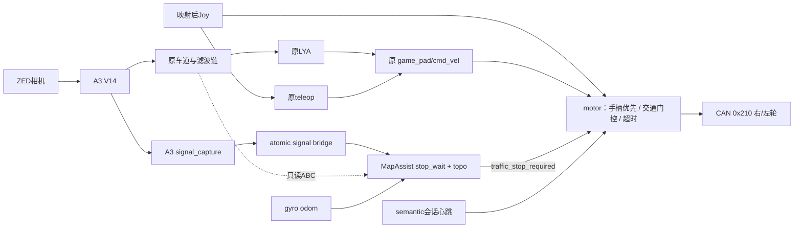

# 2026-10-12 车辆实验与 Agent 总交接

> 日期和下列时刻均为日本时间 JST（UTC+9）。车辆 `control@192.168.10.111`，工作区 `/home/workspace`，源码 `/home/workspace/src/aiformula`。不在仓库记录连接密码。
>
> **最后状态**：A3 V14、motor **0.4.1**、MapAssist **0.2.2**、semantic_vehicle_wiring **0.2.0** 已在车上。17:51:32 只读快照中 allnodes 仍运行，未见 LYA 或 semantic 会话运行；之后 SSH 超时。不能仅凭网络断开确认已断电。今天的关键日志和录包消息已保存到本地，本交接不依赖车辆继续在线。
>
> **结论**：感知输出验收通过；修复后的实车 Sem1 有红灯零指令和绿灯 `semantic_go` 证据；**topo 一圈闭环建图尚未完成**。心跳超时、semantic 重启后无输入等问题仍需调查，不能宣称整车验收全部成功。

## 1. 用户约束和下一位 Agent 应遵守的边界

- 原 allnodes、原 LYA、原手柄入口必须兼容，**不要再要求 `enable_motion`、`use_semantic` 等额外驾驶参数**。
- 不启动 semantic 时不检查红绿灯；启动车辆 semantic 入口才启用红停绿行和 topo 记录。灯色投票归 semantic，motor 执行决定。
- 手柄优先接管；保留用户确认能转向的 USB sigmoid 补偿；零指令必须输出零轮速。
- 距离停车和自动左转均不属于当前车辆模式。用户要求的是稳定红灯等待、稳定绿灯放行、一圈 topo 建图。
- 部署和软件隔离验证不能移动车辆。用户在修复部署后自行上实车，并要求停止继续验证；当时隔离脚本已自行完成退出。不要据此继续自动驾驶测试。
- 本次最后请求只是**读取日志、总结、提交 GitHub**：只读采集，未改变源码、参数、节点运行状态或发送驾驶消息。网络断开后继续本地分析。
- 保留旧权重、环境、备份和 PR 历史；不要强推、合并 PR、删除旧环境或替用户回滚。

## 2. 现用版本与可追溯来源

| 部件 | 现用/关键版本 | 来源与说明 |
| --- | --- | --- |
| 感知 | YOLOP A3 V14，local step 16384 | 标签 `a3-v14` 指向 `05f1651`，发布提交 `3d68d51de300c62fe4da74af379d60e374feb484`；PR14 已合并 |
| A3 运行兼容层 | `0.3.0+jetson.foxy` | Jetson/Foxy/Python3.8 兼容副本，原网络/权重不改，原包留存 |
| motor | **0.4.1** | `711cf30` 修复绿灯恢复；`fce6baa` 记录部署并修复安装器 egg-link 校验；后续本提交只增加交接 |
| motor 原始可转向算法 | USB 131 行版 | SHA256 `022a4c6210a0fb9f8d2543ab9337a90ce117dae0f2bf230ff5904c88bec42742`，PR20 |
| MapAssist ROS 包 | **0.2.2** | 在 PR23 0.2.1 stop_wait 基础上增加 `traffic_stop_required`，学习/几何不改 |
| semantic_planner_core | 0.2.0 | 冻结几何/规划基线 `63eec2da9f9d2ef90e1db29ce2c6c0b3c1a18a96` |
| semantic_drive_bridge | 0.1.0 | 带源时间/序列的灯观测桥接；原 shadow 限制保留 |
| semantic_vehicle_wiring | **0.2.0** | A3 capture、semantic 启动入口、motor 会话心跳 |
| allnodes | 车辆 A3 覆盖层 | 实际相机 SN48797506，A3 默认启动；motor 与 teleop 使用相同手柄配置；不是随意用仓库较老 allnodes 覆盖 |

最后捕获的源文件 SHA、进程及保存范围见 [capture_receipt.json](evidence/20261012/capture_receipt.json)、[process_snapshot.json](evidence/20261012/process_snapshot.json)。

GitHub 相关分支均要按实际 PR 状态理解，**车上已部署不等于已合并 main**：

- [PR19](https://github.com/Sophia-AI-formula-team/neo_aiformula_sophia/pull/19)：上游 motor 0.2.0，基于 main，OPEN。
- [PR20](https://github.com/Sophia-AI-formula-team/neo_aiformula_sophia/pull/20)：USB sigmoid 0.2.1，接续 PR19，OPEN。
- [PR21](https://github.com/Sophia-AI-formula-team/neo_aiformula_sophia/pull/21)、[PR22](https://github.com/Sophia-AI-formula-team/neo_aiformula_sophia/pull/22)：官方图/左转诊断、Unity bbox 距离试验；不是本车已验收的米制测距或自动左转。
- [PR23](https://github.com/Sophia-AI-formula-team/neo_aiformula_sophia/pull/23)：稳定红灯等待、绿灯放行，分支 `fix/topo-stable-red-wait-20261012`，OPEN。
- [PR24](https://github.com/Sophia-AI-formula-team/neo_aiformula_sophia/pull/24)：现用 motor/semantic 接线和修复，分支 `feat/vehicle-motor-traffic-gate-20261012`，基于 PR23，OPEN；本总交接也在此分支。

## 3. 今天做了什么：按阶段列明，包括失败和回滚

### 3.1 A2 → A3 V14（约 10:23–10:43）

- 阅读 neo 的部署包与 handoff；保留 A2，安装 A3 V14 单共享编码器架构。A3 一次 MobileNetV3 编码，车道分割与 FPN/RPN/ROI 检测共用编码器；不能套用 A2 的两个模型结构。
- 输出接回原车道/障碍接口，allnodes 默认 A3。没有修改 LYA、车体外参和车道算法。
- 实际相机是 **SN48797506**，旧配置为 SN48442725。新增当前相机 rectified CameraInfo 对应的 nHD 内参：640×360，fx=fy=246.07122802734375，cx=328.65667724609375，cy=189.0115509033203；保留旧标定。
- 权重 SHA256 `a411c983b661d6b26217019a968251c89a6b66c95400e4e7cb78f04a644ca10c`，79,763,687 字节。原模型/权重没有因 Foxy 适配改变。
- 26 项上游测试通过，CUDA NMS/ROIAlign 可用。GPU 对比车道像素差 0，含目标帧检测框/分数/类别一致、一次编码器遍历。
- 45 秒观察窗口：490 帧非空车道掩码、538 条检测 JSON、162 次 person 识别；障碍掩码 109 帧非空。推理 total p50 45.08 ms，p95 52.15 ms。用户放置目标完成输出验收，另存人员框截图，代表分数 0.99828。
- 重启输出仍正常：127 帧车道掩码、144 帧障碍掩码、146 条 JSON，其中 139 次 person。上述计数是观察记录，不等于保证的端到端帧率。
- 当时场景的车道点云为空，**没有据此验收道路几何/可行驶路径**。LLP 在 SIGINT 退出时报 FastDDS wait-set/-11，未修改该节点解决退出问题。
- 用户随后同时打开独立 A3 和 allnodes，触发 Existing publishers 保护。核对并退出旧独立 A3 会话后保护检查通过；没有放宽重复发布检查。两种入口不能同时开。
- 完整历史记录：[A3 车辆交接](evidence/20261012/a3_vehicle_handoff_historical.md)，[A3 证据目录](evidence/20261012/a3)。

### 3.2 semantic 初次上车，仅源码和独立接线（约 10:58）

- 按用户要求部署源码、做好独立 semantic/shadow 接线，**不接 allnodes、不编译、不启动**。
- 源提交 `b7872771e34bbafc481c811dadb01072fc524da9`，137 个文件校验；79 个 Python 文件做 3.8 语法检查，7 个上游节点用 stub 构造检查。
- 回执确认 allnodes、旧 semantic、build/install 均未改动。[源部署回执](evidence/20261012/receipts/semantic_source_stage_20261012/deployment_result.json)。
- 发现真实米制信号灯距离不可用；原生 odom child_frame 为 `base_footprint`，相关 LYA 配置期望 `base_link`，须明确 TF 关系，不能仅改字符串假装完成标定。

### 3.3 motor 上游替换、只读转向诊断、USB 原版部署（约 11:22–11:56）

- 按用户指定，从 `aiformula_sophia` 的 `dd55f65ef2fe434512d9f7bf48fff7c17141fac3` 导入 motor。算法 SHA `224cee23e3151d94cdd5864963c57266b0ab2297ba68f155d24ce93193d44d0e`，包 0.2.0。单包编译通过，语义包和 allnodes 未改。
- 隔离 ROS 域93验证 5组命令、70帧：零→(0,0)，v=0.2/w=0.3→右58/左40 RPM，反向→(-58,-40)，符号与小端编码正确。没有发到硬件。该旧入口 SIGINT 未及时退出，最终 SIGTERM；不能声称当时优雅退出已通过。
- 用户反馈旧车能转，新车只能前后；当时要求“不修改、不移动车辆”。操作信息是**行驶时左摇杆油门、右摇杆转向**，不是停车原地转向。调查区分了轮速差、编码、输入覆盖和底盘响应。
- 用户指定 U 盘路径 `/run/media/nanato/6718-316A/aiformula0124/aiformula/control/motor_controller/motor_controller/motor_controller.py`，原样替换并单包编译；之后用户明确反馈能转向。neo 以 0.2.1/PR20 保存，短 README 和来源哈希齐全。
- 可用版在轮速补偿前加正/负 sigmoid 逆映射，会显著改变转向输入。上游版的隔离 CAN 已有轮速差，因此不能把“新车不转”简单等同于 CAN 编码没发送；补偿/底盘响应差异是有依据的解释，摩擦死区、实际扭矩、现场 override 未做完整动力学验收。
- **131 行原版有已知零速问题**：v=w=0 时右−63/左+63 RPM。后续版本才修复；应保留这项事实，不能因“能转弯”就声称停车安全。
- 用户后来索取 131 行文件，提供了未改动副本，没有在该请求中擅自回滚车辆。最终部署前却发现车上主文件确已变为完全相同的 131 行版；不能推断由谁改动。

### 3.4 topo 与红灯方案简化、PR23 源部署（约 14:51）

- 用户明确只关注 topo 建图部分，不是整个 semantic planner；讨论了速度接线、是否在跑、是否影响手柄。
- 改为默认 `stop_wait`：稳定红灯锁停、新鲜稳定绿灯解除；去掉当前模式的按距离停车和自动 detour。没有添加自动左转。
- PR23 源码 0.2.1 更新12个文件，最初仍按约定**不编译**，保留安装内容；之后用户另行授权编译和接到 motor，才进入下一阶段。
- topo 的学习/几何保持原有；PR22 的 bbox 距离试验不能当作车辆已有可靠距离输入。

### 3.5 motor 0.3.0 首次门控方案与回滚（约 15:30–16:14）

- 用户授权 PR23 编译部署、LYA 经过 motor 内红灯门控、手柄优先、修复零速度轮速非零，并要求不移动车辆。
- 初版 0.3.0 使用默认 `motion_enabled=false`、新增 enable_motion、分离手柄速度话题并在 motor 重复灯色判定；6包编译、20场景隔离 DDS 通过。曾用明确禁用运动的真实 allnodes 观察767帧全零CAN、145个 odom v=0样本。
- **问题**：这破坏了用户原有不带 semantic 的 LYA/手动测试流程，且要求额外参数。用户要求回滚，已执行，不把“隔离测试通过”当作接口兼容性通过。
- 回滚恢复 USB motor 的源/build/install及原 allnodes；语义包未全局回滚。旧零速问题也随原版恢复。[回滚回执](evidence/20261012/receipts/motor_traffic_gate_20261012/rollback_result.json)。
- 首次包依赖出现 launcher→motor 环，已修正；诊断 uint8 JSON 序列化也修正。15:38、15:40 两次 motor exit1 有日志，但没有足够堆栈确认各次原因，不猜测。

### 3.6 兼容版 motor 0.4.0（约 16:59）

- 恢复原话题、原 allnodes/LYA/手柄启动方式，移除 enable_motion 要求。无 semantic 会话时按原输入控制；正常退出 semantic 回到原流程，异常失联暂停自动，手柄优先。
- 新入口 `ros2 run semantic_vehicle_wiring semantic` 启动 capture、bridge、MapAssist、会话心跳，不再启动另一套 LYA。灯色投票回归 semantic；motor 保留命令超时、手柄仲裁和零速修复。
- motor 读取与 teleop 相同配置的映射后 Joy，不再让 LYA 与手动共享 Twist 的发布时序决定谁优先。
- 3包编译，25项纯逻辑测试和27项真实 DDS 隔离场景通过。历史回执 [docs/motor_compat_20261012](../docs/motor_compat_20261012/README.md)。

### 3.7 绿灯不能继续：离线复现、配套修复、最终部署（约 17:10–17:31）

- 用户实车反馈红灯能停、绿灯后不能继续，要求先断开车、修代码和准备包，联网后再部署。
- 找到并离线复现一个真实逻辑缺陷：semantic 已 `normal/green_resume`，motor 仍要求 topo 私有诊断流 `forwarding_controller` 和 `path_output_allowed`；缺新完整 ABC 就永久保持 `waiting_fresh_visual_triplet`。车辆的原 LYA 并不依赖这个私有诊断输出。
- 0.4.1 + MapAssist 0.2.2 新增 `traffic_stop_required`，motor 只执行红灯锁停决定，不再要求 topo 诊断路径就绪。仍须新鲜 LYA 指令，绿灯不生成速度、不重放停车前命令；手柄优先和超时保留。
- 离线：motor27、联动6、topo/启动108、安装事务最初4项通过。联动包含完全不送ABC的反复红绿切换。准备带前后SHA、备份、编译失败自动恢复的部署包。
- 用户重新授权“部署”。发现车上主文件已回到 USB131；原包校验拒绝覆盖后，确认正是已知原版，生成明确以该SHA为基线的补充包，先备份再安装完整修复版。
- 停止核对身份后的原 allnodes，未发送驾驶测试消息。首次两包编译通过，但安装器只查 site-packages 目录、未支持 Foxy egg-link，校验失败后自动恢复。增加按新环境实际 Python import 路径校验，再部署成功；安装器回归增至5项。
- 最终两包 Foxy 编译成功，11个覆盖文件和3个前提文件SHA核对；域93/localhost/私有CAN话题完成**30场景、9066帧**隔离 DDS。没有 SocketCAN 硬件发送。用户说“不用验证，我上实车了”时脚本已完成退出；之后不再继续验证或操控用户节点。
- 完整变更、部署清单和备份：[green-resume 交接](../docs/motor_green_resume_20261012/README.md)，[本次实际 DDS 结果](evidence/20261012/receipts/motor_green_resume_20261012/dds_results.json)。

## 4. 本次抢读到的真实录包：不是隔离测试

共有15段。原始大图像 `.db3` 多为0.4–3.3 GB，本次未全量复制；已从只读 SQLite 提取以下关键消息：灯捕获/桥接、MapAssist状态、motor状态/会话、LYA Twist、轮速CAN、odom、A3检测JSON，以及每包原metadata和话题表。[原路径和体积](evidence/20261012/bag_inventory.json)，[统计汇总](evidence/20261012/bag_summary.json)，[可重现的消息存档](evidence/20261012/bag_selected_messages.tar.gz)。

录包名是文件事实，**不单凭名字认定所用控制器、实验意图或成功率**。多包关键话题只记录约1Hz且消息到录包时间有明显积压；不能把记录频率当发布频率，不能直接把bag时间差当控制响应/制动时延。MapAssist自身 `ros_time_sec` 与bag接收时间均在证据中保留。

| 录包 | 开始 JST | 时长(s) | 本次可确认的结果 |
| --- | --- | ---: | --- |
| trajectory_1_bag | 16:31:40 | 70.132 | 有控制/CAN/odom/A3记录，未记录semantic状态；不推断具体控制策略 |
| trajectory_2_bag | 16:33:28 | 61.713 | 同上 |
| trajectory_3_bag | 16:35:27 | 36.034 | 同上 |
| trajectory_4__bag | 16:37:04 | 57.390 | 同上，文件名确有双下划线 |
| trajectory_5_bag | 16:41:14 | 31.014 | 同上 |
| trajectory_6_bag | 16:43:08 | 44.143 | 同上 |
| trajectory_7_bag | 16:45:57 | 29.499 | 同上 |
| trajectory_R1_bag | 17:10:16 | 61.567 | 旧协议；红灯等待，未记录 green_resume；79点/16.51m，未闭环 |
| trajectory_f1_bag | 17:18:04 | 220.569 | 有控制/CAN/odom/A3；没有可用semantic状态记录 |
| trajectory_8_bag | 17:23:36 | 29.905 | 同上；位于最终修复部署之前 |
| trajectory_Sem1_bag | 17:33:03 | 87.969 | 新协议；红停、绿灯恢复、短暂再锁停后再放行；395点/83.47m，未闭环 |
| trajectory_Sem2_bag | 17:34:58 | 49.973 | 灯均unknown/normal；49条 command_timeout，22条 semantic_go；108点/22.76m |
| trajectory_Sem3_bag | 17:36:30 | 81.163 | 灯均unknown/normal；37条 command_timeout，31条semantic_go，3条手动；380点/80.74m |
| trajectory_Sem3hand_bag | 17:38:02 | 218.567 | 97条manual_priority、116条semantic_session_timeout；950点/202.54m，未闭环 |
| rosbag2_2026_10_12-17_45_23 | 17:45:23 | 173.836 | SSD上的语义专用包；跨一次重启。旧节点5条950点状态，之后新节点527条无odom/ABC输入、采样0 |

### 4.1 红绿灯的实车证据和边界

- **R1（修复前）**：51条Map状态中31条wait、20条normal，绿灯原始状态仅1条，稳定灯字段未采到green；33条motor红灯保持，自动红灯保持的CAN全零。采样中没有green_resume。因此**不能把当时实车失败全部归因于后来复现的ABC门槛**；稳定绿灯是否真正形成也是待查方向。
- **Sem1（修复后）**：节点源时间17:33:52.254出现red_wait_green；17:33:55.853出现green_resume；17:33:56.653短暂重新wait；17:33:57.453再次green_resume。当时灯判定有混合/unknown，不能凭稀疏记录判定真实灯色或视觉误检率。
- 对应bag接收时间17:33:58.630记录 `semantic_go`、`command=[2.0021985458,-0.0400003098]`、CAN字节`ae00000017010000`（右174、左279 RPM）。随后录有非零odom；证明实车记录中存在放行指令，**不是严格同步的制动距离/恢复延迟验收**。
- Sem1共19条自动red hold，所记录CAN均零；后续又进入红灯等待。详细前后记录见 [traffic_events.json](evidence/20261012/traffic_events.json)。
- Sem2/Sem3/手动包主要为unknown，不提供重复红绿灯成功率。不要把“normal允许继续”和“可靠识别绿灯”混为一谈。

### 4.2 topo 当前真正达到的效果

- 学习使用真实 odom 米制坐标，约每0.2m采样；需要先离开起点区，再回起点1.5m内、朝向差≤25°，至少40m和30采样，且当前点/绕行状态允许，才能尝试闭环和官方图融合。
- 采样累计距离超过40m只是必要条件。**83m、80m或202m不等于完成一圈**。所有本次捕获Map状态仍为learning，reference_length_m均为空；日志未见First lap complete。
- 首圈完成后才可能建立reference、关联官方拓扑和后续守护。现在不能说地图融合或自动左转已成功。车辆入口 `enable_correction=false`，不把topo私有点接回LYA。
- 地图目前在RAM。17:45专用包前5条是旧会话950点/202.54m；重启后回到0点。**不能用该包的最大值202.54m证明新会话继续了原图**。
- 后527条新会话 `odom_age_sec=null`、ABC年龄全部null，526条reason为visual_points_stale、1条waiting_for_odom；旧会话刚才还有新鲜输入。新启动节点没有接收到这些输入，原因未查明。
- 旧会话 fusion_status中的 `waiting_for_odom` 是尚未构建reference时的默认状态，不能在odom_age仍新鲜时据此断言没里程计；应读取odom_age和recorded_samples一起判断。

### 4.3 新发现但未改动的问题

1. **semantic心跳超时**：Sem3hand有116条 `semantic_session_timeout`，手动仍可优先；录包同时有217条同一session的递增心跳。bag接收时的心跳年龄约0.921–1.025s，高于motor 0.6s门槛，但这可能包含录包自身积压，**不能直接当作motor实际收到的延迟，也不能直接放宽超时**。须在后续授权下测motor端接收时间、源时间、QoS、调度和进程归属。
2. **新semantic实例收不到既有输入**：17:45:34之后新Map没有odom、ABC或有效灯输入。应排查ROS_DOMAIN_ID/ROS_LOCALHOST_ONLY、DDS发现、话题真实发布者/QoS、进程是否在同一运行域及相机源；现有日志不足以定因。
3. **LYA指令超时**：Sem2/Sem3有大量command_timeout，不能把每次停车都归咎于红绿灯。应同步查看LYA实际输出、手柄使能/释放和点更新；绿灯不应该伪造速度。
4. **拓扑闭环条件未满足或尚未查清**：需基于源时间与地图首点核对返回距离、航向、excluded状态/点有效性，而不是直接缩小阈值或宣布“已经跑够里程”。
5. **灯状态交替/未知**：Sem1放行附近出现重锁，其他段多数unknown；需要RGB和原检测序列复核，不能把本次软件修复当作灯分类精度验收。
6. **日志退出噪声与真正错误分开**：17:33/35/36/38/45这些semantic会话的map_assist exit−2均发生在明确Ctrl+C之后；session进程干净退出。既有LLP/CAN/FastDDS退出问题和RViz GLXBadDrawable保留待查，不都属于运行中故障。汇总403条launch ERROR中379条出现在该文件明确用户中断之后；剩余24条也不等于24个独立运行故障（含启动失败后的清理/强制退出）。

## 5. 当前接线和启动方式



- LYA/teleop原输入：`/aiformula_control/game_pad/cmd_vel`。
- 手柄优先依据：`/aiformula_control/joy_node/joy_l2_throttle`。保持原映射模式；原模式左杆油门/右杆方向，触发器模式使用重映射虚拟油门。L2/L1使能按现有映射判断，不新增按钮。
- motor输出：`/aiformula_control/motor_controller/reference_signal` → SocketCAN。0x210，右轮在前、左轮在后，两个有符号int32小端。
- 灯输入链：A3 `/aiformula_perception/yolop_a3/detections` → `/semantic_drive/signal_capture` → `/semantic_drive/map_signal` → MapAssist。
- motor只消费 `/semantic_drive/motor_session` 和 `/semantic_drive/map_status` 里的交通决定，不直接重新投票A3灯色。
- topo观察 `/processed_point_a/b/c` 和 `/aiformula_sensing/gyro_odometry_publisher/odom`；输出 `/semantic_drive/topo_point_*`、`/semantic_drive/topo_diagnostic_cmd_vel` 是私有诊断，不能误接成新的LYA输入/电机输出。
- motor默认不依赖semantic。开启semantic后失联保持自动停车；正常Ctrl+C有明确释放消息，回普通模式；手柄仍优先。命令/手柄0.5s超时；session/status约0.6s失效。绿灯只解除红灯门控，需新鲜LYA命令；无新命令或新命令为零仍为零。

每个终端加载：

```bash
source /home/workspace/install/setup.bash
```

按需分别启动（已有实例不要重复）：

```bash
ros2 launch launchers allnodes.launch.py
ros2 run trajectory_follower lya_follower_connected_omegat_global
ros2 run semantic_vehicle_wiring semantic
```

纯手动只需要原allnodes/手柄；普通LYA不启动第三条；需要红绿灯和topo才启动第三条。LYA命令是本次交付沿用的入口，日志里的同名trajectory_follower不保证所有用户实验都用了相同可执行文件或参数。不要同时叠加独立A3、另一套LYA、map_drive或shadow。不要把裸 `ros2 run semantic_local_planner_ros map_assist` 的默认接线等同于车辆wrapper。

## 6. 米制灯距、坐标和旧仿真证据

- 2D检测框/颜色并不直接提供米制距离。相机光学系通常x右/y下/z前，车体系x前/y左/z上；像素、光轴深度、地面前向距离、沿轨迹距离并不等价。必须用真实内外参/TF及测距模型变换，并保留单位、源时间和不确定度。
- 车上当前捕获的灯观测 `distance_m=null`；不伪造距离。现用stop_wait不需要距离，状态里仍有历史8.5m配置也不代表按距停车开启。
- PR16/17封存Unity core63四场景有约8.6m红灯停车证据，是固定仿真条件下的历史结果，不是本车测距/物理制动证据。PR18/21含左转阻塞调查；PR22为可选Unity bbox距离试验。**这些不是本对话今天在车辆上重新完成的实验。**

## 7. 备份、部署包与后续恢复

| 备份目录 `/home/control/aiformula_backups/` 下 | 含义 |
| --- | --- |
| `20261012_yolop_a3` | A3接入前启动文件，旧A2及环境另外保留 |
| `20261012_semantic_source_stage` | semantic源码初次部署前 |
| `20261012_motor_controller_0_2_0` | 替换上游motor前；当时旧source主文件缺失，安装树已留存，不可假定源码备份能直接重建 |
| `20261012_motor_controller_usb` | 换131行USB原版前 |
| `20261012_topo_red_wait_source` | PR23源码更改前 |
| `20261012_motor_traffic_gate` | motor0.3门控部署前 |
| `20261012_motor_gate_rollback` | 用户要求回滚时保存0.3源/build/install |
| `20261012_motor_compat_0_4_0` | 0.4兼容版部署前 |
| `motor_green_resume_20261012T082823Z_c56e2e4e` | 首次绿灯修复编译/校验失败，已自动恢复；日志仍在 |
| `motor_green_resume_20261012T082911Z_0fc1218a` | 最终成功部署前快照，**主motor是已恢复的131行原版**，不是一套干净0.4.0发布源码 |

最终部署覆盖列表：[vehicle_deployment_manifest.json](../docs/motor_green_resume_20261012/vehicle_deployment_manifest.json)。motor主文件非零sigmoid算法保留；回滚到131行会恢复零速−63/+63问题和缺少门控/超时的旧行为。

最终适配USB131基线的包：`/home/control/aiformula_runtime/motor_green_resume_20261012/motor_green_resume_0.4.1_from_usb131_foxyfix.tar.gz`，SHA256 `bc2d212facc5eca86fe0ba27d6773e8d64a0010a8b3a3493653e3e7880667f68`。安装成功回执在上述成功备份目录。旧原包不适用于车辆主文件已恢复131行的基线，禁止绕过校验直接覆盖未知修改。

A3运行根 `/home/control/aiformula_runtime/yolop_a3_v14_20261012`；它通过私有环境复用A2目录的NVIDIA Torch等依赖，**不要删除 `/home/control/aiformula_runtime/yolop_a2_20261005`**。不更换系统Python/CUDA，不删旧权重或标定。

车辆恢复供电/网络后，先读取当前源码哈希、运行节点和最近日志；电源中断后不要假定仍与本快照一致。用户本轮没有要求修复第4节新问题或再次部署，不要在无人确认实车状态时启动控制。

## 8. 证据保存范围、限制和复现分析

- 17:51:32快照抢读1521文件，79,117,902字节，无错误、无截断；本地完整压缩日志 `/home/nanato/aiformulaws/integration/day_handoff_20261012/vehicle_evidence.tar.gz`。SHA和逐文件来源在 [捕获回执](evidence/20261012/capture_receipt.json)、[完整索引](evidence/20261012/log_capture_index.json)。Git保留关键原日志/回执及索引，未把79MB原日志全文铺进仓库。
- 15段录包关键消息、原metadata/话题表读取完成，无提取失败，不复制RGB帧；[提取索引](evidence/20261012/bag_extraction_index.json)列出每包消息数和SHA。
- 17:45语义专用包位于外置SSD `/media/control/OrinSSD2000/rosbag2_2026_10_12-17_45_23/`，完整db3约3.04MB。尝试额外复制原db3时车辆已超时；**它的关键消息和metadata此前已经成功保存**。其他完整图像包也仍在车辆原路径，不能声称全量图像/原db3已备份。
- 重算离线表：在证据目录建`bags/`，将`bag_selected_messages.tar.gz`解压到其中，使用带PyYAML的Python运行`analyze_bags.py`。不需要ROS、不连接车辆。得到bag_summary/traffic_events；不要将稀疏记录的近邻时间误当严格同步因果关系。
- 小结中的“用户反馈”“源代码复现”“隔离DDS”“真实录包”是不同证据等级。静止输出、仿真、命令非零、odom变化、完整一圈/安全制动不能互相替代。
