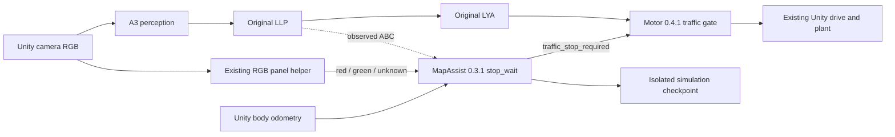

# Unity neo semantic topo validation

Integration version **0.1.0**. Upstream baseline is neo PR25 commit
`ed8e397ae41732877dfef334f0b89f98c0b20ae8`
(`feat/topo-checkpoint-diagnostics-20261013`). The deployment source pin is
**`3c6fbac2ff9f8dd23b247a187e966648876400b1`**, including the necessary
**MapAssist 0.3.1** checkpoint fix. This is a feature-branch pin; do not substitute
main, the old PR25 pin, or the separate bbox-distance branch.

This integration carries the existing RGB A3 → LLP → LYA command through the
original motor 0.4.1 traffic gate. MapAssist 0.3.1 observes original ABC and
simulator odometry to learn its topo reference. Its private diagnostic commands
and points do not replace the original LYA stream.

The production semantic tree and gate are exported byte-for-byte from the fixed
commit. Relative to the upstream baseline, the one runtime predicate change
accepts finite signed route progress after a valid closed reference exists.
Route matching already emits signed, unwrapped progress near the start seam;
the old checkpoint validator rejected it as `negative_progress`. Accumulated
distance and progress before closure remain nonnegative. Geometry, closure
thresholds, official-map matching and traffic decisions are unchanged.

The issue was analyzed before the fix. The real `outer_closure_02` run closed a
reference but failed final checkpoint save, so its overall rejection is retained.
Original-validator reproduction and 118 checkpoint/MapAssist tests are archived
in the [production issue record](../../workspace/src/aiformula/perception/semantic_planning_system/semantic_local_planner_ros/docs/checkpoint_signed_progress_20261015/README.md).
These Windows tests use explicit storage-boundary shims; they are not live Unity
recovery or native POSIX durability evidence.

The Unity C# and Python transports, editor harness, and Windows simulation
checkpoint adapter provide the integration. Transport is stdio with ROS message
shims; it is not a native ROS executor or DDS test. The existing optional panel
RGB correction is recorded per case; do not describe an enabled case as A3-only
traffic classification.

The historical `SemanticPlanning` tree remains separate. The new runtime opts
into `SemanticPlanningNeo20261015`. Bbox distance PR22 remains its own branch and
experiment; this package refuses its range payload. stop_wait has no 8–9 m
distance target. Stop distance is an observed measurement only.

## Acceptance and evidence

All four final MCP cases passed: inner/outer red hold and green resume, plus
inner/outer full-lap closure with partial-map and closed-reference restarts.
See [RESULTS.md](RESULTS.md) for measured values and source-specific receipts.
The traffic color in these cases comes from the existing RGB panel helper;
A3 supplies the genuine lane prediction used by original LLP/LYA. Official-map
fusion remains unavailable because its unchanged RMSE gate rejects the fit.

For both inner and outer starts, verification covers red hold/green resume and
an actual full lap with continuous odometry and production closure checks. During
that lap, the recovery case holds the stationary vehicle for a semantic-only
restart after partial learning, then restarts the closed reference after closure.
That same recovery case can establish full-lap closure and both recovery states;
an additional lap without restarts is not required. Genuine model output and
continuous vehicle odometry determine results. Official map fusion is reported
separately from closed-reference availability.

The harness also offers an explicit `component-only` lane recovery trial after
analysis of `inner_closure_02`: it temporarily enables the existing current-mask
component fallback while disabling CurrentCorridor. Baseline remains the default;
original flags are restored. No LLP/LYA algorithm source is changed. Record this
option in every result and compare it separately from failed baseline runs.

See DEPLOYMENT.md for setup and AGENT_HANDOFF.md for continuation boundaries.
