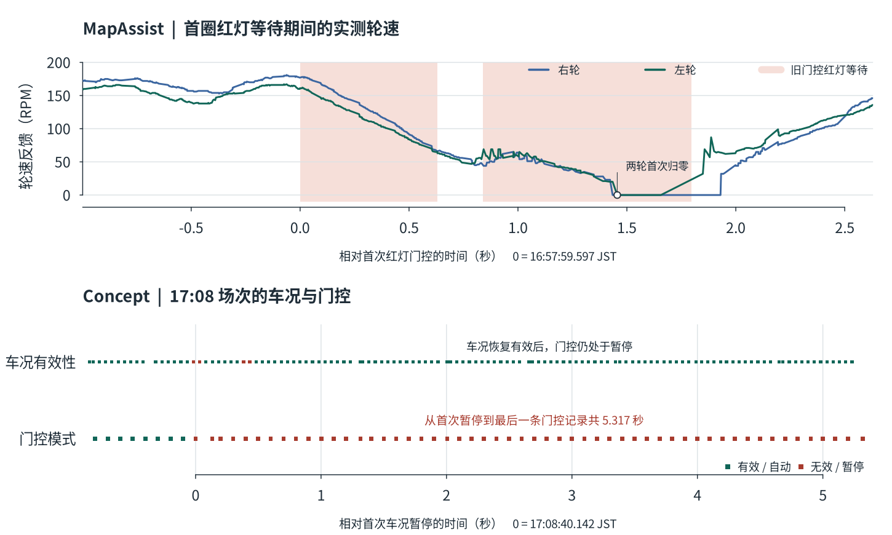

# 2026-11-19 现场试验总评

**今天这版值得冻结为下一轮的对照基线。** MapAssist 有一场首圈红灯试验，能从 A3 灯色、旧电机门控一路追到两轮实际归零和恢复转动。Concept 在晚间三场都发出了自动指令，也有真实轮速反馈。对于整车验收，仍缺一段能连续证明首圈闭合、匹配成功、遇红灯绕行并由 OA/LYA 驶出的记录。Concept 在最后一场仍因车况有效性暂停。今天确认了多条实车链路，稳定完成整圈还待验证。[时间线](TIMELINE.md) · [17 份原始录包](bag/) · [车端冻结 ZIP 与安装清单](active-code/)

## MapAssist 确实完成过一次停车和恢复

16:57:59.597，旧门控首次记录 `semantic_hold:red_wait_first_lap`。9 毫秒后，底盘 CAN 反馈右轮 178、左轮 161 RPM。16:58:01.053，两轮首次同时为 0。16:58:01.477 门控恢复 `semantic_go`，16:58:01.530 已有两轮正转反馈。这段里 15 条红灯门控记录的速度命令和八个 CAN 输出字节全部为零。[该场原包与逐话题计数](bag/semantic/rosbag2_2026_11_19-16_55_15/) · [复算数据](assessment/field-measurements.json)

这次等待分成两段。首末红灯门控记录之间，识别话题有 9 条 `red`、12 条 `unknown`，红像素为 0–1,274。中途状态确实短暂恢复过。现场规则允许新鲜非红恢复，因此更该查清同一处灯为什么在图像上反复失去红色。此次轮速证实停车发生过，停车线位置和多次通过的一致性仍缺现场对照。匹配后的绕行优先、OA 接管与切回已有隔离测试。16:10 那轮的终端只记录了开始学习。[停车与绕行对照](semantic-045/) · [16:10 首圈与 OA 记录](records/workstation/concept-followup-20261119/semantic-lap-1620/)

## Concept 已能驱动车辆，末场暴露出具体的暂停条件

上午 10:59 的 288 条决策没有产生自动指令。晚间三场的 `/concept/auto_cmd` 依次为 371、504、106 条。三场录到的规划目标都是 **2.0 m/s**，实际门控上限分别为 1.5、1.5 至 2.5、2.5 m/s。默认配置的 4.0 m/s 和 16:35 旧版一次过猛起步，都不足以评定最终版的 4.0 m/s 跟踪。[上午诊断](concept-v6275/2026-11-19-concept-no-auto-output.md) · [晚间三场参数与指令](assessment/field-measurements.json) · [16:35 场实车与修复后回放](records/workstation/concept-followup-20261119/concept-1635/)

17:08 末场有 4 条车况报告 `gyro_timeout`。门控在 17:08:40.142 转入暂停，车况在 17:08:40.224 首次恢复有效。门控持续报告 `invalid_vehicle_state` 至 17:08:45.459，共 54 条，覆盖同一次暂停的 5.317 秒。四个无效时刻前后，录制器收到的相邻 VectorNav IMU 消息仍相隔 49.72–50.08 ms。优先需要查车况节点**实际收到的陀螺样本**及其与轮速源时间的配对。录制器的收包时间无法代替该节点的回调时间。[17:08 原包](bag/concept/concept_20261119_170817_6e2488e80f3a400fa08f855537b2ab02/) · [四个时刻的 IMU 间隔](assessment/field-measurements.json)

**低速倒车也有了更直接的证据。** 15:50 的 13 条 −0.2 m/s 请求都停在规划层。17:07:52.168，后续版本已发布 −0.2 m/s，内部电机入口收到 10 条负向请求，内部 CAN 有 20 帧要求两轮各 −49 RPM。约 235 ms 后，下一条自动指令已改为 +0.2 m/s。这段内仅存两条轮速反馈，两条都是 0。现在能确认负指令到达了换算器。这次脉冲长度和样本数仍不足以量出机械起动死区。[15:50 诊断](records/workstation/concept-followup-20261119/concept-drive-fix/) · [17:06 场原包](bag/concept/concept_20261119_170616_9c3633963e6243b8a263147917ea72d8/) · [倒车窗口复算](assessment/field-measurements.json)

## 感知和几何各自取得了什么进展

A3 V14、A4、A4Light 都在同一台车、同一台 ZED 上发布了非空物体检测。每档只测了两轮、每轮约十秒，现场也没有逐帧真值。A4Light 相对 A4 的 GPU 均值差在两轮分别是 12.1 和 0.2 个百分点，长期负载排序和识别准确率仍待测量。补测里最长的物体标注图间隔达到 335.3 ms，平均 GPU 占用解释不了全部卡顿。[三档负载与帧时序图](gpu-load-10s/README.md)

Concept 的 B1.4 推理中位数从约 600 ms 降到 60 ms，是当天最明确的性能改进。整套系统运行时，16:35 场同时开着独立 A4_lite，采集到自动指令的 P95 仍为 469 ms。停车对照中退出独立识别后，B1.4 推理中位由 127 ms 降至 74 ms。后续评价应以实际组合的长尾时延为准，并记录同机有哪些识别进程。[解码器实测](records/workstation/concept-latency-20261119-1310/) · [同机负载对照](records/workstation/concept-followup-20261119/concept-1635/)

道路和障碍接地点已共用实时 CameraInfo、本田安装姿态与 0.55 m 高度的地面投影，也已修复障碍距离被重复校正的问题。用图像方位和轮速里程计交会复核四个反复出现的锥桶，四个目标的前向偏差都减小。左侧一个目标仍有约 −3.17 m 的有符号中位偏差。风大导致现场没有同帧实测距离，当前几何可用于复现和继续排错，绝对测距精度仍待独立标定。[接地点、距离图与误差](records/workstation/concept-followup-20261119/concept-1635/objects/)

## 下一轮我会先验这三件事

1. **先复现末场的四个无效车况。** 用同一份 17:08 录包和冻结代码，同时记录轮速源时间、IMU 源时间、节点回调时刻及配对拒绝原因。验收点是能解释每次拒绝，并能区分短时配对失败和真实 IMU 断流。
2. **把 MapAssist 一圈的证据接到一起。** 在同一场次同步记录原生闭合/匹配状态、灯色与红像素、选中的 ABC 来源、旧门控和两轮反馈。这样才能分别验收首圈停车恢复、匹配后红灯绕行以及 OA/LYA 的实际执行。
3. **单独测量低速起动，再评价速度目标。** 对齐请求、内部换算、实际发送与左右轮反馈，比较相同请求在不同持续时间下何时开始转动。目标和门控上限以当次节点的实际读数为准。

冻包保存了车上实际加载的版本。LYA 安装副本的反馈增益与工作区源码不同。复现实验应以已安装副本及其散列作为起点。[LYA 差异](active-code/neo-diff/lya-source-vs-installed.patch) · [活动包来源](active-code/neo-diff/active-packages.tsv) · [复算脚本](assessment/measure_runs.py)
