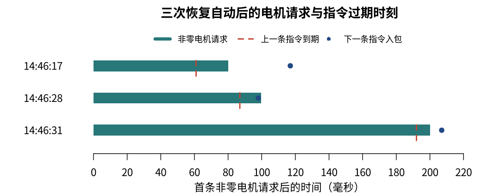

# Concept 实车无输出、近车路径与累计地图

2026-11-19 JST。新版提交 `32a91bdce498cbb901936b82e002eea9a5436255`，基于实车延迟修复 `4c4f3b3`。

| 时间 | 操作与结果 |
| --- | --- |
| 13:55–13:58 | 只读核对 13:49:19–13:50:28 录包。相机未标定，全部 468 条决策进入影子模式，自动指令为零。控制门全部 661 条状态均为 `joy_timeout` 并已暂停，3,197 条内部电机请求均为零。[运行分析](logs/2026-11-19-concept-run-1349.md) |
| 13:56–13:59 | 现场可布点。核对 SN48797506 配对相机图与 CameraInfo，现有登记表缺少地面测点。加入 0.55 m 光心高度适配、独立地面误差检验与原子安装；桌面启动默认读取验证后的登记表。[相机核查](calibration/2026-11-19-calibration.md) |
| 13:58:01 | 布点前请求关闭软件输出，服务返回 `output_disabled`。保留原会话相机。 |
| 13:58–14:00 | 主界面嵌入累计赛道地图，驾驶节点重启成功后清除地图及旧请求。相机近车俯视框绘制当前决策的选中或恢复路径，比例尺 1 m，前方朝上。无路径时显示 NO PATH。 |
| 14:00:11 | 对原包全部 468 条决策在 Jetson 上重画，288 条非空路径全部可见，180 条空路径均未误画。7 条轨迹点坐标重合，显示为一个点。[实包绘制统计](logs/near-path-metrics.json) |
| 14:00:17–14:02:38 | 生成版本提交。在车端单独构建 5 个 overlay 包。稀疏仓库尝试额外下载后改用同一提交的已跟踪文件打包构建，28 项车端测试通过。[测试结果](logs/vehicle-tests.log) |
| 14:02:26 | 蓝牙设备 Wireless Controller 已配对且受信任，当前未连接。 |
| 14:03:03–14:03:21 | 核验桌面启动入口和新版包路径。既有会话继续运行原版；新启动加载新版。门控实时状态 `disabled`、暂停、线速度与角速度均为零。 |

决策在有路径和无路径之间切换 31 次。原透视图里的粉线仅覆盖底部 30 行。新的近车俯视图也显示视野外的真实选中路径，候选筛选与规划控制仍使用冻结策略。采集到决策的 P95 为 496 ms，23 条超过 500 ms。

标定需在一张配对左图中定位现场实测标记。拟合和独立核验分别使用不同的地面点。待现场确认布点与实测值后取图，独立误差上限为 0.10 m。输出恢复还需要手柄心跳及现场操作。

部署目录为 `~/aiformula_runtime/concept-field-20261119`，原启动环境备份在该目录的 `activate_concept.before.bash`。如须回退，结束 Concept 会话后，将该备份还原到 `~/concept_v6275_ws/activate_concept.bash`。

14:16:06 JST 只读复核。默认标定回执不存在，无线手柄未连接，当次旧面板及驾驶节点仍在运行。门控 disabled / paused，规划状态 invalid（incomplete planner step; pause the gate and restart the driver），相机配置 unverified-resize。新终端解析到已安装的新版面板。

### 本田投影的自动指令发布（JST）

| 时间 | 变更与核验 |
| --- | --- |
| 14:33:58–14:35:13 | SSH 核对车端桌面环境和部署路径。确认规划器在计算完成后将本田投影单独标记为 shadow 并跳过发布。 |
| 14:35:36 | 车端安装本田投影发布补丁，使用既有 ZED CameraInfo.P、安装位姿与 0.55 m 光心高度。保留图像、反馈和门控检查。 |
| 14:35–14:36 | 车端隔离域回放测试通过。对归档赛道输入使用本田配置标记，观察到正向指令，核对采集戳、坐标系和决策数值，同时验证未知投影的 shadow 行为。 |
| 14:36:23–14:36:36 | 车端独立域运行真实 ZED、感知、规划以及模拟静止轮速/陀螺反馈。实收 25 条指令，每条均与同戳本田投影决策数值一致。25 条状态均为 ok，当时全部为 recovery_no_checked_motion，线速度为零。最长采集至决策 401 ms。测试进程均已退出，未启动电机或 CAN 发送器。 |
| 14:37 | 保存补丁与测试摘要，确认启动环境加载部署源码。提交 `5604a15`。 |

[实车采样摘要](calibration/honda-cmd-live.json) · [复核脚本](calibration/verify_honda_cmd.py) · [代码补丁](calibration/honda-auto-cmd.patch)

### 真实轮速与陀螺仪反馈复核（JST）

| 时间 | 操作与结果 |
| --- | --- |
| 14:38:54–14:39:17 | 核对桌面入口的实车模式，确认底盘 can0 在线。状态节点订阅本田 CAN 0x711 原始帧及 VectorNav IMU，把成对且未超时的反馈发布至 /concept/vehicle_state。13:49 的既有录包记录 1,359 条有效静止反馈。 |
| 14:39:54–14:40:10 | 使用原车 CAN 接收器、VectorNav、ZED、状态、识别及规划节点运行独立域验证。VectorNav VN-200T-CR 经 /dev/ttyUSB0 连接。首轮核验脚本写 JSON 时遇到 NumPy uint8 序列化错误，退出测试并将记录端的字节转为 Python 整数。 |
| 14:40:24–14:40:40 | 重测收到 100 个不同时间戳的原始轮速帧、204 个 IMU 样本。91 个有效状态样本的轮速与角速度均和原始消息同戳同值；启动时另有一次 gyro_timeout。逐条核对图像决策采用的状态采样时刻和最终话题的速度值，30 条完整匹配，其中 8 条正向、22 条因无通过检查的动作而为零。车轮实测左右均为 0 RPM。仅启动传感、感知和规划节点，测试已退出。 |

[传感器与指令实收统计](logs/physical-inputs.json) · [只读核验脚本](logs/verify_physical_inputs.py)

14:41:14–14:41:35 JST，只读核对桌面 Concept 实车启动配置、已安装里程计源码、历史节点日志和话题解析。原车 gyro_odometry_publisher 接收 /aiformula_sensing/vehicle_info 与 /aiformula_sensing/vectornav/imu，使用 IMU 姿态与轮速生成 /aiformula_sensing/gyro_odometry_publisher/odom（odom → base_footprint）。Concept 状态节点并行读取相同的原始 CAN 与 IMU，驾驶节点用左右 RPM 和 IMU 的 angular_velocity.z 自行累计局部位姿。主 UI 累计赛道图使用后者。独立的纯轮速 wheel_odometry_publisher 已安装，Concept 实车启动未拉起该节点。此次核查未改变接线。

### 14:46 自动行驶三次短暂输出

| 核查时间（JST） | 结果 |
| --- | --- |
| 14:47:29 | 定位 14:41:53 启动的桌面 Concept 和最新 14:46 录包。录包覆盖 14:46:14.461–14:46:34.641；14:47:34 整机 launch 收到 SIGINT 退出。 |
| 14:47–14:48 | 只读解析录包。164 条自动指令全为 1.0 m/s，382 条手柄心跳，391 条有效轮速均为零，另有 2 条 gyro_timeout。三次恢复后均记录 auto_timeout。内部 motor_cmd 中 18/930 条非零，分三段持续约 80、100、200 ms，内部 0x210 CAN 有 34/1815 条非零。最终 reference_signal 未录制，无法据此判定执行器收到的帧。 |
| 14:48–14:49 | 对齐三次自动超时前的相机采集戳和下一条自动指令到达录包的时间，分别超过上一条指令有效期约 56、11、15 ms。采集到自动指令入包中位数 400 ms，P95 463 ms。163 个连续指令间隔中有 92 个出现上一条已满 500 ms、下一条尚未入包的时段。分段估算进入驾驶回调前中位数 281 ms，驾驶回调中位数 110 ms。本次只读诊断，未改 motor 或门控，未重新启动车辆。 |

[逐话题统计与时间戳](logs/gate-trace-144612.json)

15:11 JST：定位规划前延迟、实测多档相机采集/发布频率、对比两种感知到规划的传递方式，并改进过期指令处理。各组时间戳、负载与门控结果见[自动超时专项记录](auto-timeout/2026-11-19-auto-timeout.md)。
