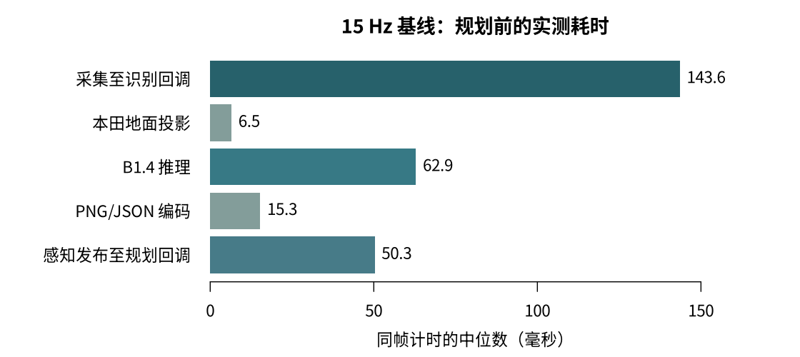

# 11 月 19 日 Concept 自动驾驶超时复测

日期为 2026-11-19，时区 JST。Jetson 连接车载 ZED X、CAN 接收器、VectorNav 和无线手柄，运行本田 0.55 m 投影。隔离域使用实车门控与原 motor 换算节点，最终输出重映射到软件接收器。测试程序在启用门控之前核验软件接收器身份及物理输出话题没有订阅者。各次试验都保留原始相机采集时间戳。

| 时间 | 步骤与证据 |
| --- | --- |
| 14:51 | 核对既有感知剖析、实车默认 15 Hz 图像采集和发布配置、0.5 s 采集时效以及 ROS 接线。 |
| 14:52:28–14:53:05 | 首次基线剖析用系统 Python 启动识别，缺 Torch。测试未能恢复自动，清理测试图后改用部署环境的 Python。 |
| 14:53:06–14:53:35 | 正式基线用真实相机、CAN、IMU、手柄与门控复现 282 ms 规划入口年龄和 auto_timeout。独立相机订阅中位 113 ms，识别回调在采集后 144 ms 开始，投影 6.5 ms，推理 62.9 ms，PNG/JSON 编码 15.3 ms，发布后到规划入口约 50 ms。分别统计匹配帧，各项中位数无须相加。 |
| 14:53:45–14:54:20 | 单改采集到 30 Hz，保留 15 Hz 发布，规划入口 299 ms，再次超时。 |
| 14:54 | 在 Jetson 用五张归档帧对原规划器取样。主要 CPU 开销包括路面、候选动作和建图。核对 ZED 原车驱动单独设置的采集和发布频率。 |
| 14:55–14:56 | SSH 短暂 No route to host，实验网恢复后继续。 |
| 14:56:07–14:56:41 | 同时设置采集/发布 60 Hz。规划入口中位 195 ms，真实自动门控在 20 秒短测期间保持自动。 |
| 14:56–14:57 | 30/30 Hz 的 22 秒对照再次超时。核对替代 PNG 实现的无损逐像素结果和编解码开销，更大的消息只换来少量总耗时改善。 |
| 14:58:53 | 安装仅由 Concept 实车启动使用的 60/60 Hz 相机配置。车端构造并核验传感器启动图，桌面入口默认参数已更新。 |
| 14:59–15:02 | 加入离屏主面板、地图快照、识别叠图和 JPEG 订阅。在 60 Hz 仅改相机的更长测试中再次观察到 auto_timeout，继续改动感知到规划的传递方式。 |
| 15:02:30 | 仅调整相机，离屏主面板三轮各 62 秒均复现锁停。三轮分别记录 34、40、32 个相邻指令的有效期空档。 |
| 15:02–15:04 | 车内同步直传实测规划入口中位 136 ms，采集到指令中位 223 ms。归档帧通过直传与 ROS 两条路径，所选路径、候选集和控制值相等。同步直传长测仍有瞬时空档，最差从上一采集至下一指令入包 559 ms。 |
| 15:04–15:07 | 实测并行线程、用最新推理覆盖等待帧的方案。面板负载下三轮仍锁停，最大间隔达 853 ms，恢复同步直传实现。 |
| 15:06–15:08 | 单独处理源帧到期和持续断流。源帧满 500 ms 后输出零；短暂更新间隙的零帧须经换算器确认；超过有界等待或有效指令接收超时后锁定暂停。构建独立车端门控 overlay。18 项车端测试通过。ROS 启动回归发现 rclpy 参数声明会调用刚注册的更新回调，修正初始化顺序。 |
| 15:08–15:10 | SSH 再次返回 No route to host，重试回装并核验修正版启动。 |
| 15:11:37 | 本机最终补丁 `0dc4e9e` 已提交。门控、编码和相机几何测试共 14 项通过。SSH 连续 18 次连接超时或无路由，已请求确认车机当前联网状态。 |
| 15:12–15:14 | 现场要先测其他项目。已核对 Semantic MapAssist 0.4.5 的专用启动与诊断话题。最后一次仅回装启动修正的 SSH 尝试仍返回 No route to host。最终三轮门控和断流试验未开始。 |

[15 Hz 基线](baseline.json) · [仅修改相机的三轮长测](installed-panel-camera-only.json) · [直接传递同帧输入](direct-sync.json) · [并行方案对照](direct-async.json) · [待完整核验的源码补丁](installed-source.patch)

2026-11-19 15:18:43–15:18:56 JST，SSH 恢复后安装最终启动顺序修复。车端运行源码逐文件 SHA-256 与 `0dc4e9e` 一致。18 项车端测试、隔离 DDS 回归及实车启动图静态核对通过，桌面环境解析到新门控和驾驶节点。车机仍有原车 allnodes 进程，本轮核验未启动 Concept 或复测真实自动行驶。
