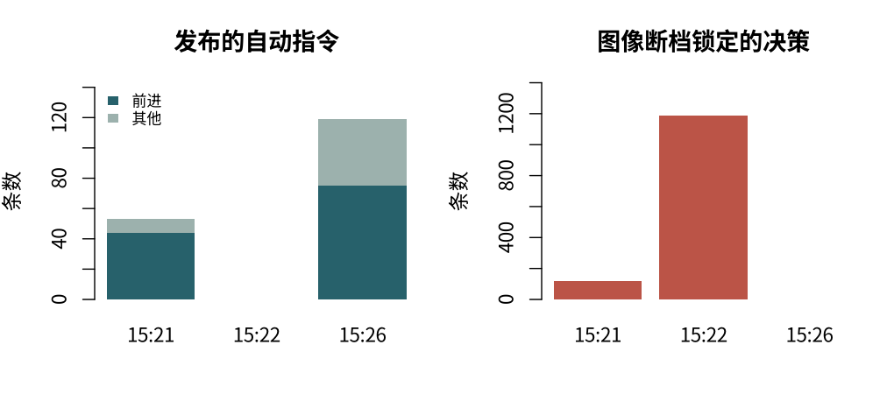

# 2026-11-19 Concept 装车后复测

已在车端只读分析 3 份 rosbag SQLite 录包并取回 JSON 摘要和 launch 日志。录包继续保存在车机。

| 录包 (JST) | 观测 |
| --- | --- |
| 15:21:09–15:21:42 | 53 条自动指令、44 条正向。相邻自动指令接收间隔最大 451 ms。门控反复自动超时，后来有 116 条图像断档锁定。 |
| 15:22:26–15:24:25 | 1,189 条决策全因图像断档锁定，0 条自动指令。手柄接管期间仍有电机请求及有效非零轮速。 |
| 15:26:25–15:26:59 | 119 条自动指令、75 条正向。相邻自动指令接收间隔最大 428 ms，门控多次 auto_timeout。在一次暂停周围，上一帧有效期结束至下一指令记录之间相差约 159 ms。 |

| 排查时间 (JST) | 记录 |
| --- | --- |
| 15:38:26–15:39:29 | SSH 多次超时，重试后恢复。 |
| 15:39:30–15:39:50 | 提取 3 包摘要。两份有输出的录包里，新的有效自动指令接收间隔始终小于 500 ms。旧版除了源帧 500 ms 有效期，还用同一源帧加 100 ms 再次锁停，混淆了指令过期与指令断流。 |
| 15:40:08 | 部署补丁。旧帧满 500 ms 仍立即进入零输出和零确认流程；收到下一条有效指令的 500 ms 接收看门狗独立计时，真断流仍锁停。图像断档锁定时，面板显示「清空累计地图并继续」，按下后暂停、清空状态、继续各自等待确认。 |
| 15:40:28 | 车端 31 项测试通过。隔离 DDS 回放重现图像断档，验证期间无指令，重启后以新时间戳恢复发布。 |
| 15:40:21–15:41:24 | 用真实 ZED、底盘 CAN 轮速、VectorNav、手柄和离屏主面板运行两轮各 22 秒。自动窗口分别收到 110 和 107 条指令，多次短暂清零后恢复，两轮均无非预期暂停。主动暂停驾驶进程，真实断流触发 auto_timeout 并在进程恢复后保持锁停，75 条后续电机请求全部为零。软件接收器替代物理 CAN sender。 |
| 15:41:25 | 核对车端运行文件与提交 `01a9044` 一致，测试节点已退出。 |

[静态测试摘要](static-test.json)

