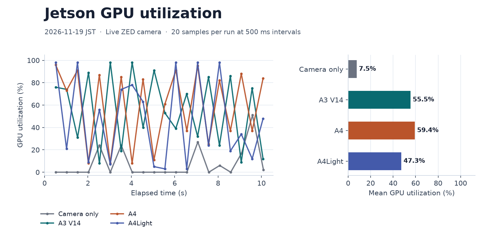
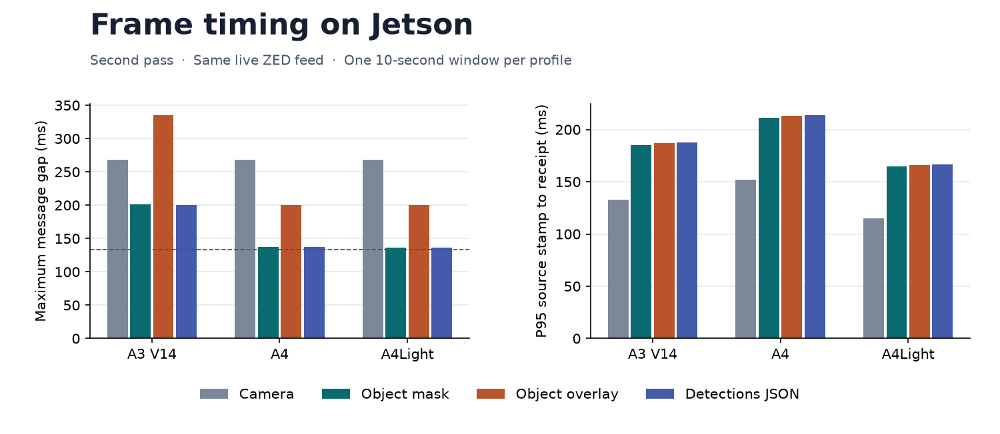

# 2026-11-19 YOLOP 车端实验报告

## GPU 负载与物体检测

同一台 Jetson、同一台 ZED 相机、固定 640×360 输入，按 A3 V14 → A4 → A4Light 顺序各测一轮。电源模式为 `MAXN`。关闭整车 ROS 应用后，仅启动相机和当轮识别节点，使用 localhost ROS 域 193。每轮收到相机、车道和物体输出后开始计时。

| 模式 | 开始时间 JST | 采样秒数 | GPU 均值 | 中位数 | 最低–最高 | 相机帧 | 车道掩膜 | 物体掩膜 | 物体标注图 | 检测 JSON | 有检测的帧 |
| --- | --- | ---: | ---: | ---: | ---: | ---: | ---: | ---: | ---: | ---: | ---: |
| 相机基线 | 10:04:51.428 | 10.095 | 7.5% | 0.0% | 0–51% | 148 | 0 | 0 | 0 | 0 | 0 |
| A3 V14 | 10:05:13.998 | 10.075 | 55.5% | 61.5% | 8–98% | 148 | 146 | 150 | 133 | 151 | 36 |
| A4 | 10:05:37.625 | 10.078 | 59.4% | 77.5% | 8–96% | 149 | 141 | 150 | 127 | 150 | 110 |
| A4Light | 10:06:00.790 | 10.078 | 47.3% | 41.0% | 3–98% | 150 | 138 | 150 | 130 | 150 | 135 |

本轮 GPU 均值最低的识别模式为 **A4Light（47.3%）**。A4Light 比 A4 低 12.1 个百分点。每轮采集 20 个 `tegrastats` `GR3D_FREQ` 样本，间隔 500 ms。该指标是整机 GPU 活跃率，包含相机和系统背景开销。相机单独运行一轮作为参照。

三档均确认了车道掩膜、车道标注图、物体掩膜、物体标注图、检测 JSON 和两路信号灯话题，采样结束时每个话题均只有一个发布者。物体栏记录检测器上报的非空列表。现场物体没有人工标注，因此本次测试范围是 GPU 负载和实时接线。

## 负载与卡顿补测

追加一轮相同顺序、相同相机设置的 10 秒采样。整机 CPU 为所有在线核心的平均活跃率，识别进程 CPU 以一个逻辑核为 100%。RSS 是进程组中各进程 RSS 的合计，可能重复计入共享页。磁盘读写是采样期内识别进程组的实际 I/O 差值，启动和模型加载已在计时前完成。

| 模式 | GPU 均值 | GPU 实测频率范围 MHz | 整机 CPU 均值 / 峰值 | 最忙单核峰值 | 识别进程 CPU | 内存峰值 / 识别进程 RSS 峰值 | Swap 峰值 | GPU / CPU 最高温 | 识别磁盘读 / 写 |
| --- | ---: | ---: | ---: | ---: | ---: | ---: | ---: | ---: | ---: |
| 相机基线 | 6.2% | 306–306 | 9.7% / 16.8% | 27% | — | 4924 MB / — | 0 MB | 37.4°C / 42.4°C | — |
| A3 V14 | 44.8% | 1300–1300 | 14.2% / 16.3% | 71% | 67.8% | 6909 MB / 3399 MiB | 0 MB | 41.7°C / 45.0°C | 0 / 0 KiB |
| A4 | 51.2% | 1300–1300 | 15.5% / 17.4% | 83% | 79.9% | 6917 MB / 3356 MiB | 0 MB | 42.1°C / 45.6°C | 0 / 0 KiB |
| A4Light | 51.0% | 1300–1300 | 15.0% / 16.2% | 74% | 70.7% | 6986 MB / 3355 MiB | 0 MB | 43.3°C / 46.0°C | 0 / 0 KiB |

四组 EMC 遥测的读数均为 0%，本轮无法据此判断实际内存带宽。可用的采样输出没有功率读数，因此未报告瓦数。两轮的 GPU 均值排序有变化，A4Light 两轮均低于 A4，差值分别为 12.1 和 0.2 个百分点。

补测中，跨三档的最长检测 JSON 间隔为 **200.2 ms（A3 V14）**，最长物体标注图间隔为 **335.3 ms（A3 V14）**，相机订阅端最长间隔为 268.2 ms。A4Light 的检测 JSON 在补测开始时有一个 514.2 ms 的源时间戳至接收延迟，已计入最大值，其 P95 为 166.7 ms。

| 模式 | 话题 | 接收 FPS | 间隔 P95 ms | 最大间隔 ms | >133.3 ms 次数 | 接收延迟 P95 ms | 最大接收延迟 ms |
| --- | --- | ---: | ---: | ---: | ---: | ---: | ---: |
| 相机基线 | 相机 | 15.0 | 67.7 | 68.7 | 0 | 110.8 | 113.3 |
| A3 V14 | 相机 | 12.9 | 134.5 | 268.1 | 13 | 132.6 | 134.4 |
| A3 V14 | 车道掩膜 | 13.2 | 136.8 | 268.2 | 10 | 183.5 | 186.4 |
| A3 V14 | 物体掩膜 | 13.6 | 135.4 | 200.9 | 10 | 185.0 | 187.7 |
| A3 V14 | 物体标注图 | 11.1 | 200.3 | 335.3 | 18 | 186.9 | 189.2 |
| A3 V14 | 检测 JSON | 13.8 | 135.4 | 200.2 | 9 | 187.4 | 190.0 |
| A4 | 相机 | 12.5 | 200.1 | 267.8 | 12 | 151.8 | 153.1 |
| A4 | 车道掩膜 | 14.3 | 75.4 | 196.5 | 5 | 211.0 | 272.8 |
| A4 | 物体掩膜 | 14.7 | 74.8 | 137.5 | 3 | 211.4 | 273.1 |
| A4 | 物体标注图 | 13.4 | 133.8 | 199.8 | 12 | 213.1 | 274.0 |
| A4 | 检测 JSON | 14.8 | 74.4 | 137.5 | 2 | 213.8 | 274.7 |
| A4Light | 相机 | 12.6 | 199.9 | 268.2 | 13 | 114.8 | 115.7 |
| A4Light | 车道掩膜 | 14.6 | 69.8 | 136.1 | 4 | 163.9 | 219.6 |
| A4Light | 物体掩膜 | 14.9 | 69.1 | 136.1 | 2 | 164.4 | 220.3 |
| A4Light | 物体标注图 | 13.2 | 133.7 | 200.2 | 10 | 166.0 | 221.3 |
| A4Light | 检测 JSON | 15.0 | 70.4 | 136.1 | 2 | 166.7 | 514.2 |

相机设为 15 FPS，两帧周期约 133.3 ms。间隔由同机 ROS 订阅端测量，延迟是消息源时间戳与本机收到消息的差值，包含相机/DDS/回调调度开销。图像采用 best-effort 订阅，订阅端的间隔也会受接收队列影响。本次相机订阅端收到的图像比检测 JSON 少，表中的相机接收帧和间隔无法直接当作相机源丢帧计数。各模式分时测量，因此物体数量会随场景变化。本报告的短时采样不覆盖整车节点同时运行时的长期卡顿。

## 今日时间线（JST）

- **09:34–09:47** 准备并核验 A3 V14、A4、A4Light 三档，完成 A4 车辆话题的隔离 DDS 检查。
- **09:55:54** 安装并核验终端命令 `yolop`，可打开三档选择菜单。
- **09:59:06** 将 A4Light 接到与 A4 相同的 7 个车辆感知话题；09:59:58 完成替代推理的本地隔离 DDS 检查。
- **10:03 起** 停止原先运行的 allnodes 和 A4，10:04:45 再次核实车辆进程已退出。使用真实 ZED 图像顺序测量三档。
- **10:07:31** SSH 恢复，取回首轮原始数据。
- **10:07:57–10:09:19** 完成负载与帧时序补测并关闭测试相机和识别进程。

## 随包材料

- `evidence/` 含按 JST 时间戳记录的 GPU 原始样本、各 ROS 话题计数和运行时间线。每个样本保留 `tegrastats` 原行。
- `scripts/` 含相机专用启动文件、测量脚本和制图脚本。归档仅含报告、PNG、文本证据和脚本。
