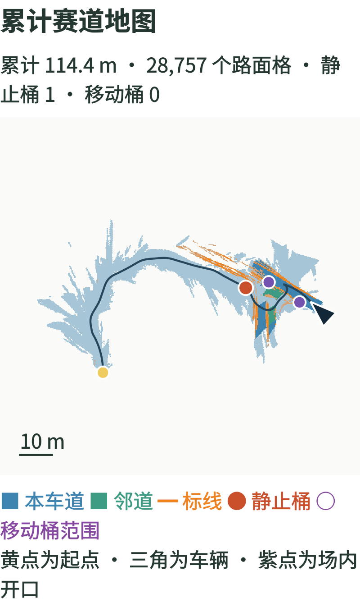
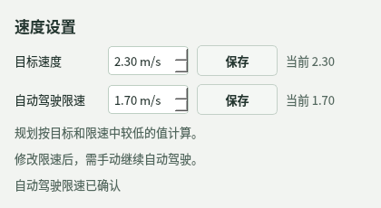

# 现场图像与图表

[下载车机和本机归档中直接枚举出的 134 个图片文件](https://github.com/Sophia-AI-formula-team/neo_aiformula_sophia/releases/download/field-archive-2026-11-19/experiment-images.tar.gz) · [原始路径、字节数和 SHA-256](files.tsv)

按内容哈希去重后共 100 张，包含现场图像、诊断截图、图表和随源码保存的既有测试图片。单独保存的图像与录包中的压缩相机叠图都保留了原有格式。

### 车机保存的累计赛道图

### 车机保存的速度设置

[三种识别负载和帧时序图](../gpu-load-10s/) · [16:35 实车指令与轮速曲线](../records/workstation/concept-followup-20261119/concept-1635/trace/run-trace.png) · [锥桶接地点对照](../records/workstation/concept-followup-20261119/concept-1635/objects/field-contacts.jpg)
