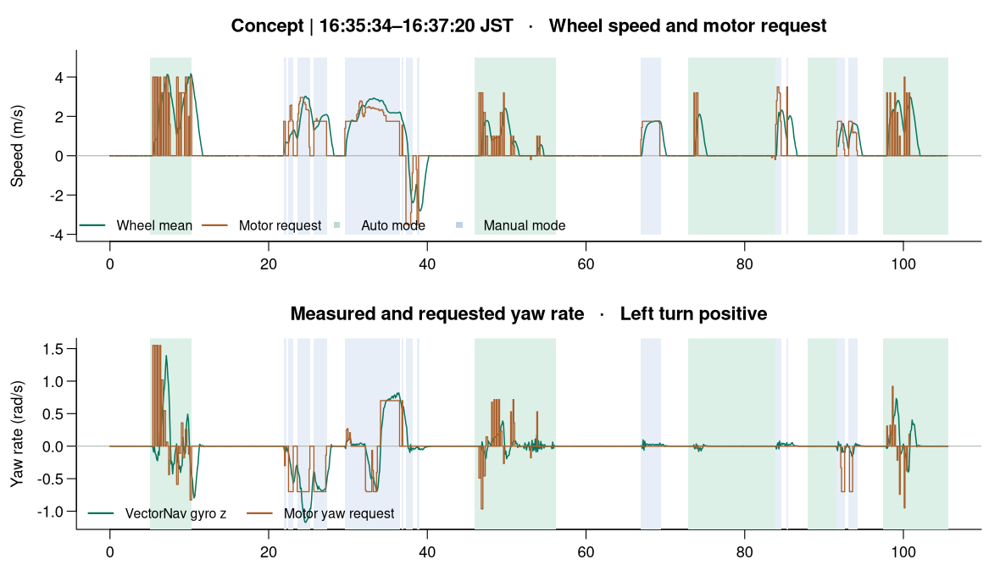
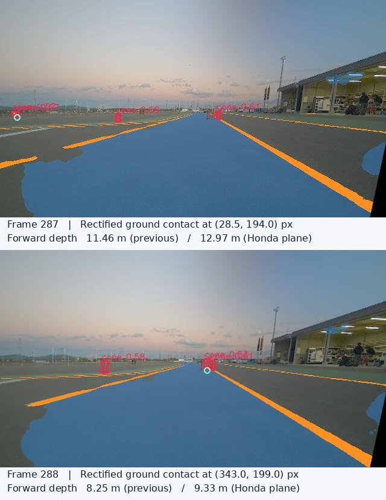

# 2026-11-19 Concept 实车起步、转向与障碍物坐标复核

16:35:33 场次的 105.7 秒录包里，有 448 帧识别图、448 条驾驶决策和 209 条自动指令。车辆从静止恢复自动时，首个电机请求已经是 4.0 m/s、+1.55 rad/s。随后的一次转弯触发轮速误判，门控持续暂停 11.56 秒。车上已安装本次修复，桌面 Concept 和终端 `concept-live` 均使用提交 `5314396` 的车端构建。规划目标与自动上限均为 4.0 m/s。[原始场次](bag-info.txt) · [安装文件与参数核验](installed-verified.json)

## 起步、转向与停顿

| 核对项 | 16:35 实车记录 | 修复后用记录复核 |
| --- | --- | --- |
| 从静止起步的第一条指令 | 4.00 m/s，+1.549 rad/s，右轮 558、左轮 291 RPM | 同一时刻的 59 行道路观测、实际零轮速和初始航向送入规划，得到 0.20 m/s，+0.0622 rad/s，右轮 58、左轮 40 RPM |
| 小角速度 | 另一次 +0.06211 rad/s 指令换算后，右轮 391、左轮 455 RPM，轮差方向错误 | 规划使用原车差速换算，约束轮差方向、幅度和变化率。按 17 个实车手动窗口拟合转向滞后，另 25 个窗口上角速度预测 RMSE 从 0.226 降至 0.112 rad/s |
| 入弯时突然停车 | 16:35:44.682 左轮 363、右轮 276 RPM，旧单轮上限 341 RPM 把有效反馈丢弃，驾驶节点随后连续 233 帧报告规划断档 | 依据车型和规划速度范围重算轮速有效区间。同一批 CAN、陀螺和图像回放中，原先失配的两张图都找到了 51 ms 内的反馈。轮速断档和相机断流现在分别显示 |

选用的初始调试值为前向加速度 1.0 m/s²，单次增量最多 0.2 m/s，指令最多领先实际轮速 0.5 m/s。横向加速度上限 1.0 m/s²，在 4 m/s 时对应车体角速度上限 0.25 rad/s。规划先用这些动作检查路界、制动和碰撞，再选路径。14 帧没有可行路径的决策里，每帧都出现路界淘汰，5 帧还出现障碍淘汰。实车自动段按左右轮换算的速度 P95 为 4.02 m/s，峰值 4.44 m/s，包含清零后的滑行。[起步回放](control/README.md) · [车况与停车分析](trace/README.md)

## 障碍物接地点与距离

定位到车端已经使用 ZED 内参和 0.55 m 安装高度投影，障碍物模块却又应用了一次仿真锥桶高度修正，导致距离偏近。当前障碍物接地点和道路共用地面投影。在同一帧内，一处检测由前方 11.46 m 修正为 12.97 m，超出原有 12 m 跟踪范围；旧版只见过它一次，却保留了 53 秒。另一处由 8.25 m 修正到 9.33 m。新日志记录接地点像素、前向及横向米数、是否在跟踪范围；RViz 分色显示本帧观测与历史估计。[投影对照与逐目标误差](objects/README.md)

四个反复出现的锥桶共 388 次观测。用图像方位和轮速里程计交会作交叉检查，四个目标的前向偏差均减小，但左侧一个目标的有符号偏差中位数仍为 −3.17 m。现场未布点，该录包也缺同帧立体深度，绝对坐标精度仍未确认。

## 车端负载与安装

该场次同时运行 Concept 自带 B1.4 和一个独立的 A4_lite。原始录包中，图像采集到自动指令的中位为 377 ms，P95 为 469 ms，识别和规划中位各为 135 ms 和 174 ms。停车、关闭门控输出后，保留 Concept 识别、面板和 RViz，单独退出 A4_lite。前后两个短窗口内，B1.4 推理中位从 127 ms 降到 74 ms，P95 从 147 ms 降到 85 ms。两段采样分别为 74 和 113 帧。[停稳与输出状态](parked-stop.log) · [A4 同跑与退出后的分段计时](parked-ab.log)

车机完成 7 个包的构建、70 项回归及独立 ROS 节点通信测试。电机模块散列与此前一致。装车后另一套 MapAssist 已使用 ZED、VectorNav 和底盘，静态验证切换到隔离回放。[构建与回归记录](final-build-tests.log) · [车端资源占用](live-bench-admission.log) · [本次代码变更](verified-changes.patch) · [操作时间线，JST](timeline.log)

## 装车后隔离静态回放

16:55:18–16:55:33 JST，在车机上运行实际安装的驾驶节点、车况节点、门控和原电机换算。输入为停稳时保存的五帧 Honda 投影与 B1.4 推理结果，以及 16:36:36.680 起的 2 秒录包片段，含 20 条静止轮速、40 条 IMU、39 条释放手柄消息。循环回放时平移时间戳，保留各消息采集至收件的延时。软件接收端代替物理 CAN 发送器。[静帧采集索引](parked-fixture.json) · [首次正常回放](trace/stationary-replay-field.json) · [回放程序](trace/stationary-replay.py)

| 两次独立恢复自动 | 窗口 1 | 窗口 2 |
| --- | ---: | ---: |
| 窗口长度、有效零速车况 | 7.0 秒，140/140 | 7.0 秒，140/140 |
| 电机端前三级纵向输入 | 0.20 → 0.40 → 0.50 m/s | 0.20 → 0.40 → 0.50 m/s |
| 电机端最大绝对角速度 | 0.06263 rad/s | 0.06263 rad/s |
| 稳定段自动门控状态 | 63/63 | 63/63 |
| 非零内部电机请求 | 341 条 | 342 条 |

16:55:33 起停止图像输入 1.45 秒，门控由自动转为 `auto_timeout` 暂停。断流 700 ms 后，收到的 38 条电机请求全为零，软件 CAN 端的非零帧数也为零。早先另一个录包切片中，连续两条轮速消息实际间隔 200.35 ms，首次恢复自动后进入 `invalid_vehicle_state`，这次结果也已归档。[含断档输入的原始结果](trace/stationary-replay-gapped-input.json)

此回放验证的是装车软件产生的指令及失联行为。未进行落地起步、4 m/s 跟踪或过弯测试，也没有从静止轮速回放推定车辆的机械死区。

16:56:43–16:57:11 JST，仅用归档中的五帧和 4 KB 传感器片段独立复跑，两次恢复自动都得到同样的三级速度。原车电机换算分别给软件接收端发出 679 和 668 条非零 CAN 帧，每段总帧数均为 701。断图后 498 ms 观察到门控超时，700 ms 后的 37 条电机请求和 75 条 CAN 帧全为零。回放节点已退出，原 Concept 和独立 A4_lite 已退出，现场 MapAssist 由操作员继续使用。[独立复跑结果](trace/stationary-replay.json) · [传感器时间间隔](trace/segment-gaps.jsonl) · [隔离域退出检查](trace/isolated-cleanup.log) · [车端进程](completion-processes.log)
