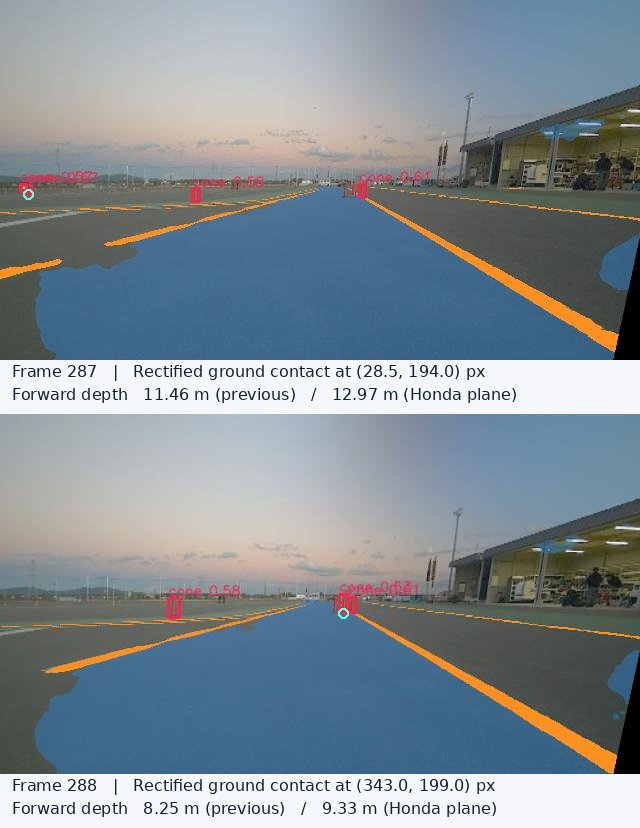

# 16:35 Concept 障碍物坐标核对

车端 16:35:33 录包有 448 条决策和 448 张识别 JPEG。检查了车身前向、车身右向、ROS 左向的符号和相机视图。当前实车几何先以 ZED 内参和 0.55 m 安装高度变换到参考视图，参考视图中同一地面点必须和道路共用 0.655 m、254.391622 px 的投影。旧障碍物模块随后根据仿真锥桶底座形状，把参考高度又改成 0.57875 或 0.605 m。实际观察到的彩色锥壳接地点因此持续偏近。保留原有 0.24 m 的底座前缘至障碍物中心建模距离和碰撞半径。

| 最后一次重启后的首观测 | 接地点像素 u,v | 原地面前距 | 修复后的地面前距 | 修复后的车身右向 |
|---|---:|---:|---:|---:|
| 帧 273，0 号 | 169.5, 198 | 8.74 m | 9.89 m | −6.24 m |
| 帧 287，2 号 | 28.5, 194 | 11.46 m | 12.97 m | −15.37 m |
| 帧 288，3 号 | 343, 199 | 8.25 m | 9.33 m | 0.48 m |

2 号只有一次观测，旧系统将它保存在跟踪器中超过 53 秒，误差指标一度超过 200 m。修复后，该框在现有 12 m 前向跟踪范围外，识别和决策审计仍保留像素和距离，无法由此创建虚假的近距轨迹。四条反复观测到的锥桶都进入了跟踪范围。曾被遮挡的在距轨迹继续执行原有空间和碰撞检查。RViz 本地视图使用浅灰色标出记忆轨迹，当前观测另用原有橙色。新决策记录带有每个通过颜色筛选的地面接触观测 `obstacle_measurements`，包含像素、前/右距离和是否在跟踪范围。

用同一录包中四条重复观测的水平视线与轮速／角速度里程计独立交会，检查相机地面反投影的前距。各目标旧方案的前向有符号误差中位数为 −4.01、−1.54、−2.05、−1.34 m，统一参考平面后为 −3.17、−0.46、−1.16、−0.25 m。此对照依赖锥桶静止、里程计尺度和视线测量，不能等同现场测距。使用其他三个目标估计额外固定俯仰和横滚，左侧留出目标的 P95 误差反而从 5.33 增至 13.49 m，未采用该拟合。当前录包缺少测量点和同帧立体深度，无法证明绝对距离精度。

[逐帧源数据和方位交会](distance.json) · [校准留出检验](holdout.log) · [隔离测试](tests.log)
