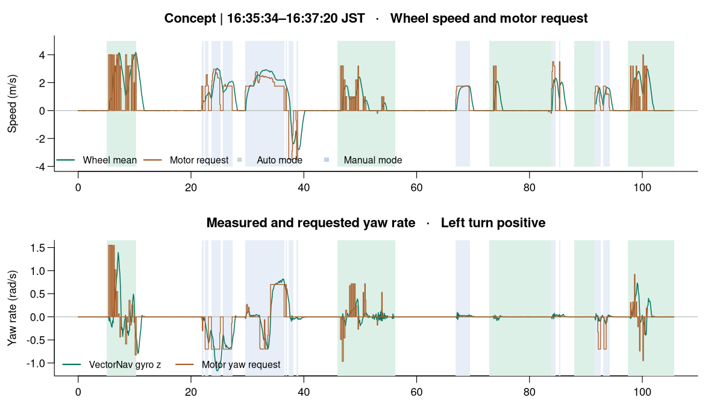

# 16:35 Concept 实车控制和显示核对

Jetson 在 2026-11-19 16:35:34.430 至 16:37:20.104 JST 录到 68,774 条消息。448 条决策和 448 张 JPEG 识别叠图进入了录包，209 条自动速度通过驾驶节点发出。门控上限全程为 4.0 m/s。[录包元数据](metadata.yaml) · [启动日志](field-launch.log)

图中速度由 CAN 0x711 左右轮平均值和 0.127 m 轮半径换算，角速度为 VectorNav 的 ROS z 轴。各曲线每 100 ms 取中位值，绿底为门控自动状态，蓝底为手动状态。将原始轮速和最近 240 ms 内的门控状态配对，自动区间 P95 为 4.023 m/s，峰值 4.442 m/s；该统计包括指令清零后车辆仍在运动的采样。[分组统计](diagnostic.json) · [速度时间序列](run-trace.json)

| 时间（JST） | 观察 |
| --- | --- |
| 16:35:39.541 | 恢复自动，接着多次出现 4.0 m/s 与 1.55 rad/s 的组合请求。 |
| 16:35:44.682 | 转弯时一侧真实轮速跨过旧 +341 RPM 上限。发布车况无效，随后门控从 16:35:44.777 起连续约 11.56 秒报告 `invalid_vehicle_state`。其他三次短暂失效来自 gyro_timeout。 |
| 16:35:45.010–16:36:20.293 | 驾驶节点连续 233 帧报告图像间隔超过 500 ms，等待重启。驾驶状态在能完整推进本帧后才更新其记忆时刻，相机持续来帧时也可能因轮速缺失形成这个间隔。 |
| 16:36:22.195 | 无可行前进候选。两条刚更新轨迹的车体前向距离是 8.17、10.10 m，横向坐标是 −5.84、−2.01 m。该帧 75 个候选中，49 个触发障碍约束、42 个触发路界、43 个触发未观察区域、30 个触发相机断流后的停车约束，各项有重叠。 |
| 16:36:30.641–16:36:41.241 | 门控再次因 `auto_timeout` 暂停约 10.7 秒。全程共有 89 帧报告当前没有通过检查的恢复动作。 |

14 帧 `no_feasible_trajectory` 都有候选因路界淘汰，其中 5 帧同时出现障碍淘汰。记录到的 956 个轨迹状态中，566 个是记忆估计，384 个为已有轨迹的检测框更新，6 个为新轨迹。举例来说，16:36:26.621 时，新观测的轨迹前向 6.75–8.26 m，另一条记忆轨迹最后观测在 1.58 秒前，估计位置在前方 10.21 m、左侧 13.82 m。叠图里的单个检测框、跟踪位置和累计地图中的历史障碍分别对应不同时间的信息。[逐阶段决策与轨迹](diagnostic.json)

采集至自动指令入包中位 376.8 ms，P95 469.2 ms。有效决策内，采集到图像回调中位 60.7 ms，投影解码 7.5 ms，识别推理 134.8 ms，规划 173.7 ms。本包中门控频繁在新帧之间送零，212 条状态报告 `waiting_fresh_auto`。[计时与仲裁明细](timing.json)

核对了实际图像链、RViz 和主面板的坐标换算。识别叠图由已变换到规划相机的同帧图像生成，像素绘制与该虚拟相机的内参和光心一致。RViz 在 `base_footprint` 中将前向、向右变换为 ROS 的 x 前、y 左；主面板使用起点坐标、前向朝上，读取地图中的世界坐标。原车底盘模型的 180° 旋转只应用于可视网格，底盘 TF 关节为单位旋转。未发现把左右或纵横坐标交换的显示代码。此核对无法替代场地实际测距。

## 轮速异常与规划断档回放

按此包中原始 CAN、IMU、2111 次车况报告的实际收包时间以及图像采集时间重建状态。旧范围在 **16:35:44.682** 重现 `unsupported_can_rpm_range`；按车辆运动上限算出的可接受范围在同一时刻解出左 **363 RPM**、右 **276 RPM**，最近的因果 IMU 样本早 14.1 ms。重建 2111 次车况报告的状态原因有 2027 次与原始发布完全一致。录包收件时间与节点实际回调时间存在差异。

以同一故障前成功帧为起点，保留原始状态报告，只用上述原始传感器重算值替换这一次无效报告。旧报告清空驾驶节点的反馈历史，采集于 44.513、44.679 的两帧都找不到因果反馈。新报告保留反馈历史，两帧都能取到 33.44、50.14 ms 内的样本，44.813 的下一帧不再触发 500 ms 连续性锁停。若用原始 CAN/IMU 重建该段所有状态报告，结论相同。此实验验证门控与输入同步的触发机制，未重放物理行驶或后续闭环轨迹。[回放脚本](replay-feedback.py) · [逐帧结果](replay-feedback.json)

驾驶节点现在分别记录最新鲜图像和上次完整规划的采集时间；当完整规划已断档，面板会区分图像未到、轮速/陀螺无法同步及其他规划中断。500 ms 锁停、暂停后清图重启和原有恢复按钮行为保持原有要求。

## 静止输入的启动与断帧复测

在 Jetson 的本机 DDS 域 207 中运行正式驾驶、车况、门控、原车电机转换和软件接收器。输入使用原包中始于 16:36:36.680 的两秒静止片段，含 20 条原始 CAN 轮速、40 条 VectorNav IMU、39 条空闲手柄消息，按原始收包间隔与原始测量延迟循环平移时间戳。感知输入循环发送五张驻车时拍摄的 Honda 投影图及对应 B1.4 识别结果，间隔约 200 ms。实体 CAN 发送话题两端均为零，软件接收器是回放末端的唯一订阅者。

最早的 16:52 复测选取了另一段静止记录。该段内相邻两次 CAN 轮速到达间隔长达 200.35 ms。循环播放时，两次 7 秒内均只有 133/140 条车况有效，门控报告 `invalid_vehicle_state` 并保持暂停。16:55 首次改用连续的两秒片段复测，最长 CAN 间隔为 101.24 ms，两次恢复均走完 7 秒。16:56 再从归档的 4 KB 原始传感器消息独立复现。[有轮速间断的复测](stationary-replay-gapped-input.json) · [原始间隔](segment-gaps.jsonl) · [首轮通过结果](stationary-replay-field.json)

| 独立复测，JST | 结果 |
| --- | --- |
| 16:56:43.216 恢复 | 43.433、43.614、43.814 依次请求 0.20、0.40、0.50 m/s。起步 ω 为 +0.06221 rad/s。电机转换发布 701 条内部 CAN，其中 679 条非零。 |
| 16:56:50.928 恢复 | 51.256、51.575、52.075 依次请求 0.20、0.40、0.50 m/s。电机转换发布 701 条内部 CAN，其中 668 条非零。 |
| 16:56:57.936 主动停发图像 | 最后一条非零电机请求于 58.334 收到，58.434 门控记录 `auto_timeout`，相距停发 497.8 ms。停发 700 ms 后收到的 37 条电机请求与 75 条内部 CAN 全为零。 |
| 16:57:11 清理 | 检查进程环境，域 207 的进程数回到零。 |

两次复测窗口各有 140/140 条有效零轮速报告，恢复 650 ms 后各有 63/63 条门控状态处于自动。两个窗口的速度上限均为 0.50 m/s，最大 |ω| 为 0.06263 rad/s，配置的门控速度总上限仍为 4.0 m/s。两次复测均用了驻车反馈，未测量实体起步速度、刹停距离或转弯响应。[独立复测结果](stationary-replay.json) · [隔离进程检查](isolated-cleanup.log)

复现需要 Jetson 的 ROS Foxy 工作区、测试覆盖层和五组 `fixture/*.png` 与同名 `.npz`。将启动文件、回放脚本、启动脚本和传感器样本放在同一目录，按启动脚本中的路径准备覆盖层和图像，在该目录运行 `bash run-stationary.bash`。脚本在域 207 内启动软件接收器，并检查实体 CAN 发送话题的发布端和订阅端均为空。[启动脚本](run-stationary.bash) · [节点选择](stationary-replay.launch.py) · [回放脚本](stationary-replay.py) · [传感器样本](stationary-inputs.json.gz)
