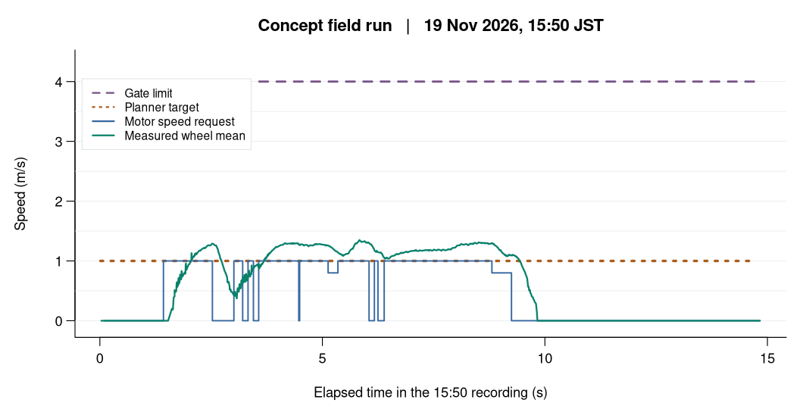

# 2026-11-19 Concept 实车速度与控制延迟

15:50:42 JST 录包中，64 条驾驶决策的**规划目标均为 1.0 m/s**，148 条门控状态的**自动上限均为 4.0 m/s**。40 条已发布的自动指令中，31 条为 1.0 m/s，3 条为 0.8 m/s，6 条为零。按左右轮实际 RPM 换算，自动模式车体纵向速度中位数为 1.130 m/s，P95 为 1.297 m/s，峰值为 **1.350 m/s**。此次自动段未请求 4.0 m/s。[八份录包速度统计](speeds.json) · [逐条速度曲线数据](1550-speed-trace.json)

## 控制与轮速

- **倒车未到达电机。** 13 条经过规划检查的 −0.2 m/s 倒车决策在旧版本因轮速方向未经确认而进入 shadow，全部未发布到 `/concept/auto_cmd`。15:22 手动倒车记录给出负向轮速证据。实车状态节点改为分别解码 CAN 0x711 的两个小端有符号 32 位轮速，Honda 投影和有效真实反馈组合允许发布倒车指令。[15:50 指令分组](15-50-commands.json) · [倒车方向原始帧](../concept-low-speed/wheel-direction-evidence.json)
- **高速反馈超出旧范围。** 10:59 手动行驶记录中，按轮速换算的峰值为 3.983 m/s，303 帧至少一侧超过 +255 RPM，单轮峰值为 +341 RPM。车端依据记录接受 −255 至 +341 RPM；4.0 m/s 直行对应约 301 RPM。15:50 单轮最高 108 RPM。两次记录对应不同驾驶模式。[各场次与越界样本](speeds.json)
- **实车恢复动作。** 冻结仿真把零纵向请求作为制动，旧实车接线却将残余转向一并交给差速电机，15:50 录到 22 条这样的内部电机请求。实车模式现将自动释放动作输出为线速和角速同时为零。车端规划使用原车换算规律预测左右轮，−0.2 m/s 直退预测值由原先右 −83、左 +44 修正为两轮均 −49 RPM。对比原车换算器，53 个现场动作、1,060 组输入与 18,171 个转向代表值的结果全部一致。原车 motor 源码保持原版。[换算器逐项比对](field-converter.json) · [内部 CAN 与电机请求统计](../concept-low-speed/1550-timing.json)
- **机械起步门槛仍待测。** 八份录包中，电机端进入接近直线的 −0.15 至 −0.25 m/s 区间共 0 段；对应正向区间最长仅 181 ms。−49 RPM 是发给换算器后得到的轮速请求，落地能否起步须与持续请求期间的真实轮速配对确认。本轮保留经过检查的倒车速度。[小指令持续时间](small-commands-all-bags.json)

## 延迟

| 15:50 实车数据，单位 ms | 中位数 | P95 |
| --- | ---: | ---: |
| 相机采集至规划回调入口 | 149.53 | 160.41 |
| 成功决策的规划回调 | 114.36 | 247.03 |
| 相机采集至自动指令入包（40 条） | 263.48 | 394.69 |
| 自动指令入包至首次匹配内部电机请求（17 个发生变化的非零指令） | 4.49 | 23.12 |
| 相机采集至上述内部电机请求 | 278.16 | 437.55 |

各行按各自样本独立统计，末两行终点为 ROS 内部电机接口。该录包没有最终物理 CAN 发送话题。[相机与规划分段](../concept-low-speed/1550-timing.json) · [17 个指令匹配统计](../concept-low-speed/1550-motor-timing.json)

16:05–16:10 JST，在 Jetson 上用这 13 帧的道路和反馈离线对照，完整倒车分支检查中位数从 95.00 降至 16.45 ms，273 个分支结果逐项一致。另用 64 帧归档输入复现 Python 全堆回收，每次停顿从 126–135 降至 2.2–4.8 ms；优化后仍有一次 427 ms 的整帧慢样本。识别端减少两张掩码从 GPU 到 CPU 的传输量，6 张图上的道路、车道线和物体检测输出逐项一致。新决策附带相机回调、解码投影、推理和视野裁剪耗时。[规划复核](planner-performance.md) · [相机复核](camera-findings.md)

## 面板速度与重启

实车模式首次启动时，规划目标与自动上限都默认 **4.0 m/s**。在面板速度设置中应用后，面板读取两个节点的实际值并显示，两个设置分别持久化。重开设置、重开面板及重启驾驶与门控节点都会读取已保存值。显式启动参数优先于对应的已保存项；回放模式使用独立设置。

16:12:50–16:13:31 JST，在隔离 ROS 域使用实际 Qt 控件和参数服务完成验证。将两项从 4.0/4.0 设为 2.3/1.7，重启后仍为 2.3/1.7；临时仅覆盖规划目标时显示 3.1/1.7。最后保存回 4.0/4.0 并再次重启，两个节点和界面读回均为 4.0/4.0。[逐次服务读数](settings-e2e.log) · [Qt 界面](settings-qt-saved.png)

[总操作时间戳](steps.log) · [控制校验时间戳](low-steps.log) · [规划验证时间戳](perf-steps.log) · [相机及面板验证时间戳](camera-steps.log)

## 装车

16:16 JST，桌面 Concept 和终端 `concept-live` 已切换至本次构建，对应提交 `a86f412`。在车辆实际使用的配置目录，通过两个 ROS 参数服务分别保存 4.0 m/s。服务回读、磁盘文件均为 4.0，写入时门控禁用。65 项车端测试通过。随后以归档帧的原始目标速度 3.4 m/s 复核 DDS 接线，覆盖倒车正式发布、零速释放、切换限速、重启与图像时间戳。整车启动图移除了未被订阅的手柄预览发布者，手柄仍直接接入门控仲裁，原电机模块的 SHA-256 与装车前一致。[实车参数及磁盘回读](saved-vehicle-settings.json) · [安装文件核验](verified-desktop-sources.json) · [DDS 与启动图回归](final-dds-retest.log)

现场八份录包都缺少从静止持续向电机发送直线 −0.2 m/s 的片段。当前轮胎、载荷和地面条件下的倒车起步能力仍待落地测量。[低速请求时长](small-commands-all-bags.json)

## 安装后真实传感器静态复测

16:18:43–16:19:53 JST，车上接入 ZED、0x711 有符号轮速、VectorNav、手柄和离屏主面板。测试域没有物理 CAN 发送器，真实电机换算节点的输出接到软件接收端。两轮各约 26 秒，每轮收到 162 条新自动指令，均无过期断档或非预期暂停。含预热在内共 337 条有效规划，全为 **4.0 m/s**，门控后记录到 **2,588 条 4.0 m/s** 电机输入。零纵向请求中附带非零转向的次数为零。采集至自动指令发布的订阅端观测中位 **209.28 ms**、P95 **223.80 ms**、最大 **271.22 ms**。16:05 同车静态基线为中位 242.59 ms、P95 274.18 ms、最大 387.85 ms。两组在不同时间观察现场画面，属于整套部署的现场静态对比。[修复后分段计时、速度与门控](final-bench.json) · [修复前静态基线](baseline-summary.json)

测试末尾主动暂停驾驶进程 1.36 秒，门控进入 `auto_timeout` 并保持暂停。超时后的 74 条电机输入全部为零。1 条陈旧图像和 7 条图像断档出现在故障注入阶段。16:23:01 JST 确认所有测试节点和原 allnodes、OA、LYA 均已退出。静态试验仅验证软件指令和失联响应，本次未测落地 4.0 m/s 实速或 −0.2 m/s 的负载起步。[结束状态](after-test-processes.log)
