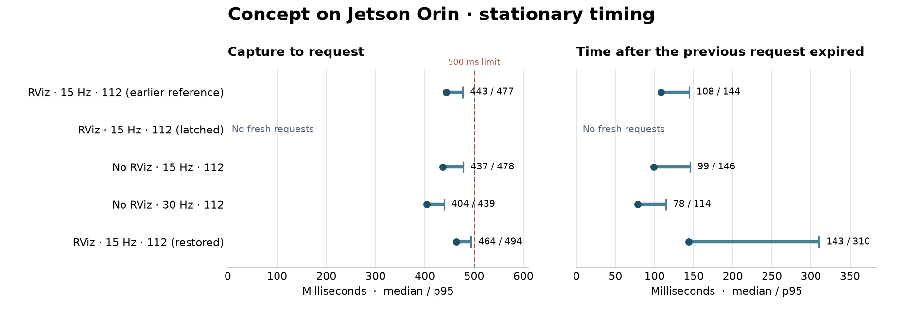
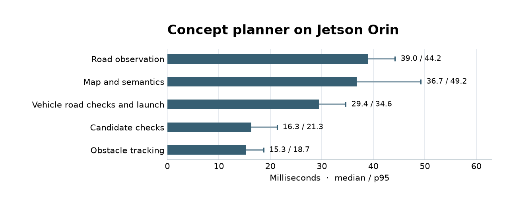
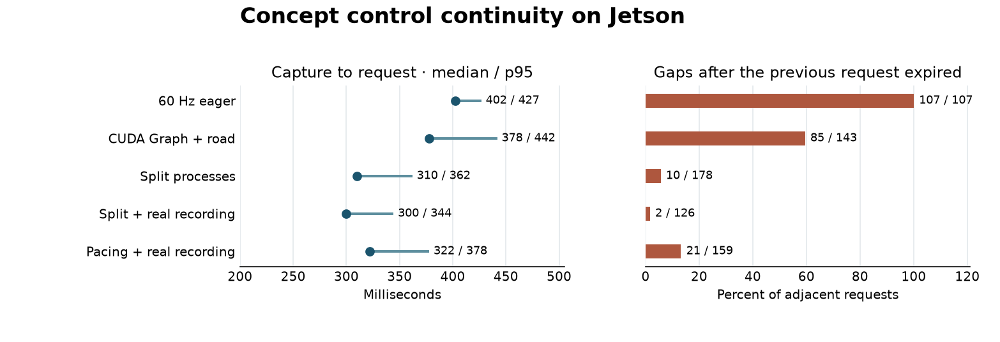

# Concept 2026-11-20 收尾

7 个后段 Concept 原包与 15 FPS 面板截图已收存于车上的 Extreme SSD。具体场次、消息数、结果和文件指纹见录包清单。此前 1120-06、1120-07、1120-08 和 1120-11 仍按当天云端索引查找。

- [后段录包与结果](CONCEPT-RUNS.md)
- [当日完整场次](../CONCEPT.md)
- [已上传 Drive 的早期录包](../BAGS.md)

## 下午延迟复测

14:47 的对照包含原相机配置与双解码。30 Hz 发布后实车静态端到端中位约 394 ms。进入 CUDA Graph 和同机分进程阶段后，同一时段另有端到端中位约 310 ms 的静态样本。锥桶较多的实跑仍有门控超时，两个最新场次记录到轮速响应，但无法证明连续自动行驶。

