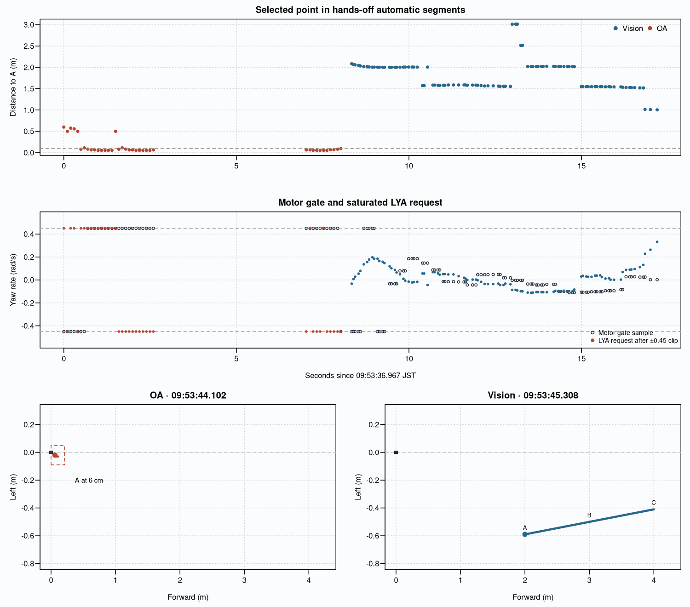
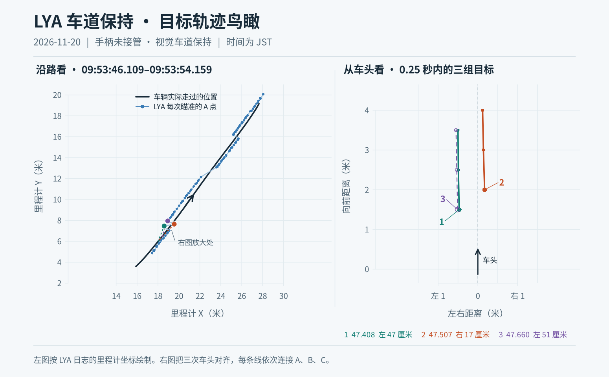
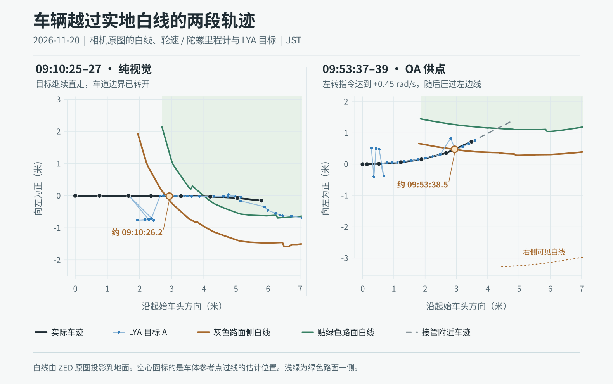

# 2026-11-20 MapAssist LYA 无手柄接管段

## 数据与筛选

从当天三个已关闭的 SQLite 原包只读提取选点、门控、轮速、里程计和手柄等小话题，交叉核对两场 LYA 和 MapAssist 私有滤波节点日志。只保留前后相邻门控样本均为 semantic_go、manual_held=false 的 LYA 计算，前后门控距计算各不超过 0.5 秒。私有滤波输出距 LYA 计算不超过 80 ms，同时核对局部 A 距离与 LYA 的全局误差距离。该筛选用于归因，回调次数不是独立车况或独立试验数。09:03 首场没有 semantic_go 记录，故无可用于对照的自动轨迹。[分析数据](summary.json) · [逐条自动指令与选点](auto.csv)

| 录制区间 | 选点来源 | 匹配回调 | A 距车中位数 | A 距车小于 0.7 m | LYA 未限幅角速度绝对值中位数 | 触及 ±0.45 rad/s |
| --- | --- | ---: | ---: | ---: | ---: | ---: |
| 09:09–09:11 | 视觉 | 429 | 1.50 m | 0 | 0.040 | 14 |
| 09:09–09:11 | OA | 44 | 0.384 m | 39 | 1.579 | 44 |
| 09:53–09:55 | 视觉 | 98 | 1.59 m | 0 | 0.057 | 0 |
| 09:53–09:55 | OA | 38 | 0.063 m | 38 | 10.666 | 38 |

ROS bag 内私有选点间隔中位为 334 和 348 ms。LYA 自身连续计算日志的间隔中位为 97 和 100 ms，统计排除大于等于 0.5 秒的间断。袋里约 3 Hz 的消息节奏不能直接视为 LYA 在运行时只计算 3 Hz。

## OA 近点和角速度反向

- 09:53:44.102，OA 的 A=(0.06, −0.02)、B=(0.08, −0.03)、C=(0.11, −0.03) m。近邻里程计车速约 1.07 m/s。LYA 未限幅计算为 +100.067 rad/s，约 194 ms 后为 −15.183 rad/s。这是内部计算，实际命令受 ±0.45 rad/s 限幅。
- 09:53:44.609 与 09:53:44.977 的两个相邻门控样本均是语义自动且手柄未接管，实际门控角速度由 +0.45 变为 −0.45 rad/s。两场共有七组这种相邻自动门控的近满幅反向，最新场五组。
- 09:53:45.308 切回视觉时，A=(2.00, −0.59)、B=(3.00, −0.50)、C=(4.00, −0.41) m，当前 LYA 未限幅值 −0.033 rad/s。
- OA2 发布器在障碍消失后的路径续发阶段，把下一组轨迹点减去上一组的中间点作为临时原点。它每个定时窗口前进三个样条采样，无车体里程计补偿。该三点消息随后经私有滤波交给 LYA，而 LYA 将 A 和 A→B 航向作为当前 base_link 下的目标。因而局部增量坐标被当成车身前视点，实际前视可缩到 5–10 cm。控制器的距离项与小转角分母会放大这种输入。09:53:44.102 LYA 收到的角速度前馈仅 −0.09 rad/s，与选择器发布相符，本次尖峰不能归因于前馈话题迟到。OA2 续发源码（见录包或原实验记录）

## 视觉段也存在离散切换

09:10:22.732，原车道节点报左右线不足，退回直行参考。私有选点在 09:10:22.769 使用 A=(1.50, 0.00) m，09:10:22.921 变为 A=(3.00, −1.14) m，约 152 ms 内跳变 1.88 m。同一时段的 LYA 原始转向从 −0.040 到 −0.120 rad/s。当前证据显示视觉段也有目标跳变，最大幅度的连续反打则集中出现在 OA 选点或切换附近。现场版 LYA 增益与 11/19 冻结一致，本次只读取证。

## 单看视觉车道保持

在无手柄接管的样本上，仅保留视觉选点，并剔除路径来源每次切换前后各 1 秒。对同场相邻的保留样本，仅统计相距 20–230 ms 的配对。

| 录制区间 | LYA 计算 | 相邻配对 | A 点位移超过 0.5 m | LYA 内部计算达到 ±0.45 rad/s 限幅阈值 |
| --- | ---: | ---: | ---: | ---: |
| 09:09–09:11 | 412 | 404 | 42 | 12 |
| 09:53–09:55 | 87 | 86 | 7 | 0 |
| 合计 | 499 | 490 | 49 | 12 |

- 09:53:47.408、47.507、47.660，LYA 看到的 A 点依次是 (1.50, +0.47)、(2.00, −0.17)、(1.50, +0.51) m。约 0.25 秒内，目标从车头左边跳到右边，再回到左边，LYA 的内部转向计算也同向反复变号。车道节点在前后两组点明确报告右线不足，改用左线推算中线。三组均来自视觉。这里的变号指控制器计算，稀疏录包未逐条采到对应的旧门控和 motor 输出。车道节点原始日志（见录包或原实验记录）
- 09:10:18.171，A 点几乎在正前方 (1.50, −0.02) m，但 B 点在 (2.50, +0.42) m。A→B 指向左约 24°，LYA 未限幅转向计算为 +0.786 rad/s。只看 A 点会漏掉这类角度跳变。
- 车道代码在直接使用中线、单边估算和两边均不足时的直行默认点之间即时切换。各分支直接发出 A/B/C，未按上组目标约束新组的位置或方向。09:53 的左→右→左和 09:10:22 的默认直行→右侧 1.14 m 跳变都发生在 LYA 计算之前。

左图从 LYA 日志取同次计算的车辆位姿与全局 A 目标，绘出 09:53:46.109–09:53:54.159 的 87 次视觉样本。蓝线按时间顺序连接目标样本。右图使用原始车身坐标中的 A/B/C，把 09:53:47 的三次车头对齐。两图的横纵轴比例相同。可在本目录运行 `Rscript plot-vision-birdseye.R` 重画。

## 里程计与实地白线复核

从 SSD 已校验归档只读提取 1120-02、1120-03。以相机消息的采集时间对齐同一个 `base_footprint` 的轮速／陀螺里程计。独立从 ZED 校正原图描出两条白线中心，使用同包的 CameraInfo、TF 以及近处平地假设投影。录包 TF 的相机高度为 0.54 m。图里的过线时刻是相邻里程计样本之间插值的车体参考点过线时刻。[越线前后四张原图](lya-lane-exit-camera.jpg)

| 时段（JST） | 证据 |
| --- | --- |
| 09:10:25–27，纯视觉 | 灰色路面侧白线的过线时刻约 09:10:26.2，里程计样本区间为 25.927–26.295；靠绿色路面的白线约 26.6。25.660–26.443 的车道节点持续报告两侧点不足，发布直行参考。过第一条线附近 LYA 发布角速度约 −0.04 rad/s，里程计航向基本保持。门控在该段持续 semantic_go、manual_held=false，这个时段没有独立手柄样本可核对。 |
| 09:53:37–39，OA 供点 | 门控从 37.600 开始多次记录 +0.45 rad/s。38.419–38.789 的里程计夹住第一条白线的过线时刻，插值约 38.5。第一个采到的手柄接管输入源时间 39.168，录包时间 39.264，门控首次显示 manual_priority 为 39.944。靠绿地的第二条线和人工操作的时间很接近，因此图中接管附近的车迹用虚线标记。 |

09:10:18.211–19.247 另有一次纯视觉左摆，陀螺里程计航向变了约 27°。原图显示车在绿色铺装区域内，回投影没有显示这一小段跨越所跟踪的绿色边沿。它和上表确认的越过实地白线是不同事件。09:10:30 附近的手柄源时间在 29.718 已采到输入，不能仅依据门控 30.857 才显示接管就把该段算给 LYA。

`lane-exit-evidence.json` 保留绘图用的车迹、实际发布的目标和人工描线投影。在此目录运行 `Rscript plot-lane-exit.R` 可重画。重新提取的脚本为 `scan-lane-exit.py` 与 `trace-lane-exit.py`。
