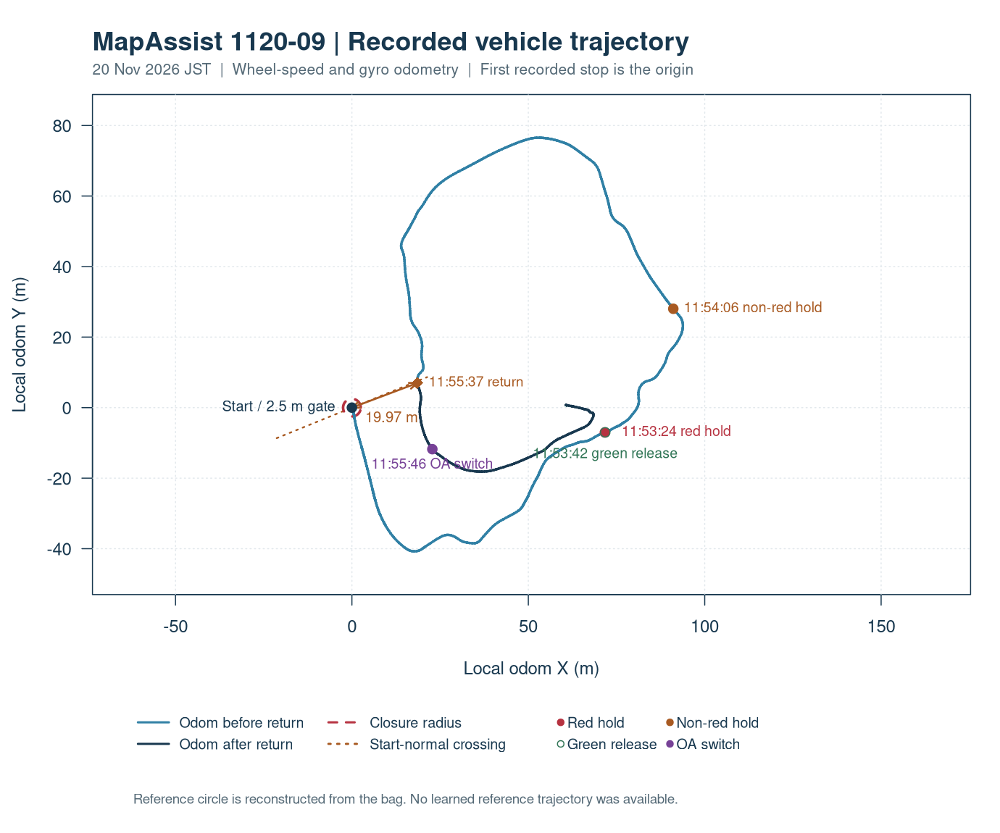

# MapAssist 1120-09 · 实车轨迹与复盘

2026-11-20，时间均为 JST（UTC+09:00）。原包 `rosbag2_2026_11_20-11_49_36` 实际录制 11:52:14.763–11:56:47.704，共 190,065 条消息。车上运行 A3、MapAssist 0.4.5 外圈、OA2 和独立 LYA。SSD 转存目录原编号为 `1120-06`，当天统一索引以 `1120-09` 归档，以区分已归档的 Concept 1120-06。 [原包索引及校验](../../BAGS.md)

## 实车轨迹

[完整轨迹 CSV](trajectory-odom.csv) 含从 SSD 原包只读解码的 3,738 条轮速＋陀螺里程计，帧为 `odom → base_footprint`。XY 原点平移至首个静止样本，轴向与偏航角沿用原里程计，单位为米和弧度。含源时标、录包接收时标、前向速度和偏航角速度。手柄与电机门控取同一接收时钟下最近且未超过 350 ms 的旧样本，OA 标志上限 500 ms，超时留空。图按里程计源时标绘制，事件标记取最接近的轨迹样本。可用参考路线、匹配路线和 detour 路线未形成，轨迹图使用实车测得的相对里程计坐标。

## 逐事件结果

| JST | 现场证据 | 结果 |
| --- | --- | --- |
| 11:53:24.919 | 门控进入 `semantic_hold:red_wait_signal_lost`，此前红灯已经触发锁定 | 红灯等待 |
| 11:53:42.637–42.642 | 状态发布 `green_resume`，门控切到 `semantic_go`，约 1.17 m/s 的速度指令和非零 CAN 输出恢复 | 这次绿灯自动解锁并恢复驱动 |
| 11:54:05.451–16.971 | 左线 6 点、右线 11 点、中线 3 点。旧选点分支仍按索引 0/2/4 取中线，出现 149 条中线不足告警。11:54:06.138–16.839 LYA 断供 10.701 s | 车道点断供，旧适配器随即把 `semantic_045_route_or_command_unready` 接成 `stop_wait` |
| 11:54:06.090–14.961 | 连续 85 条电机门控样本的 CAN 驱动数据为零，实测轮速降到零。同期 109 条灯态为 `unknown`，红像素最大 0，OA 未活跃。11:54:14.967 短暂手动接管 | 此次停车由三点断供和旧兼容逻辑造成 |
| 11:55:37.409 | 回程正向穿过重建的起点横截面，航向差约 14.1°，横向距离 19.97 m。驶出 40 m 后，包内最近也离起点 19.24 m | 回程超过 2.5 m 闭环半径，同进程回读仍为 `learning`、`lap=1`，`odom_reference_ready=false`、`route_matched=false` |
| 11:55:46.397–48.717 | 左弯由 OA 给 LYA 三点。11:55:48.414 的目标距车约 2 cm，略在车后，限幅前指令 +86.793 rad/s，实际角速度指令限幅 ±0.45 rad/s | 尖峰出现在 OA 接管期间。MapAssist 的地图修正角为 0 |
| 11:56:09.048 | 同轮再次见红，状态为 `red_wait_first_lap` | 仍按第一圈红停处理，detour 路径为空 |

### 第一圈闭环为何失败

同段首尾实拍均能辨认车库直道。按源时标重建，11:52:15.297–25.500 初始停车期间里程计位置不变，用首个静止点估计 MapAssist 的起点。实现要求累计距离达到 40 m、航向偏差不超过 25°，并沿原前进方向穿越起点的垂直截面，交点距起点需在 2.5 m 内。本包满足前两个数值条件，回程交点超过距离门槛。进程未发布内部首个采样点，19.97 m 含起点估计误差。仅凭相机画面及轮速和陀螺里程计，无法量化实际回程行车线差异、滑移与里程计累计误差各自的贡献。 [闭环检查代码](../../../../../workspace/src/aiformula/perception/semantic_planning_system/semantic_local_planner_ros/semantic_local_planner_ros/map_assist.py#L1115)

### OA 与 LYA 异常转向

按靠近 `semantic_go` 的三点转发与 LYA 日志做时间配对，普通视觉 1,317 条样本中，0 条目标小于 0.50 m、53 条限幅前角速度绝对值超过 0.45 rad/s。OA 的 327 条样本中，相应为 199 和 326 条。距离由日志里的两位小数坐标估算。

A3 把人、车辆与锥桶检测框都填进 `/cone_mask`。将同源相机时标的检测框按当时实装逻辑重画，11:55:46.178 的固定梯形 ROI 内有 1,052 个非零像素，全部来自两个车辆框，高于进入阈值 1,000 px。相同 OA 代码复算的首组三点与 11:55:46.401 转发日志逐点一致。11:55:48.378，检测框在 ROI 内的复算像素为零，随后仍可在日志看到存量路径尾段继续交给 LYA。OA 出点的相对原点会随旧路径推进，LYA 按当前车身坐标解释 A 点，目标过近时控制律放大角速度。原包记录了 A3 检测框和 `/point_flag`，当时 OA 消费的掩码及像素计数未入包，1,052 px 属于离线重画。 [OA 实现](../../../../../workspace/src/aiformula/perception/obsticle_avoidence/obsticle_avoidence/oa_2.py)

## 跑完之后的验证

- 12:12–12:13 回放同一停车窗口。加短中线回退后，原先 143 帧断供恢复为出点，147/147 帧均有 A/B/C。12:13:19 装入短中线回退与只在红灯时联动旧 `stop_wait` 的更新，旧进程会在重启后加载。另有无红、红停和绿解锁的静态验证记录。
- 12:14:27–30 两个 OA 安装入口的梯形 ROI 上边缘从图像高度比例 0.50 改为 0.40。以同一误触发帧反算，两个车框计入像素由 1,052 增到 1,116，仍超过 1,000 px。以上更新在本包录制结束后发生，实车复测结果待下一包确认。
