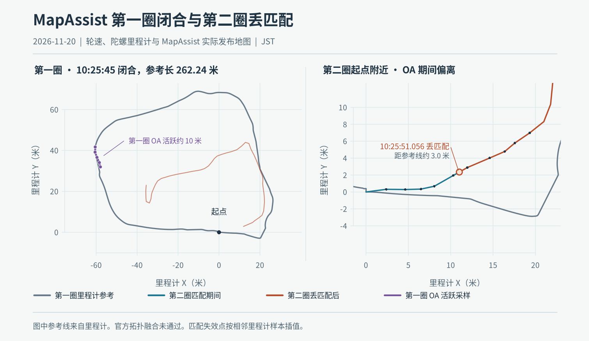

# 2026-11-20 MapAssist 额外停车、建图和绕行

录包 `rosbag2_2026_11_20-10_22_28`，10:22:43–10:29:01 JST，早于 10:34:52 的 A3 小绿牌补丁。车端参数为匹配距离 2.5 m，搜索窗 3.0 m，融合排除段门槛 2.0 m，视觉点有效期 0.5 s。

## 两次额外停车

| 电机门控入包时段（JST） | 行为与原始证据 |
| --- | --- |
| 10:25:23.685–10:25:28.655 | 六条门控样本均为 `semantic_045_route_or_command_unready`，速度与 CAN 为零。停住时左右线典型值 5 和 14，中线只有 3 点。LYA 目标在源时刻 10:25:23.080–10:25:28.982 之间断流约 5.9 s。 |
| 10:26:13.335–10:26:39.277 | 25 条门控样本均为同一等待原因。停车期间典型样本左 5、右 8–9、中 4。LYA 目标在 10:26:11.580–10:26:39.031 之间断流约 27.5 s。该段路线匹配也失效，但视觉点恢复后自动速度曾通过。 |

两个窗口均无 `red_stop_required=true` 或 `/flag_stop=true`，红像素诊断最大为 0，灯色为 `unknown`。车道节点反复报 `Insufficient points in center line`。原入口取第 0、2、4 个点。左右各有五个点时直接尝试取中线，而左右观测纵向覆盖不完全重合，中线只剩 3–4 点时该分支直接退出，A/B/C 停止更新。门控采用录包时间，点云和 LYA 采用各自源时间。

## 第一圈闭合与第二圈失配

- 10:25:45.469 发布 1,313 点的闭合路径，原生状态采集样本 1,238，参考长 262.24 m，进入第 2 圈。
- 10:25:45.654 首次采到 `route_matched=true`。状态为 `odom_only`，融合拒绝原因 `excluded_gap_too_long`。融合排除绕障及不合格的视觉记录。第一圈 10:24:54.845–10:24:59.854 的五份状态均显示 OA 活跃，首尾里程计相距约 10.06 m。该值是实录首尾位移，系统未报告导致融合拒绝的准确内部分段长度。
- 10:25:51.056 首次采到 `route_matched=false`，OA 仍活跃。里程计插值后对已发布路径的距离约 3.03 m，超过 2.5 m；上一个匹配样本约 2.11 m。进度停在 9.98 m 到录包结束。旧算法只在上次进度附近找，失配后的预测进度增量也有限，车继续前进后超出搜索范围。
- 闭合后 177 条状态中灯色 176 unknown、1 green、0 red。从未进入 `prepare` 或 `detour`，`auto_trigger_reason` 始终为 `not_evaluated`，绕行路径为 0 点。录包不能确认闭合后实体灯是否变红。

本次只读诊断。运行 `python3 summarize.py` 和 `Rscript plot-lap.R` 可复算、重画；几何摘录约 70 KB。
