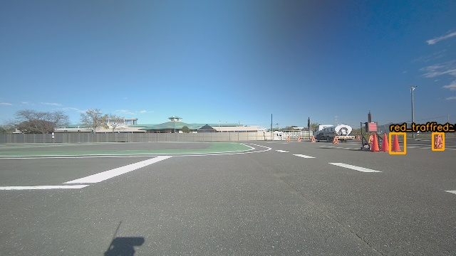

# 11 月 20 日 MapAssist 正面红灯牌漏检

第二场 **09:10:23.335 JST** 的实录里，画面右侧移动灯牌的红色牌面和支架清楚可见。A3 的车载 overlay 标出了相邻路锥，灯牌区域没有交通灯框。

**09:10:24.069 JST** 有原图与车载 overlay 时间戳完全相同的一对。右侧红牌已进入近处，YOLOP 仍只标出路锥。另一段逆光中，牌面灯色无法从画面确认。按现场操作员复核，`unknown` 是这段的预期结果，本次漏检样本以正面红牌为准。[同一时刻原图](images/examples/130-camera.jpg) · [同一时刻的实录 overlay](images/examples/130-vehicle-overlay.jpg) · [下一张同时间戳配对的原图](images/examples/131-camera.jpg)

[正面证据包，29 张车载 overlay 与 7 张配对原图](images/2026-11-20-lamp-board-overlay.zip) · [两场的全部 475 张 overlay](images/) · [七张 A4 本机回放 overlay](images/2026-11-20-lamp-board-A4-replay.zip) · [225 份车载 ROS 日志](logs/2026-11-20-mapassist-ros-logs.zip)

## 连线与实测

| 录包 | 实际记录范围 JST | 能确认的结果 |
| --- | --- | --- |
| `09_00_13` | 09:03:30.417–09:04:41.829 | A3 检测 JSON 有 219 条，全是 `unknown`、红像素为 0。旧门控有 202 条路线或指令未就绪导致的零输出，另有 16 条手柄接管的非零输出。录包缺 `/flag_stop` 和私有 MapAssist 状态。 |
| `09_09_31` | 09:09:44.488–09:11:06.120 | 243 条原生 MapAssist 状态均为学习首圈、未匹配。像素阈值 600，`/flag_stop` 250 条全为 `false`。正面看到真灯牌仍未画框。另有一条共 72 像素的红灯检测靠画面右侧洒水车，相邻帧核对为疑似误检。 |

车端基线为 MapAssist `1120-av314.1`、规划 0.4.5、motor 0.4.1。第二场实际记录到 OA 整组三点 53 条和 LYA 私有速度 163 条。原生记录的最小转弯半径为 5.5 m，对应 `outer`。[车端日志](logs/) · [两场逐话题结果](evidence/bag-diagnostics.json)

## 为什么正面漏检

三帧按相机头时间配对后，手动框住真实红色牌面，颜色分类代码读出 78、132、169 个红像素。当前 YOLOP 先要求有 `traffic light` 检测框才进颜色统计。A3 回放仅一帧有能覆盖大部分牌面的候选，分数 0.278。A4 回放三帧都有覆盖约 68%–86% 的候选框，分数约 0.24–0.27，低于原 0.50 门槛。因此这些正面样本的主要问题出在灯牌框的定位和置信度。[逐帧诊断与复算](evidence/FRONT-LIGHT-DIAGNOSIS.md)

09:26:13 车机读回 MapAssist 的终端和桌面像素阈值为 50。09:36:27 车机读回 A4 和 A4Light 入口的灯牌候选分数 0.23。低分候选还需通过框形和红/绿有效色面积检查。两档各回放 14 张，同三张正面灯牌由 0 红像素提升至 78、131、169，11 张对照的灯色和红像素输出一致。09:36:49 已运行的进程仍使用旧参数，下一次试车才可验证装车调整。[本机回放](evidence/tuned-yolop-verification.json) · [车机回读](evidence/tuning-final-vehicle-readback.txt) · [按帧和附件核验清单](evidence/publication-index.json)
