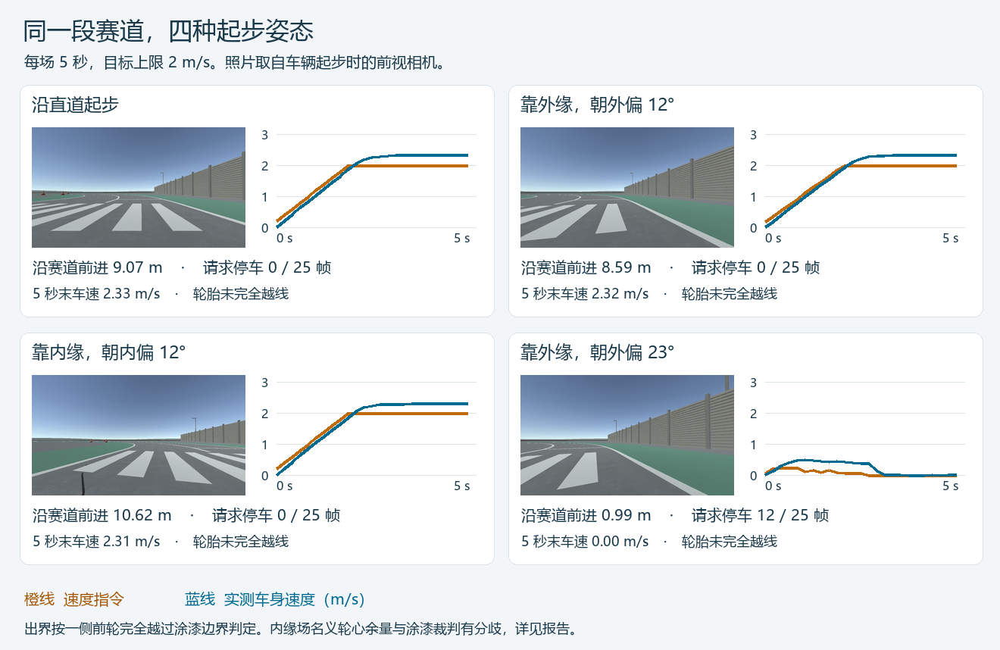

# 11/20 Concept 备车入口

**当前版本为 V6.27.8。** 运行 [车机安装与快捷方式升级](DEPLOY.md)，用原 Concept 图标在终端选 Pure Pursuit 或 LYA。最近一轮普通弯 24 秒内分别行驶 51.05 m 和 46.57 m，LYA 出弯后停稳。界面中 A、B、C 是该拍 LYA 使用的三个点。[V6.27.8 图像、选点和完整对照视频](https://github.com/Sophia-AI-formula-team/neo_aiformula_sophia/tree/f305d5f7acea5c87af0e2003bec13bdc06199d8f/vehicle_concept/checks/tracking_v6278)

## 历史记录 · V6.27.6 仿真闭环和实车回正

Concept 自己的 Unity 已能用和车上同一套 B1.4、白盒规划器、H12 和 Foxy 驾驶节点开车。车头朝外偏 12° 的短测拉回了，偏 23° 的短测停在道内。四场都是同一路段、从静止起步、无新增障碍物、目标 2 m/s，每场 5 个模拟秒。整圈、Jetson 的实时控制和实车边缘恢复仍待验证。[部署步骤](DEPLOY.md) · [原车逐帧实测](field-timing/实车回正时序.md)

| 起步姿态 | 沿赛道前进 | 速度为零的请求 | 拍照至 Unity 写入轮速，中位数 / 第 95 百分位 | 观察到的结果 |
|---|---:|---:|---:|---|
| 外车道中央，沿路起步 | 9.07 m | 0/25 | 159 / 216 ms | 5 秒末车身 2.33 m/s，超过 2 m/s 的速度指令 |
| 靠外缘，朝外偏 12° | 8.59 m | 0/25 | 144 / 197 ms | 外侧前轮轮心至名义边界的距离从 0.77 m 减至 0.45 m，随后回升至 0.66 m |
| 靠内缘，朝内偏 12° | 10.62 m | 0/25 | 154 / 223 ms | 涂漆裁判未判出界。按等宽赛道算，前轮轮心已越过名义边界约 0.53 m，末段仍向内偏。回正待验证 |
| 靠外缘，朝外偏 23° | 0.99 m | 12/25 | 138 / 197 ms | **停在道内，恢复失败。** 最近轮心距名义边界仍有 0.24 m |

第四场的停车可以定位到候选选择。第 2.6 秒，60 个候选因路界被筛掉，余下 15 个都是零速。第 3.2 秒以及末帧已有 30 个可行候选，其中 15 个能前进，最快仅 0.05 m/s。白盒和 H12 都把停车排在第一，起步检查记录为 `whitebox_prefers_hold`。下一步要检查车仍在道内时能否提前给出可执行的低速回正路线；一侧轮胎完全出界时仍保留停车。[每帧的指令、实速、余量与计时](unity-runs.json)

## 复用的依赖和实测边界

- 工作站用独立 Unity 2022.3.22f1，在 Ubuntu 20.04 / ROS 2 Foxy 的 semantic GPU 环境内运行车辆源码。Python 3.8.10、Torch 2.0.0+cu118、TorchVision 0.15.1+cu118、NumPy 1.24.4、SciPy 1.10.1。显卡 RTX 4070 Ti。Jetson 上 Torch 为 2.0.0+nv23.05。
- 与 semantic 使用的学校仿真工程逐一比对，编辑器版本、相机、差速驱动、电机模型三个 C# 源文件以及本场景相同。Unity 包的取得方式有区别，Concept 的离线工程自带包。核对的 Burst 1.8.12、Mathematics 1.2.6、Barracuda 3.0.2、Newtonsoft.Json 3.2.1、Physics 和 ImageConversion 1.0.0 版本一致。Unity Editor MCP 仅在学校工程使用。模拟车装载的电机仍是 `JanuaryLapIdentified`，11/19 实车电机在当前电池和地面下的响应还有待测量。
- 左相机对仿真地面实测 0.550 m，使用 11/19 的相机内参和安装位置。Unity 将 640×360 图像、轮速、陀螺和上一拍指令反馈交给驾驶节点。赛道的形状、世界坐标和轮胎裁判留在 Unity 内。裁判每 0.01 秒检查任一侧前轮胎面是否已完全越过涂漆边界。表中的“名义边界”由固定宽度估算，供分析偏移方向；正式判罚依据是涂漆边界。
- 四场共 100 次决策，100 次都把命令写入模拟电机，96 次有下一帧可核对上次写入，全部一致。随后在独立 ROS 域用原车控制门和电机节点重放相同的 100 条速度和转向指令，软件 CAN 终端的左右轮目标逐条吻合。四次断流后均持续发零。原车门控与这些短测分开核对，物理 CAN 没有接入。
- 表中为实测墙钟耗时，包含 Unity 拍照、编码、通信、推理、规划和写入。物理仿真在每次请求期间等待控制返回，能检测路线反馈，但模拟时间里的 5 Hz 不能证明车机实时达到 5 Hz。

## 真实时钟下，5 Hz 能输出多少条指令

将同一段直道的 25 张已解码原图和同期模拟反馈按墙钟送入 ROS，图片每隔约 200 ms 到一张。下面单帧延迟从发布图像计到收到对应的 ROS 自动转向、速度指令。实车相机采集、USB/相机传输和最终电机门控还要另计。

| 测量环境 | 25 张图得到的有效指令 | 单帧延迟中位 / 第 95 百分位 / 最大 | 超过 200 ms |
|---|---:|---:|---:|
| 保留闭环服务，另起一份 GPU 回放，连续四次 | 22、1、0、0 | 首轮有指令的 22 帧为 143 / 185 / 186 ms；第二轮仅一条，212 ms | 有帧因过期或缺失未发令 |
| 停本任务的常驻服务，只让一份 GPU 模型工作 | 25/25 | 146 / 197 / 221 ms | 1/25 |
| 同条件再做一次 | 25/25 | 147 / 198 / 208 ms | 2/25 |

两次单模型输入频率实测 4.99 和 4.97 Hz。按首末指令时刻折算，输出都约 5 Hz；中间最长两条指令的间隔分别约 269 和 284 ms。两组共 50 帧均有指令，47 帧在 200 ms 内返回。这证明该工作站在这段短回放中能跟上输入，尚未证明全程都按 200 ms 截止时间出指令。

停止额外的常驻服务后，桌面显存空闲时的已用量约从 6.7 GB 降至 3.5 GB。慢场里存在单帧推理约 0.55–1.04 秒的记录，触发了已有的 0.5 秒时限。初次回放还有 3 帧报轮速时间不匹配，回放的轮速只有 5 Hz，实车通常更频繁。机器同时还有其他桌面负载，现有数据支持避免重复启动 GPU 推理，无法把全部波动归到单一原因。部署排查时先数清楚实际运行的识别进程，再在 Jetson 上用原相机时间戳测一遍。[六次逐帧回放、GPU 采样和四场车端门控重放](wall-clock/)

## 11/19 为什么看起来回正太晚

末场第 27 帧在 **17:08:26.565** 拍摄。前方 5 m 处，系统选中的路线中心已经画到左外缘以外，而这一帧反而加大了左转。两帧后，所选路线持续指向外缘之外。第一条向右的指令来自 **17:08:28.415** 的画面。两张图相隔 **1.85 秒**，按实测轮速车已经走了 **4.21 m**。

最后这张图在 **28.680** 生成自动指令，**28.701** 录到门控输出。从拍摄到门控约 **286 ms**，期间又走了 **0.64 m**。其中相机订阅前约 68 ms、识别 77 ms、驾驶回调 112 ms。**28.900** 门控给出停车。右转请求维持约 0.20 秒，期间实测偏航积分仍略向左。照片看不见轮胎接地点，不能认定车轮完全出界的时刻。

缩短单帧处理能减少这 0.64 m。更长的一段是画面已经能看出所选路线有风险，系统仍连续几帧给向左的指令。实车复测应同时记录首帧风险、首次减小向外转向、首次向内指令及随后陀螺读数，以便分清路界判断、选线和执行响应。[原始画面和时间线](field-timing/实车回正时序.md)
