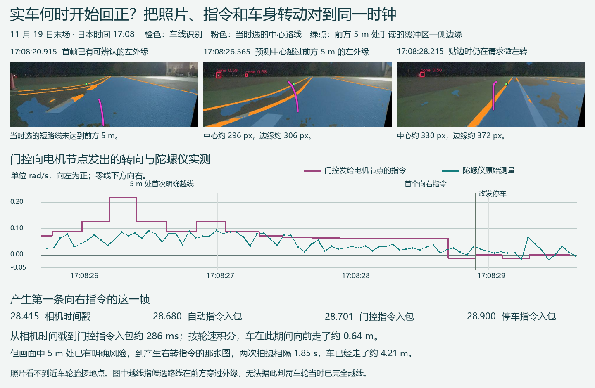

# 11 月 19 日末场：是图像太迟，还是车辆回正太迟？

**有约 0.29 秒的图像到门控延迟，但更长的等待发生在驾驶策略连续几帧仍给左转。** 从画面第一次明确显示“所选路线在前方 5 m 处穿过左侧外缘”，到首次请求向右的那张图，已经过去 1.85 秒，轮速积分走过约 4.21 m。期间车辆确实减小过左转，随后又加大。现有记录能判断预测的路线偏出，也能确认车体向左偏移；看不到车轮接地点，不能判罚哪一侧轮胎在哪一帧完全出界。

### 实车发生了什么

以下时刻为日本时间，均在 17:08 这一分钟。向左的角速度为正，向右为负。车上程序实际使用并写入日志的路线叠在照片中。

| 时间 | 从哪条记录看到 | 发生了什么 |
|---|---|---|
| 20.915 | 首张相机叠图 | 左侧绿色缓冲区和旁边的连续外缘已能辨认。这时车辆所选路线较短，预测未延伸到 5 m。 |
| 26.396 → 26.402 | 自动指令 → 门控输出入包 | 在本次加左达到峰值之后，指令首次从 +0.218 降到 +0.127 rad/s，仍然向左。 |
| 26.565 拍，26.820 出指令 | 第 27 帧照片及实际规划 | 在固定的前方 5 m 截面，预测中心约在 296.4 像素，绿色侧的外缘约在 306 像素。中心首次明确落到缓冲区一侧。此帧指令反而从 +0.088 回到 +0.127。 |
| 26.782 拍，27.044 出指令 | 第 28 帧 | 5 m 处预测中心回到线附近。自动指令从 +0.127 降至 +0.088，此后正角速度逐步减小，直到跨过零。 |
| 26.999 拍，27.815 拍 | 第 29、33 帧 | 从第 29 帧起，前方 5 m 处的预测中心连续位于左外缘之外。存档路界在 1 m 处才从原来的车左约 1.30 m 小幅收窄到 1.28 m，至第 33 帧变成 0.84 m；3 m 处的左界仍固定在车左约 3.89 m。 |
| 28.215 拍，28.473 出指令 | 第 35 帧 | 画面中 3 m 处预测已在外缘左侧约 0.29 m，5 m 处约 0.83 m。速度仍为 2.00 m/s，60 条正速候选的首步都是 +0.06215 rad/s。 |
| 28.415 拍 → 28.680 自动指令 → 28.701 门控指令入包 | 第 36 帧 | 首次请求向右，−0.01296 rad/s，车速指令仍为 2.00 m/s。电机转换器内部 0x210 的两个目标轮速字在 28.707 变为右 219、左 234；此前为右 228、左 225。到门控入包为止，这一帧期间按实测轮速又行驶约 0.64 m。 |
| 28.741、28.791、28.841、28.891 | 原始 IMU 源时间 | 车身角速度分别为 +0.0257、+0.0096、−0.0005、+0.0336 rad/s。第一个负值很小，下一次采样又向左。首个右转指令保留约 0.20 s，期间实测偏航积分仍向左约 0.0031 rad。 |
| 28.900 停车，29.100 再给微右，29.300 再停 | 门控输出入包 | 第一次停车后，车短暂获准 0.101 m/s、−0.01287 rad/s。29.776 的原始轮速回报双轮才都为 0。 |

按包内轮速和陀螺仪的局部里程计，车身相对起步方向的左偏量在 26.565、27.815、28.415、29.249 分别为 0.15、0.60、0.88、1.28 m。29.965 拍摄时，里程计累计约向前 9.36 m、向左 1.40 m。这个坐标原点随本次启动确定，无法直接换算成轮胎离赛道外缘还差多少。

### 第一条向右指令为什么到 28.701 才看见

相机源戳 28.415 到驾驶节点汇报已完成约 264.9 ms。包内计时列出相机订阅回调前 67.9 ms、解码和视图投影 6.7 ms、网络推理 77.3 ms、限制预测区域 0.9 ms、驾驶节点回调（含规划）112.1 ms。自动指令在 28.680 入包，到门控 Twist 首次记录该值又过约 21 ms。门控话题没有消息头，该处时间是录包器的到达时间。整个纠偏窗口的门控状态都是自动。最终发向 socketCAN 的话题没有录制；内部 CAN 指令与测得轮速可核对，但无法把每毫秒分解成总线传输和电机执行延迟。

在首次向右请求附近，相机决策采样间隔中位约 217 ms，原始 IMU 约 50 ms。门控输出两侧最近的 IMU 源时间为 28.691、28.741，轮速源时间为 28.689、28.713。28.794 首次记录右 164、左 165 RPM，差异仅 1 RPM；28.841 的负陀螺值也落在停车时的波动范围内。该包不能给出确定的实车起转时刻。28.941–29.041 的原始 IMU 话题有约 100 ms 间隔，车况汇总单独留下了 28.991 的配对 IMU 值。

5 m 的读数以同一张 640×360 图中的绿色缓冲区一侧为边，采用约 ±7 像素的读图误差。前方还有别的深度可能更早出现风险。在平地模型下，参考图最底一行约在车前 0.94 m，照片没有车轮接地位置，也没有同步外部定位。首次明确的预测越线和车轮实际完全越线是两个不同事件。

### 两个高度分别用在哪里

实车上，**0.55 m 是当天采用的左相机光心离地高度**；本田原始安装文件给的是 0.54 m。现场配置文件将 optical_height_m 写为 0.55，本场 108 条决策的 geometry_profile 全部为 honda-v1.4.0-ground。原始 ZED 图像先结合实时 CameraInfo、安装姿态和实车高度，按水平地面变换到固定的 640×360 参考画面，再做识别和保存叠图。[现场相机配置](https://github.com/Sophia-AI-formula-team/neo_aiformula_sophia/blob/214882faee673a6a99fe3d14e2a75a104f800254/docs/experiments/2026-11-19-yolop-selection/concept-v6275/field-followup/calibration/honda-ground.json) · [0.54 m 与 0.55 m 的来源记录](https://github.com/Sophia-AI-formula-team/neo_aiformula_sophia/blob/214882faee673a6a99fe3d14e2a75a104f800254/docs/experiments/2026-11-19-yolop-selection/concept-v6275/field-followup/calibration/honda-v1.4.0-ground-projection-prior.json)

**0.655 m 是画这张参考图用的虚拟相机高度。** 复算脚本读的是已变换的 JPEG。用车前距离 z、车右距离 x 将地面点画回图里时，像素横坐标为 330.01302 + 254.391622 × x/z，纵坐标为 181.14964 + 254.391622 × 0.655/z。因此“前方 5 m”在约第 214 行。照片上的 306 像素等是手读边缘；296.4 像素是把日志里的所选中心路线投回图所得。两者的差值、换算的米数和约 0.94 m 近端视野都依赖平地模型。现场缺少同帧地面测量，这些数只能用于比较。[车端视图变换代码](https://github.com/Sophia-AI-formula-team/neo_aiformula_sophia/blob/214882faee673a6a99fe3d14e2a75a104f800254/docs/experiments/2026-11-19-yolop-selection/active-code/neo-diff/concept/concept_yolop.patch)

图像时间戳、自动指令、门控消息的入包时间、轮速回报、陀螺仪读数和分段耗时均取自原包。4.21 m、0.64 m 是轮速积分，0.0031 rad 是陀螺仪积分；它们的计算独立于上述相机高度。车身相对起步点的左偏量则直接引用当时程序保存的轮速和陀螺仪里程计。

### 复算

下载并解压末场录包，准备一款有中文字形的字体。从含 review.py 的目录运行下列命令，替换引号内的本地路径。脚本仅以只读方式打开 SQLite 文件，输出 events.json、外缘与回正时间线.png、contact.jpg 到脚本所在目录。所需数据已在这个包中，无需 ROS 环境、模型权重或额外相机文件。[末场录包下载](https://github.com/Sophia-AI-formula-team/neo_aiformula_sophia/releases/download/field-archive-2026-11-19/bag-concept-concept_20261119_170817_6e2488e80f3a400fa08f855537b2ab02.tar.gz) · [归档文件校验](https://github.com/Sophia-AI-formula-team/neo_aiformula_sophia/blob/214882faee673a6a99fe3d14e2a75a104f800254/docs/experiments/2026-11-19-yolop-selection/bag/concept/concept_20261119_170817_6e2488e80f3a400fa08f855537b2ab02/record.json)

~~~text
python -m pip install numpy opencv-python pillow
python review.py "解压目录/concept_20261119_170817_6e2488e80f3a400fa08f855537b2ab02_0.db3" --font "本机中文字体文件路径"
~~~

此次验证使用 Python 3.13.13、NumPy 2.4.4、OpenCV 4.13.0、Pillow 12.2.0。Windows 可使用 C:/Windows/Fonts/msyh.ttc，Linux 可传本机的 Noto Sans CJK 字体文件。

[18 张原车照片和当时所选路径](contact.jpg) · [逐帧源时间、指令和实测数据](events.json) · [复算脚本](review.py) · [GitHub 原包目录](https://github.com/Sophia-AI-formula-team/neo_aiformula_sophia/tree/214882faee673a6a99fe3d14e2a75a104f800254/docs/experiments/2026-11-19-yolop-selection/bag/concept/concept_20261119_170817_6e2488e80f3a400fa08f855537b2ab02)
