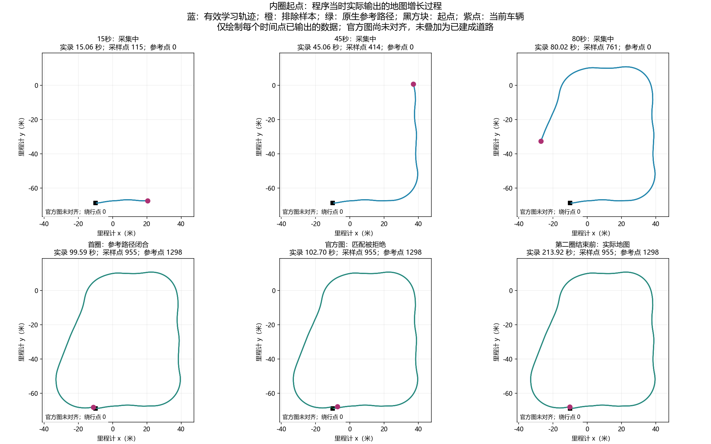
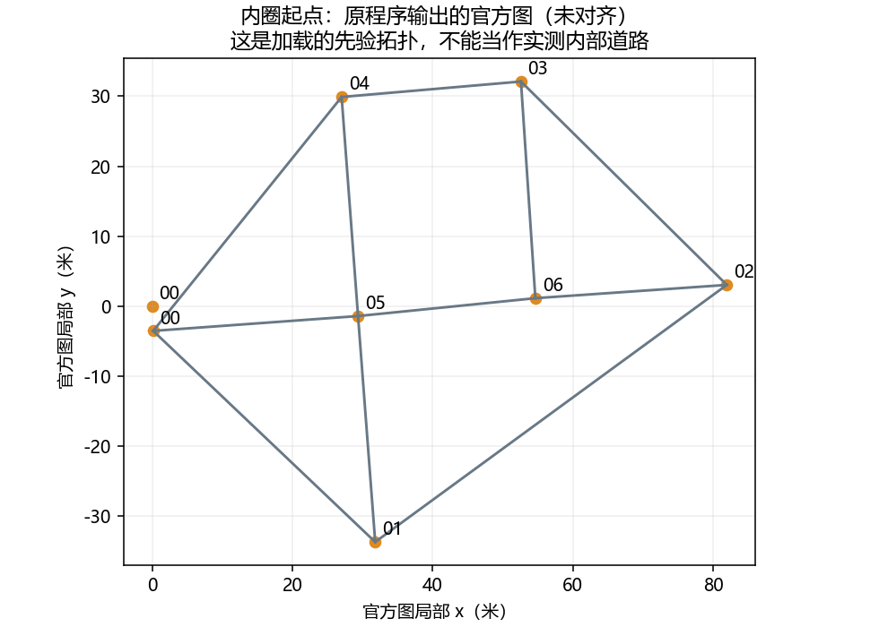
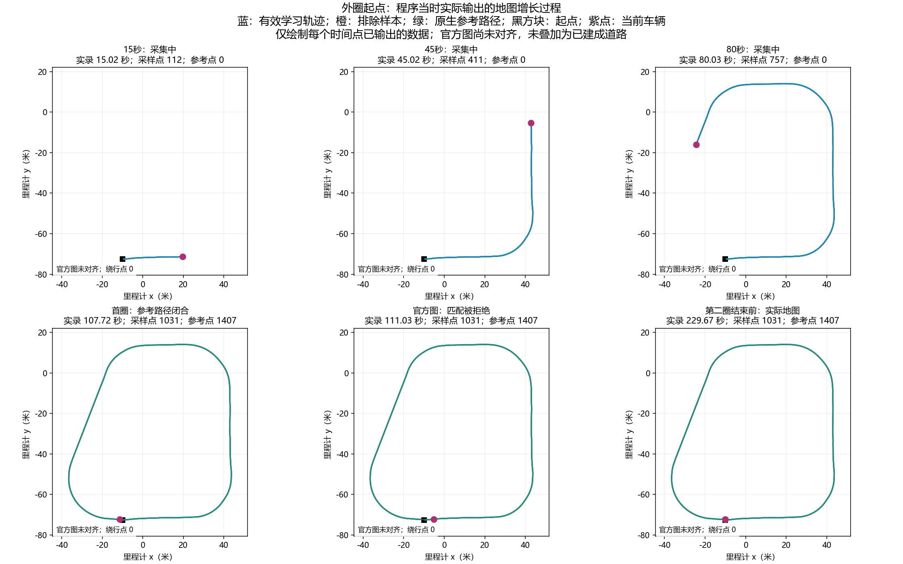
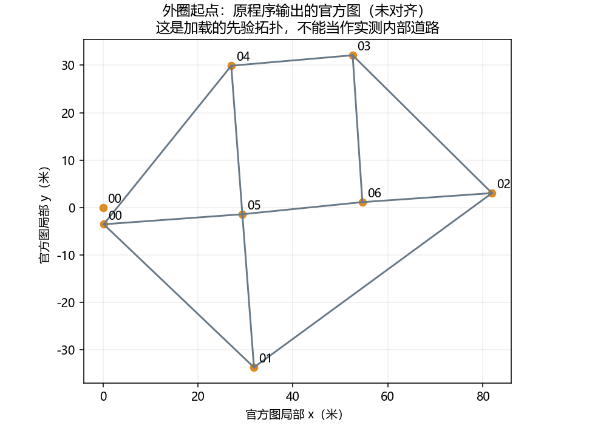

# 实际记录到了什么地图

这些图片直接来自两场实跑的原始 semantic 输出，没有重跑模型或地图匹配。每个时刻只画该时刻已经输出的数据。

程序确实边跑边记录**里程计轨迹地图**。但官方路口的可靠对位，以及内部道路的实测建图，是后续不同步骤。当前记录能证明轨迹逐步增长，不能证明内部路网已建成。

## 内圈实际建图过程

| 阶段 | 仿真秒 | 学习点数 | 参考点数 | 映射官方节点 | 绕行点数 |
| --- | ---: | ---: | ---: | ---: | ---: |
| 15秒：采集中 | 15.06 | 115 | 0 | 0 | 0 |
| 45秒：采集中 | 45.06 | 414 | 0 | 0 | 0 |
| 80秒：采集中 | 80.02 | 761 | 0 | 0 | 0 |
| 首圈：参考路径闭合 | 99.59 | 955 | 1298 | 0 | 0 |
| 官方图：匹配被拒绝 | 102.70 | 955 | 1298 | 0 | 0 |
| 第二圈结束前：实际地图 | 213.92 | 955 | 1298 | 0 | 0 |

## 外圈实际建图过程

| 阶段 | 仿真秒 | 学习点数 | 参考点数 | 映射官方节点 | 绕行点数 |
| --- | ---: | ---: | ---: | ---: | ---: |
| 15秒：采集中 | 15.02 | 112 | 0 | 0 | 0 |
| 45秒：采集中 | 45.02 | 411 | 0 | 0 | 0 |
| 80秒：采集中 | 80.03 | 757 | 0 | 0 | 0 |
| 首圈：参考路径闭合 | 107.72 | 1031 | 1407 | 0 | 0 |
| 官方图：匹配被拒绝 | 111.03 | 1031 | 1407 | 0 | 0 |
| 第二圈结束前：实际地图 | 229.67 | 1031 | 1407 | 0 | 0 |

## 如何理解

第一圈蓝色轨迹随车辆行驶逐步增长，回到起点后生成绿色闭合参考线。这就是已经记录到的“边跑边建”的部分。地图坐标为里程计坐标，显示朝向可能与Unity俯视图不同。

首圈闭合后，两场的学习样本数组与第二圈末帧完全相同：当前代码没有继续扩展学习样本。第二圈在已有参考线定位，车辆标记会动，但学习轨迹不再增长。

官方拓扑一直标记未对齐，两场映射官方节点数和绕行点数均为0。独立的官方图图片是程序加载并输出的先验图，不是车辆已经测得的内部道路。

## 原始输出

每场目录内有六个完整原始JSON行，对应六张阶段图。`实际建图统计与来源.json`保留日志路径、行号和哈希。原始输出保留了全部学习点、参考线、可信标记、官方节点与边、控制量及状态。前次中文日志/视频证据包仍保留。
