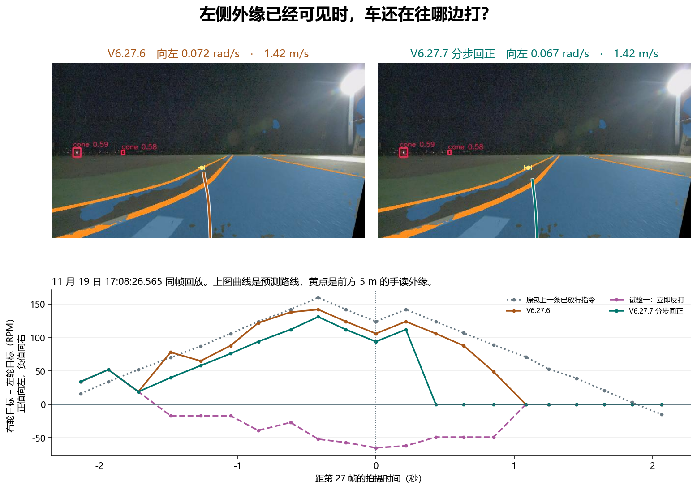
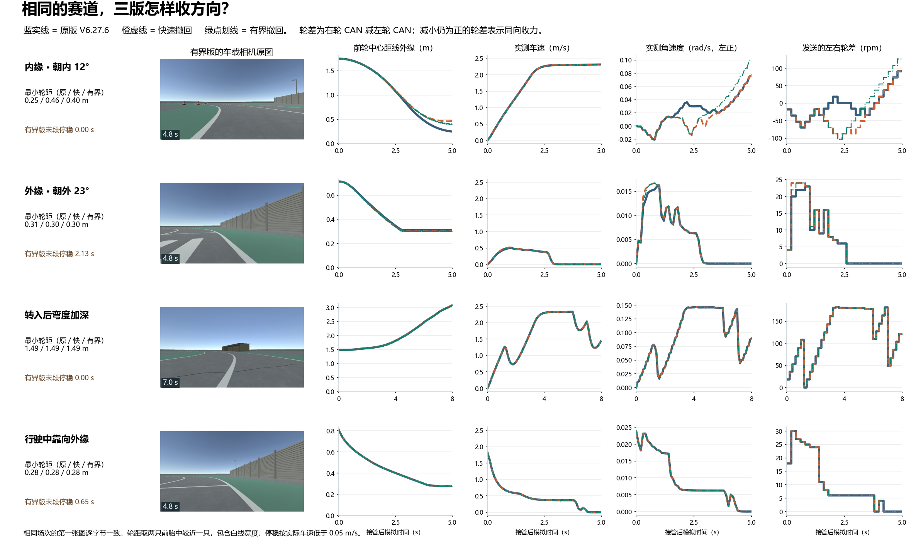
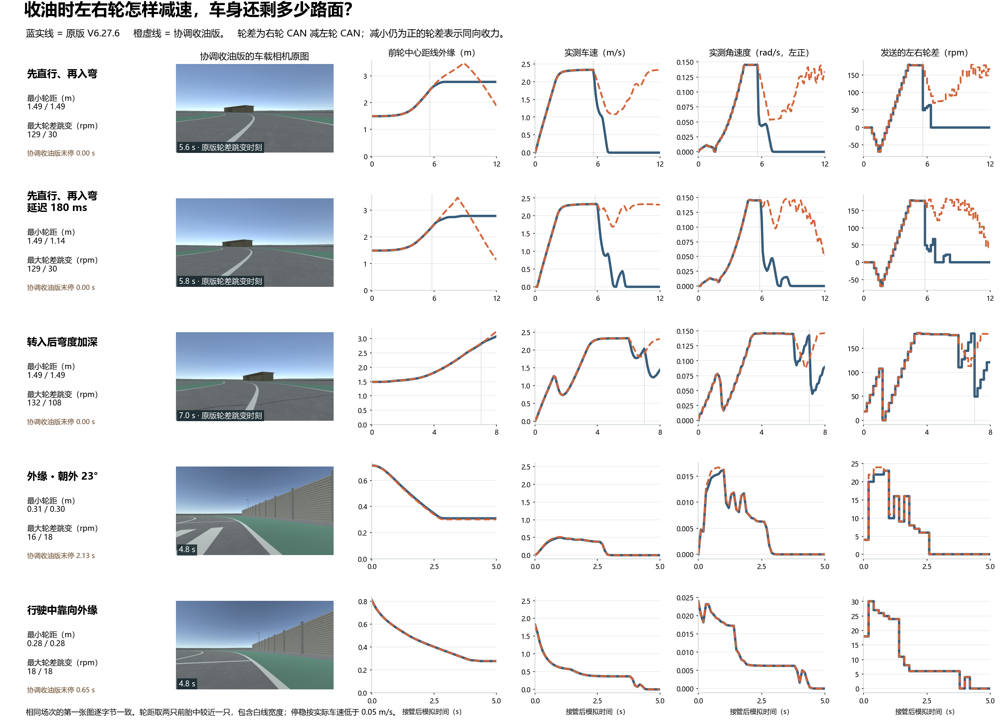
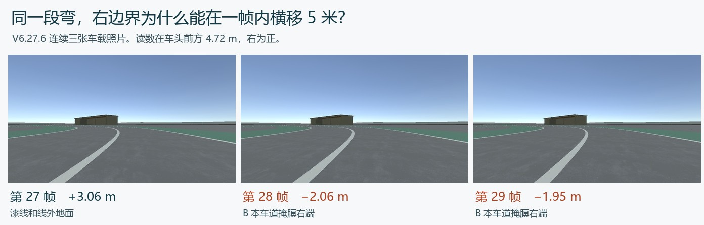

# V6.27.7 外缘、转向与延迟实验

11 月 19 日 17:08:26.565，前方约 5 米处的左侧外缘已经进入相机画面，车上当时选的路线还朝外。产生第一条向右修正指令所用的图像拍于 17:08:28.415，两张图之间过了 **1.85 秒**，按轮速积分约走了 **4.21 米**。后一张图到自动驾驶发出指令又用了约 **265 毫秒**，到控制门放行合计约 **286 毫秒**，这段又走了约 **0.64 米**。原车最终只放行向右约 0.20 秒，期间陀螺记录的净转角约 0.003 rad。前视图看不到轮胎与边线的接触点，所以这里以照片、目标轮速和陀螺分别说明。

## 看见线之后，哪一步晚了

1. 旧策略会检查候选路线是否可走。即使相机已经认出柏油结束的位置，车眼下的朝向和已施加的差速仍可能把车头继续带向外侧。仅在靠得更近时收油，留给电机和车身回正的距离会变短。
2. 试验版同时读该侧白线、线外地面、实际轮速、陀螺和上一条已放行的指令。它沿相机确实看到的那段外缘往前算，计入已测得的 0.525 秒车身转向响应时间常数，以及回收上一次转向所需的时间。若预计轮子会用掉转弯空间，就提前收回向外的轮速差。0.5 米是预留回正的空间；裁判仍允许压线，一侧轮胎完全越界才判负。
3. 路面两边都是柏油的车道分隔线仍可跨。若本帧外缘拟合中断，只在当前还有至少 5 个相符的线外地面观测、跨度至少 1 米时，允许沿用上一帧一次。运行时的判断明细随帧记录在 `field_road.edge_preview`。
4. 试过立即反打，也试过从电机上一条真实指令分步回正。第 25 帧原车上一拍的右减左轮速差是 +160 RPM。V6.27.6 要求 +142，立即反打要求 −52，分步版要求 +131。后两种一拍分别变了 212 与 29 RPM。H12 排序权重沿用原版，这次改的是它能选择的轨迹及其轮速。



图上是 11 月 19 日原车保存的识别叠图。黄点是人工在这一张照片上读出的左外缘及读数误差，细曲线是各版本计算的所选路线。下图每一拍都给三个版本喂入同一条历史电机指令，方便判断“给这辆仍在向左的车，下一拍会发什么”。所以即使在撤回左转，下拍仍会看到原车当时的左打输入。真正换上新版后方向能否接着回正，要看闭环测试。

## 两段实车录像重放

| 场景 | V6.27.6 | 立即反打 | 分步回正 |
|---|---:|---:|---:|
| 17:06，503 帧，前进 / 停车 / 倒车 | 306 / 195 / 2 | 306 / 195 / 2 | 306 / 195 / 2 |
| 其中近桶，71 帧，前进 / 停车 / 倒车 | 2 / 67 / 2 | 2 / 67 / 2 | 2 / 67 / 2 |
| 17:08，106 帧，前进 / 停车 | 73 / 33 | 73 / 33 | 70 / 36 |

从同一实车姿态开始，让后续运动和轮速由新指令决定，也测试了两个最困难的起点。第 24 帧起步，在 6 秒的局部车辆模型中，立即反打版和分步版的最大单拍差速变化分别为 208 和 40 RPM，首次向内的前进指令相差 0.8 秒。两者分别只前进 2.13 和 1.96 米，均有 4.15 秒停稳。第 30 帧起步分别前进 1.96 和 1.93 米，后者停稳 2.50 秒。两次都未达到持续恢复行驶的标准。

记录包含从 640×360 JPEG 分离出的近似颜色、B 道路和标线，归档的上游道路与障碍物观测，以及原车的轮速、陀螺和控制门输入。 [关键帧的左右轮目标](critical-170817.csv) · [全部 609 帧](field-609.csv) · [场景统计](field-comparison.json)

## 哪些计算变快了

B1.4 仍用同一套权重和输入分辨率。RTX 4070 Ti 上，将分割头的两类慢卷积交给另一套 FP32 CUDA 实现。12 张实车原图、5 张移动桶样本、100 张 Unity 图像的 **53,913,600 个二值判断与 11,521 个检测输出**全部一致。只改 GPU 实现、固定驾驶策略时，100 张连贯 Unity 输入的路界、候选和控制结果也逐帧一致。PyTorch 峰值已分配显存从约 2,850 MiB 降至 184 MiB。车载 Orin 默认保留原先验证过的实现，可单独做两种设置的车端对照。[原始数据和复测命令](../../src/concept_yolop/bench/fusion.md)

查找线外地面时，重复的像素计数被一次区域求和替代。同一组地面规则从 Python 编译成原生代码。两包共 611 张图，在固定运动输入下，路界结果、来源和余量逐项相同。17:06 的路界计算中位从 16.92 降到 13.03 毫秒，95% 分位从 28.91 降到 18.86 毫秒；17:08 从 15.98 / 21.01 降到 12.03 / 15.57 毫秒。[路界逐包统计](field-speed.json)

## 同一张起步照片，Unity 接着怎么走

三种策略各跑九个短场。首帧相机图逐组比对完全相同，后续图像由车辆实际运动产生。目标速度均为 2 m/s。移动起步先用直轮行驶 1 秒，接管时速度为 1.82 m/s。延迟场让上条 CAN 指令继续生效 180 毫秒，再接入新指令。裁判独立按照 Unity 的实际白线和前轮计算距离。下表“末段停稳”按车身实际速度低于 0.05 m/s 计算。

| 场景 | V6.27.6 进度 | 分步版进度 | 分步版末段停稳 | 现象 |
|---|---:|---:|---:|---|
| 沿外车道切线起步，5 秒 | 9.07 m | 9.07 m | 0 | 两版指令相同 |
| 外缘朝外 12°，5 秒 | 8.59 m | 8.59 m | 0 | 最近前轮中心距线外缘 0.521 m |
| 内缘朝内 12°，5 秒 | 10.62 m | 10.61 m | 0 | 最近余量 0.249 → 0.398 m；立即反打版 0.462 m |
| 外缘朝外 23°，5 秒 | 0.99 m | 1.01 m | 2.13 s | 未能持续驶离外缘 |
| 先直行再入弯，12 秒 | 11.93 m | 11.93 m | 5.02 s | 靠近弯道后停车 |
| 弯度加深，8 秒 | 13.05 m | 13.05 m | 0 | 能继续走，收油时仍有一次大的轮速差变化 |
| 先直行再入弯，延迟 180 ms | 12.73 m | 12.73 m | 3.32 s | 延迟改变了刹车点，最后仍停 |
| 朝外 23°，延迟 180 ms | 1.02 m | 1.02 m | 1.96 s | 停车 |
| 以 1.82 m/s 朝外缘移动时接管，5 秒 | 2.19 m | 2.19 m | 0.65 s | 最后车头仍朝外，未恢复 |



在大角度朝外时，能通过白盒检查的方案最后只剩约 0.05 m/s 的极慢前进。另一个入弯停车场里，H12 先选了停。停稳以后，有一帧仍有 60 个可前进选项，但画面里一个置信度 0.188 的小框无法定位，起步检查继续拦住了车。没有足够证据把这个小框认作真实交通锥。上述三版均保留这一停车行为。[完整九场图](bounded-three-full.png) · [27 场裁判与逐帧轮速](bounded-three-scores.json) · [逐帧选择](bounded-three-decisions.json)

## 收油为什么会引起大幅转向变化

在 12 秒的入弯场，第 27 至 28 帧，车身实速 2.33 m/s。H12 从第 19 条路线换到第 1 条，目标速度从 2.0 降到 0.5 m/s。两个目标都还在左转。旧计算先限制方向每拍能变多少，再根据新油门缩小允许的轮速差，第二步直接截掉了第一步保留的转向。右 / 左轮目标从 316 / 138 变为 103 / 54 RPM，差速一拍少了 129 RPM。陀螺在下一帧从向左 0.145 降至 0.046 rad/s。这能解释接近边缘时车头还来不及转回去的部分现象。

第三次试验让每条候选同时计算两只轮子怎样减速，并用实际会发出的指令预测路径。复放同一帧时，下一拍得到约 1.62 m/s、右 / 左轮 269 / 109 RPM，差速减少 18 RPM。紧急停车仍直接向两只轮子发零。这个试验还允许一类特殊路线：多开 0.2 秒，然后需要及时刹车。下图专门标记这个版本，便于核查这一做法能换来多少性能。



在固定 5 Hz 的 Unity 闭环中，普通入弯前进距离由 11.93 增至 22.34 米，最后停稳的 5.02 秒降到零，最大单拍轮差变化从 129 降到 30 RPM。固定 180 毫秒执行滞后时，从 12.73 增至 25.31 米，结束时仍以 2.31 m/s 靠近外缘。弯度加深场还有一拍变化 108 RPM，当时 75 条路线全部被排除，发出的是全刹。朝外 23° 和行驶中接管两场仍会停车。[第三次试验的九组实测](coordinated-measures.csv) · [同版两段实车录像回放](trial3-field-comparison.json)

实际车端的指令包含速度和拍摄时间戳。若下一条驾驶指令没到、手柄和 CAN 心跳正常，控制门可以在 0.2 秒后继续放行上一条。单次软件断帧实验中，到 0.48 秒仍在放行、0.52 秒已清零。这就是固定频率的 Unity 实验中允许的 0.2 秒刹车路线与现行车端的差距。

## 用车端实际允许的指令重测

`fdeb2a3` 保留每条路线的收油和转向联算，排除仅靠 0.2 秒后一定刹车才安全的新方案。把路拓宽到确实允许行驶时，连续两秒后再制动的方案仍能入选，保存的轮速、路径与评分也通过了独立重算。

在真实录像第 25、27 帧，上一条电机轮差 +160 和 +124 RPM，分别撤到了 +131 和 +94。第 29 帧全刹，第 30 和 31 帧给出 0.765、0.585 m/s 的前进指令，第 32 帧全刹。17:06 的 503 个有效决策帧为 307 进 / 194 停 / 2 倒，近桶的 71 帧保持 2 进 / 67 停 / 2 倒。17:08 为 72 进 / 34 停。[车端规则两包回放](final-field-comparison.json) · [关键帧](final-critical-170817.csv)

按这个条件重新跑九组，普通入弯的 12 秒只前进 11.76 米，V6.27.6 为 11.93 米。第 28 帧电机从 316 / 138 RPM 直接全刹，余下候选已无法证明可以向前。固定 180 毫秒执行滞后时，这场前进 14.18 米，V6.27.6 为 12.73 米。把前一节的 22.34 / 25.31 米用于实车会高估效果。[车端规则九场实测](field-measures.csv) · [实际画面和轮速对比](v6276-field-default-focus.png)

在上图的停车点追查路界输入，发现另一处与延迟不同的问题。第 27 帧在前方 4.72 米看到右外缘，位于车右约 3.06 米；第 28 帧，仍有一路视觉结果看到约 3.18 米处的右外缘，另一条却把 **B 当前车道掩膜的末端**当成可走区域的右端，报在车左约 2.06 米。两路取较窄结果后，白盒丢掉了本来能看到的邻道。第 29 帧的这一端仍在车左约 1.95 米。这个问题需要用当前画面的连续柏油和标线验证，两边读数相差很大本身不足以放宽外缘。



九场中，`fdeb2a3` 发出的**前进**指令之间（含从零起步）最大轮差变化为 19 RPM。要求全停时，两轮立即清零，仍可有 178 或 182 RPM 的跳变。这个区别在视频中可以直接看两只电机和实际车速。[16 秒正常速度并排视频](field-fdeb2a3-comparison.mp4)

## 从发布一张图到收到该图的驾驶指令

RTX 4070 Ti、正式 Foxy 驾驶节点、相同的 60 张弯道序列，每张图按序号配对。计时从发布已解码图像到订阅端收到该帧的 `/concept/auto_cmd`；相机曝光、ZED 传图及电机响应另计。15 Hz 这一组加快了图片送入的节奏，只用来测能吃下多少帧。中位数指一半指令能在这个时间内收到，P95 指 95% 的时间。

| 输入 / 版本 | 收到指令 | 未对应到指令 | 中位 / P95 / 最慢（ms） | 平均实际输出 |
|---|---:|---:|---:|---:|
| 5 Hz，V6.27.6，重复两轮 | 60/60、60/60 | 0、0 | 134 / 170 / 195；129 / 171 / 186 | 5.00、5.00 Hz |
| 5 Hz，`fdeb2a3` | 60/60 | 0 | 120 / 163 / 238 | 4.95 Hz |
| 15 Hz，V6.27.6 | 31/60 | 29 | 170 / 219 / 260 | 7.40 Hz |
| 15 Hz，`fdeb2a3` | 43/60 | 17 | 128 / 164 / 170 | 10.67 Hz |

5 Hz 场的两帧超过 200 ms。15 Hz 场还有输入帧没有产生指令。保存的每条记录包含 ROS 相机回调、推理、驾驶节点用时和是否实际收到输出。[逐轮汇总和每帧记录](wall-clock/)

## 另一台机器如何接手

团队仓库的试验分支是 `experiment/concept-edge-latency-1120b`。11/20 备车记录的回退版本是 `5511be2`。从团队仓库建立独立工作区后，在仓库根目录执行下面的镜像构建命令。基础镜像为 semantic 共用的 `vehicle-semantic:1120`，B1.4 的 `.pth` 按原手册只读挂载。若要接入 Unity，给 compose 的 `driver.image` 指定本次试验的新标签，并另外指定记录目录。实车按 11/20 手册安装，先用 `check_overlay.py` 核对实际加载了哪套 Python 和原生模块。[Foxy/GPU 依赖和 Unity 启动](../unity1120/foxy/README.md) · [车端部署](../../AGENTS.md)

```sh
docker build --network none --build-arg BASE_IMAGE=vehicle-semantic:1120 \
  -f vehicle_concept/checks/unity1120/foxy/Dockerfile \
  -t aiformula-concept:foxy-gpu-v6277 vehicle_concept
```

真实时钟复测使用相同的 Unity `exchange.jsonl` 目录以及其中逐帧相机图，输入频率为 5 Hz。给基线镜像也挂载同一份计时脚本，使相机和 ROS 节点初始化后的 Python 回收行为与正式驾驶进程一致。每次起一个新容器，逐个序号核对拍摄时间戳和 ROS 指令。车端现场核对时，还需记录 ZED 原始拍摄时间戳、`/concept/auto_cmd`、控制门实际放行的指令，以及轮速与陀螺开始改变的时刻。

```sh
docker run --rm --network none --gpus all \
  -v "$WEIGHTS:/weights/B1.4.pth:ro" -v "$CLIP:/input:ro" -v "$RESULTS:/out" \
  -v "$PWD/vehicle_concept/checks/unity1120/foxy/wall_probe.py:/opt/concept/unity/wall_probe.py:ro" \
  aiformula-concept:foxy-gpu-v6277 python3 /opt/concept/unity/wall_probe.py \
  /input /out/wall-v6277.json --hz 5
```
