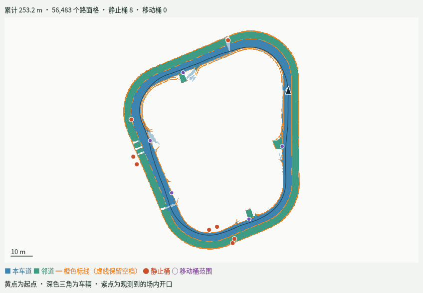

# V6.27.5 累计赛道地图验收



底部「累计赛道地图…」打开固定俯视窗口。蓝色是本车道，绿色是邻道，橙色标线按原有观测保留实线和虚线的形状。橙红点是跟踪器判为静止的桶，紫点是场内开口。深色线是轮速和陀螺仪估计的车迹。打开窗口、退出窗口和保存 PNG 均为只读操作。

## 整圈回放

以 Git 提交 `701b72b` 在两个独立 ROS 2 Foxy 工作区构建 12 个包，46 项 Python 测试通过。归档来自此前在 Unity 跑完的 81.14 秒内圈。新部署程序按原顺序接收 406 帧 B1.4 结果及对应轮速、陀螺仪，地图从空白开始。第 21 帧才打开地图，录完后关窗重开，核对最后时刻、车迹和格子与驾驶节点一致，再用面板导出上图。另一个局部回放有一只被确认的移动桶。

| 场次 | 图像 / 新指令 | 路面格 | 虚线格 | 判为静止的桶 | 已确认移动桶 | 开口 |
|---|---:|---:|---:|---:|---:|---:|
| Unity 内圈整圈 | 406 / 406 | 56,483 | 563 | 8 | 0 | 5 |
| 近距离移动桶 | 55 / 55 | 8,952 | 0 | 0 | 1 | 0 |

整圈的 253.2 m 是轮速累计距离。推算起终点相距 0.38 m。尚无回环位置校正。静止桶数来自跟踪结果，整圈里的运动桶未被判成移动。[整圈统计](inner-lap.json) · [移动桶地图](moving-cone.png) · [移动桶统计](moving-cone.json)

## 同时查看地图和录包

RTX 4070 Ti 工作站上，打开地图和录包，按真实时钟向部署版发布 60 秒、900 帧图像，使用 Unity 归档轮速和陀螺仪回放。观测到 899 帧识别和 796 条对应有效指令。任意一秒至少 10 条新指令，最长空窗 144.3 ms，拍摄到收到指令的 P95 为 184.5 ms。窗口收到了 44,395 个路面格，录包正常落盘。车载 Jetson 的时序与资源占用仍待实测。[工作站时序](timing.json)

## 停车条件

驾驶节点和门控都没有按圈数、时间或里程结束的条件。用门控状态机模拟 400 秒连续有效的手柄心跳、自动指令和 CAN 应答，持续通过非零命令，再施加软件急停，输出归零。正常情况下由操作者结束试验。无可行前进方案、输入超时、控制链异常和手柄接管仍可停止自动输出。

原始归档可用 [Foxy 和 Qt 回放检查](../lap_map_replay.py)复验。加载同一 ROS 环境，在隔离域运行如下命令。归档目录应包含 `decisions.jsonl` 和 `frames/`。

```bash
ROS_LOCALHOST_ONLY=1 ROS_DOMAIN_ID=85 xvfb-run -a python3 \
  vehicle_concept/checks/lap_map_replay.py /path/to/inner-lap /tmp/concept-lap-map-check
```
