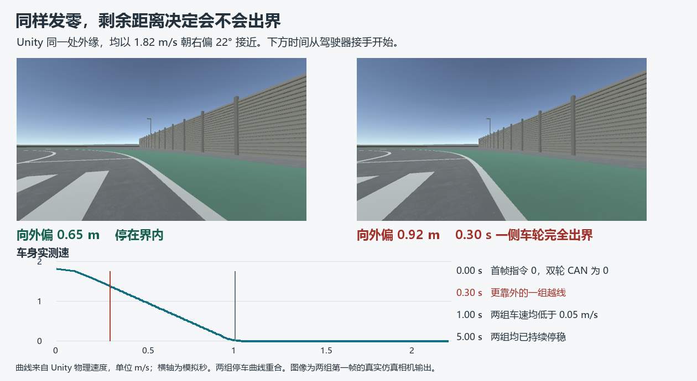

# 11 月 21 日离线驾驶实验

默认最低非零速度设为 **0.5 m/s** 后，车在直段从 0.5 起步，策略要求停车时双轮指令归零。两种跟踪器各跑五个相同初态。更靠外的一组第一帧就刹车，仍在 0.30 秒时越线。这一场判负。实际车速、刹停距离和机上耗时仍待实测。

## Unity 到底停没停

独立的 Concept Unity 2022.3.22f1 实例提供前视图、轮速、陀螺和已执行指令。B1.4 在 Foxy/CUDA 里处理每一帧。赛道真值只给裁判，压线允许，一侧轮胎完全出外界才判负。裁判观察到出界后继续跑满 5 秒，驾驶器仍需自己作决定。每个起点、每个控制器都有 25 组相机、决策、模拟双轮写入记录。

| 起点 | Pure Pursuit | LYA | 结果 |
|---|---|---|---|
| 直段正向，静止 | 前进 9.61 m | 前进 9.59 m | 首帧均为 0.50 m/s，25 帧持续有前进指令 |
| 向外偏 0.65 m、偏航 22°，已有 1.82 m/s | 25 帧均为零 | 25 帧均为零 | 沿赛道前进 0.91 m，1.00 s 时车速降至 0.05 m/s 以下，一侧车轮未完全出界 |
| 同速度同朝向，再向外移 0.27 m | 25 帧均为零 | 25 帧均为零 | 0.30 s 时一侧车轮完全出界，约 1.0 s 停稳。首帧剩余距离已不足 |
| 已出界，静止 | 25 帧均为零 | 25 帧均为零 | 五秒内持续静止 |
| 道内向外偏 0.80 m、偏航 23°，静止 | 原地 5 s | 原地 5 s | 未恢复。第一帧有 59 个可选前进槽位，H12 选了零。该场没有放桶 |

向外偏移以外车道中心为基准。表内距离是裁判测得的沿赛道进度。四组停车初态共 200 帧，均收到了有效的驾驶零指令，模拟器对应的左右电机字均为零。正常直段和滚动越界的两段指令另行经过实际 ROS 门控节点、原版电机换算节点及软件 CAN 接收器重放，各 25/25 帧一致，断流后均持续归零。门控重放重新打了采集时间戳，只检验门控和电机字。

## 指令怎样算

11 月 20 日的起步辅助可以在 H12 已选零后改选前进。本版移除了驾驶链上的这次覆盖。复用了 17:08:30 的停车评分样例，并在回归测试中提供可起步的路面证据；旧辅助会起步，新版保持零速及原始排名。决策日志同时记下 H12 的选择与当时有多少个可选的前进候选。

启动参数 `min_nonzero_speed_mps` 默认 0.5，设为 0 可关闭。两种控制器共用这个下限。生成前进候选时，先把微小的正请求提高到下限，再用这个速度检查车轮、障碍和刹停轨迹。零速继续进停车分支。如果硬性速度上限低于下限，则本帧只能放弃该前进请求。该参数约束车身目标线速度，转弯时左右轮仍可不同。

现有倒车响应只验证了 −0.2 m/s。默认 0.5 会排除主动倒车候选，避免把按 −0.2 验过的路径用 −0.5 执行。需要复现旧慢倒车时，可将下限设至 0.2 或以下；倒车还须通过车后可见范围、制动空间和带符号轮速反馈的检查。

选择 `tracking_controller:=lya` 后，每条候选从相机看到的道路上取 A、B、C 三点。A 是下一目标位置，A→B 给出目标朝向，AB 与 BC 的方向变化给出参考角速度。沿用 neo 的 LYA 公式计算线速度和角速度。`lya_v_t_mps` 是输入公式的参考速度，默认 2.0 m/s。上层仍能选择停车，白盒按速度上限、轮差和外缘检查实际会执行的动作，H12 继续在通过检查的候选中选线。

例如直段 LYA 第 4 帧，A 在车前 1.00 m、左侧 0.127 m，路线指向左侧 13.3°。LYA 算出 1.975 m/s、向左 0.437 rad/s。经过当前加速与轮差限制，实际发出 **1.10 m/s、向左 0.062 rad/s**。本场 25 帧中，8 帧由普通 LYA 候选控制，17 帧由外缘修正接手。逐帧记录保留控制来源、目标位姿、LYA 原始速度和最终指令。

## 提速有多少

比较对象为从 11 月 20 日收车归档还原的 `ae24d717`。固定同一段的 25 张 B1.4 输出、轮速和陀螺，预热一遍，再重放五遍，共 125 帧。白盒、局部地图与 H12 都计时；图像推理单独在下方墙钟测试中计入。

| 规划整步 | 收车版中位数 / P95 | 新版中位数 / P95 |
|---|---:|---:|
| Pure Pursuit，关闭新下限对照 | 54.64 / 69.80 ms | 45.19 / 53.78 ms |
| Pure Pursuit，使用默认下限 | 54.64 / 69.80 ms | 43.85 / 54.38 ms |
| LYA，使用默认下限与目标位姿算速 | 51.46 / 62.91 ms | 44.90 / 52.88 ms |

在移除旧起步覆盖前也调换过运行顺序，Pure Pursuit 关闭下限的中位数从 53.66 降到 44.56 ms，LYA 从 57.92 降到 56.41 ms，后者优势较小。最终版本在固定输入并关闭新下限时，Pure Pursuit 的道路、障碍、地图、候选、选择及指令摘要与收车版逐帧一致。默认下限与 LYA 新算速会主动改变选择。

耗时主要花在把车线和路面变为可走范围、预测车辆运动。同一张图拆给多个 Python 线程曾使中位数升至约 54 ms。当前实现只处理用得上的路面像素，共用同帧的图像计算，在没有桶检测时省去桶的颜色转换；同一目标位姿只计算一次相同的 LYA 请求。地图快照在短暂加锁后独立打包。识别与规划在两个进程里并行，依赖历史的路界和障碍更新按帧顺序执行。

## 相机持续送图时，实际收到多少条新指令

桌面 RTX 4070 Ti、ROS 2 Foxy、640×360、B1.4 CUDA。每组预热后按真实时钟送图 10 秒，驾驶节点设置 15 Hz。延迟从 ROS 图像发布到收到**同时间戳**的 `/concept/auto_cmd`。源图来自同一段 Unity，轮速和陀螺按 50 Hz 重放。这里测的是软件收发、推理和控制，未包含实体相机曝光、ZED 驱动或物理 CAN。先列开发时在同进程里试过的方案，其中的新版试验额外用了一个线程提前准备下一帧。最终采用的默认双进程见下表之后。

| 版本与控制器 | 输入 | 对上的指令 / 输入帧 | 实际输出 | 延迟中位数 / P95 | 最长相邻指令间隔 |
|---|---:|---:|---:|---:|---:|
| 收车版 Pure Pursuit | 15 Hz | 77 / 150 | 7.7 Hz | 298 / 361 ms | 192 ms |
| 新版 Pure Pursuit | 15 Hz | 80 / 150 | 8.0 Hz | 273 / 345 ms | 189 ms |
| 新版 LYA | 15 Hz | 79 / 150 | 7.9 Hz | 263 / 341 ms | 187 ms |
| 新版 Pure Pursuit | 8 Hz | 80 / 80 | 8.0 Hz | 100 / 164 ms | 203 ms |
| 新版 Pure Pursuit | 5 Hz | 50 / 50 | 5.0 Hz | 100 / 119 ms | 317 ms |
| 新版 LYA | 5 Hz | 50 / 50 | 5.0 Hz | 103 / 139 ms | 235 ms |

5 Hz 输入下，两种控制器均收齐 50 条指令；Pure Pursuit 有 49 条在 200 ms 内返回，LYA 有 50 条。15 Hz 输入下，新版分别有 70 和 71 张图没有对应的新指令。此时 Pure Pursuit 的图像推理中位数是 118 ms，驾驶步骤是 106 ms，新鲜识别结果等规划线程的中位数只有 0.16 ms。继续给候选轨迹加线程对这段等待的帮助有限。

### 车端默认的两个进程

按实际 launch 的默认接法再测了一轮。B1.4 独立运行，用与车端相同的 Fast DDS 配置向规划节点传递二进制识别结果。对同一段 150 帧输入单独切换提前算下一帧的线程：开启时 Pure Pursuit 收到 118 条指令，P95 为 240 ms；关闭后两次分别收到 132 和 130 条，P95 为 208 和 214 ms。最终删除了这条额外线程。下表是最终源码的结果，场景和计时起止点与上表一致。

| 版本与控制器 | 输入 | 对上的指令 / 输入帧 | 实际输出 | 延迟中位数 / P95 | 最长相邻指令间隔 |
|---|---:|---:|---:|---:|---:|
| 收车版 Pure Pursuit | 15 Hz | 121 / 150 | 12.1 Hz | 155 / 231 ms | 170 ms |
| 新版 Pure Pursuit | 15 Hz | 129 / 150 | 12.9 Hz | 134 / 202 ms | 165 ms |
| 新版 LYA | 15 Hz | 129 / 150 | 12.9 Hz | 143 / 202 ms | 152 ms |
| 新版 Pure Pursuit | 5 Hz | 50 / 50 | 5.0 Hz | 111 / 148 ms | 315 ms |
| 新版 LYA | 5 Hz | 50 / 50 | 5.0 Hz | 114 / 141 ms | 255 ms |

15 Hz 输入下，新版 Pure Pursuit 每 150 张图产出 129 条指令，收车版为 121 条。新版 Pure Pursuit 和 LYA 分别有 21 和 21 张图没有对应指令。5 Hz 输入下，两者在 200 ms 内返回 49/50 和 50/50 条指令。最长间隔见上表。这些是桌面十秒短测。[逐场数据、输入指令配对及分段延迟](measurements.json)

## 复现

1. 在本分支的 [Unity/Foxy 说明](../unity1120/foxy/README.md) 所述镜像中准备 B1.4 权重。统计脚本 [field_speed_replay.py](../field_speed_replay.py) 使用 `--prepare` 生成固定输入；同一份输入分别用于收车版 `--baseline` 与新版 `--minimum 0`、`--minimum .5`。
2. 用 [Unity 启动脚本](../unity1120/host/run.py) 对两种控制器分别指定 `--start .87 --seconds 5 --observe-boundary`，按上表设置 `--offset` 和 `--heading`，滚动两组加 `--rolling-start`。从 `exchange.jsonl` 对照驾驶器回包和每帧双轮写入，从 `result.json` 对照裁判时间与车身速度。
3. 在隔离容器中运行 [wall_replay.py](../unity1120/foxy/wall_replay.py)，依次传入 Unity 场次目录、输出 JSON、`--mode lya` 或 `--mode pure_pursuit`、`--hz 5`、`8` 或 `15`。加 `--split` 复现车端默认双进程。权重挂载到 `/weights/B1.4.pth`。门控另用 [replay_gate.sh](../unity1120/replay_gate.sh) 核对。

驾驶、路面、障碍、候选、可行性、排序与门控共 134 项测试通过，启动控制器选择的 6 项测试也通过。实际创建 Foxy 驾驶节点并重置后，指定的最低非零速度 0.4 和 LYA 参考速度 1.7 均正确保留。以上为桌面短测，尚未进行实车、整圈或障碍赛验收。
