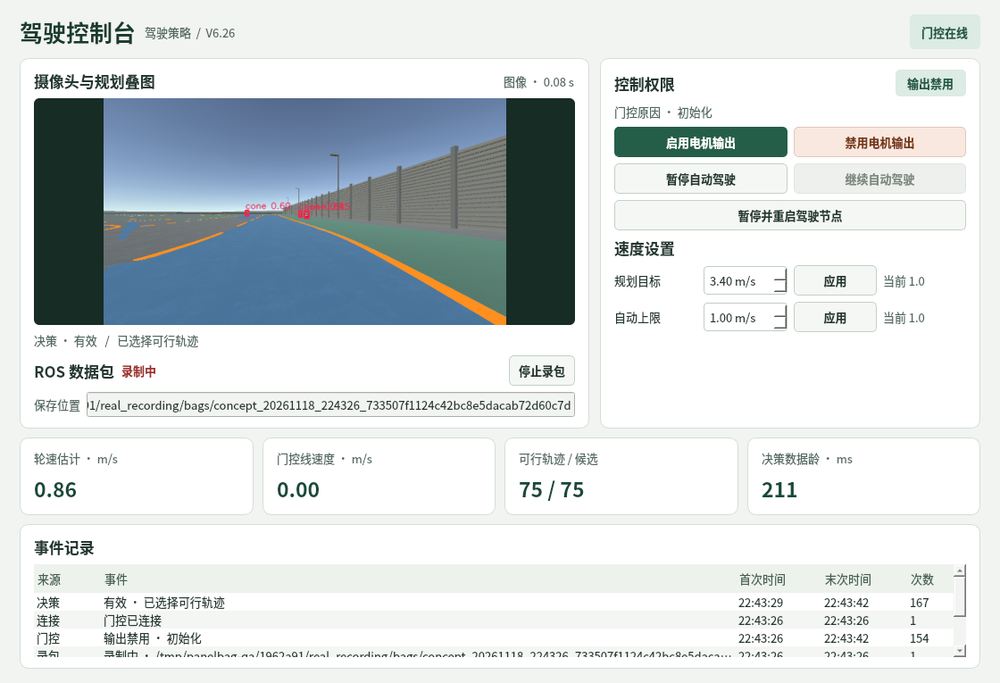

# V6.27.3 驾驶面板录包验收

包含 JPEG 识别画面的版本见 [V6.27.4 图像录包验收](overlay-v6.27.4.md)。

测试的源码提交为 `1962a91137676c9a7c16ce030f7ebe22abd3786f`。从 Git 归档分别在两个独立的 Ubuntu 20.04 / ROS 2 Foxy 工作区构建，12 个包均通过安装路径检查。使用 Foxy rosbag2 0.3.11、SQLite 和 Qt5。所有测试在软件回放或隔离的 ROS 域运行，电机输出禁用。



图中是本次工作站回放正在录制的窗口。相机叠图继续实时显示。下方的「ROS 数据包」按钮只控制录制，右侧的电机和驾驶操作可独立使用。

## 面板能否连续录两次

测试在独立 ROS 域里同时发布 10 个应录话题、原图、含图像的感知消息、显示图层和模拟的最终 CAN 话题。在 Qt 窗口点「开始录包」和「停止录包」，再开始第二袋，直接关窗。两次各录到 150 条消息，10 个预期话题各 15 条。第一袋显示的条数与磁盘一致。第二袋在关窗后生成完整元数据。分别用 `ros2 bag info`、SQLite 完整性快速检查和逐条解码复核，两袋选中的候选编号分别为 17 和 49。

测试在录制期间观察 DDS 订阅数。显示叠图始终只有窗口本身的一个订阅者，录包没有增加订阅。原相机、含图像的感知消息、RViz 标记和两条最终 CAN 线均为零订阅。关闭后录包进程余数为零。[两次录包的状态、条数及订阅实测](two-sessions.json)

全套 Python 测试通过 43 项，其中一项模拟缓慢写盘。在录包仍启动时发送 Ctrl+C，打开数据库后再次发送 Ctrl+C，写盘 5.1 秒时再发送 SIGTERM。模拟写盘共耗时 6.5 秒，面板成功等到数据库校验结束。进程异常退出、磁盘文件与元数据不匹配、零消息等情形另有测试。[慢盘测试](../../src/concept_panel/test/test_recording_shutdown.py) · [录包生命周期测试](../../src/concept_panel/test/test_recorder.py)

## 实际显示画面和运行规划时，录包占多少资源

在 RTX 4070 Ti 工作站上，按真实时钟回放 60 秒外圈障碍图像。300 张不同的 Unity 归档图各发送三次，B1.4 完成 900 次识别。使用固定轮速反馈和零陀螺输入，启动部署版规划、门控、可视化和 Qt 面板，点击开始与停止。录包额外包含发图前后的车况，所以整袋跨度为 64.70 秒。

| 实测项目 | 结果 |
|---|---|
| 录包进程峰值常驻内存 | 50.0 MiB，读取录制进程的 Linux VmHWM。仅计录包进程，未计 GPU、规划器或 Qt 窗口。 |
| 文件和条数 | SQLite 83.9 MiB，共 14,922 条消息。回放期间没人动手柄，也未触发软件急停，两项各为 0 条。 |
| 决策能否完整复盘 | 独立接收端收到 663 条决策与 663 条对应的自动指令。按采集时间戳逐条对照，袋内全部找得到，也没有额外条目。每条决策保留了 75 个候选。 |
| 录制时出指令的节奏 | 任意连续一秒最少 8 条新指令，最长间隔 199.9 ms。拍到图至收到指令的中位为 159.5 ms，P95 为 210.2 ms。900 张输入图中有 237 张没有产生独立新指令。 |

完整决策在这段回放中每条约 84–162 kB，包含候选轨迹、评分和局部地图数据。按本段写入速度，10 分钟约用 0.82 GB 磁盘；现场耗量会随决策频率和场景变化。工作站只测了这段时长，慢盘上使用 best-effort 订阅仍可能漏消息。[回放逐话题条数、内存与时钟数据](outer-replay.json)

## 如何复测

在开发机加载 Foxy、neo 底层和本版工作区后，运行下面的命令。在 `--domain` 选择空闲域。脚本通过 Xvfb 启动真实 Qt 窗口；开发机需有 Xvfb、xauth 及 PyQt5 的 QtTest。验收目录保留两份 SQLite bag、界面状态、订阅统计和命令行读回结果。

```bash
python3 "$REPO/vehicle_concept/checks/panel_bag_smoke.py" --domain 89 --output /tmp/concept-panel-qa
```

带图像负载的复测可沿用[工作站真实时钟回放](../timing/v6.27.2/README.md)的外圈输入和 `realtime_meter.py`，打开面板，将袋写入有空间的本地磁盘，开始录制后再发图。停止后的 `/concept/decision` 与 `/concept/auto_cmd` 可用采集时间戳同独立接收端逐条核对。车载 Jetson 的录包进程内存、磁盘和控制时序仍需使用实机测量。
