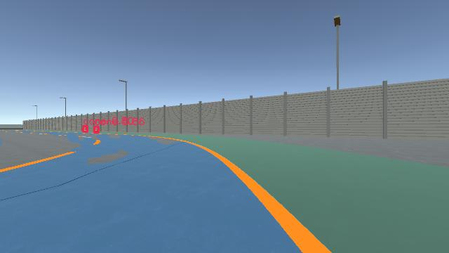

# V6.27.4 驾驶面板与图像录包验收

面板左侧显示规划器当前的动作、原因、请求速度、转向和候选编号。电机状态单独显示在色块右上角。截图里规划选择前进，门控仍保持禁用，实际发送的速度指令为 0。右侧保留实时叠图、录包、控制和调速。

**自动驾驶限速**是自动速度指令的上限。目标速度为 3 m/s、限速为 1 m/s 时，规划按 1 m/s 计算，过弯或避障时可以更慢。一旦收到超过上限的自动指令，门控会暂停自动。修改限速后也要手动点「继续自动驾驶」。手柄控制使用自己的设置。

## 袋里是什么画面

`/concept/perception/overlay/compressed` 是现有 640×360 B1.4 识别叠图的 JPEG 版本。它保留道路、车线和障碍物标记，每次成功生成识别叠图时都可发布一张，和原有输出同频。只有订阅者存在时才进行压缩。选中轨迹和其余候选保存在同一 bag 的 `/concept/decision`，可以用采集时间戳配对。bag 的唯一图像格式是 `sensor_msgs/msg/CompressedImage`。

## 验收

从源码 `d5138e8462f8b7465b4cda9ee295220c2435df74` 的 Git 归档，在独立 Ubuntu 20.04 / ROS 2 Foxy 环境构建 12 个软件包。44 项测试通过。两个真实 Qt 录包会话分别通过点击停止和关窗结束，各保存 165 条消息，其中各有 15 张 JPEG 可解码。录制过程没有新增未压缩原图、感知帧、RViz 图层或最终 CAN 指令的 DDS 订阅。结束后没有残留录包进程。

最终提交 `4453e3a` 缩小了右栏和事件列表的间距。18 项面板测试通过。在 1366×768 的显示环境中，窗口内容为 1120×765。上图来自该布局的独立 22 秒录包回放。

工作站负载使用 RTX 4070 Ti 和 60 秒 Unity 外圈障碍画面，按 15 Hz 输入 B1.4。面板处于录制中。以下数据来自 DB 逐帧解码、独立接收端的时间戳核对，以及另一隔离域的 `ros2 bag play --topics /concept/perception/overlay/compressed` 实测。

| 项目 | 结果 |
|---|---|
| JPEG 画面 | 收到 900 张识别叠图，录入 900 张，回放收到 900 张，逐帧时间戳一致。每张 JPEG 平均 15.5 kB。 |
| 决策与指令 | 658 条新决策与 658 条对应的自动指令全部录到。新指令在任意连续一秒内至少 8 条，最长间隔 184.5 ms。 |
| 磁盘与内存 | 整包 15,830 条消息，SQLite 97.5 MiB，其中 JPEG 内容约 14.0 MB。录包进程峰值常驻内存 49.7 MiB。 |

车载 Jetson 的实际内存、磁盘负载及指令时序仍需实测。[工作站统计](overlay-v6.27.4.json) · [部署与回放命令](../../AGENTS.md)
