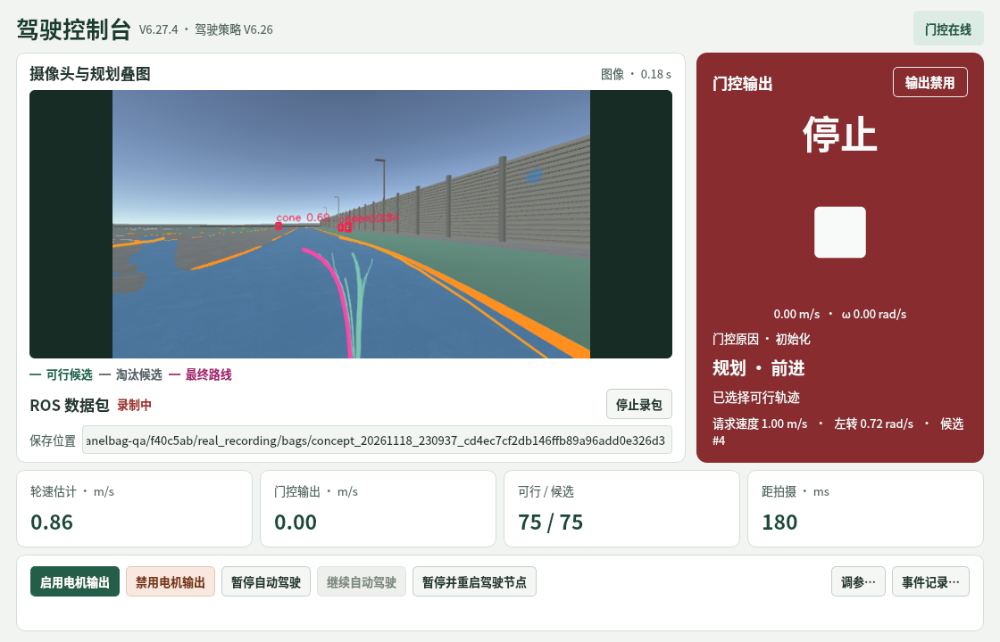
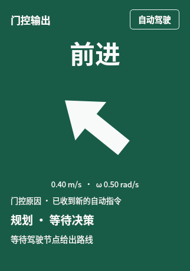
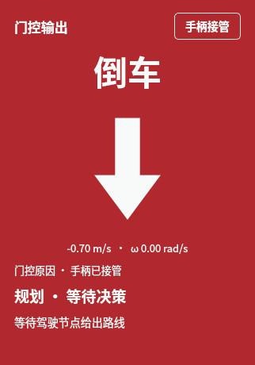
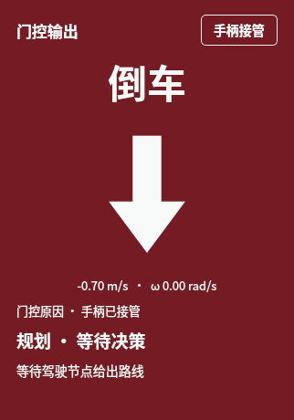
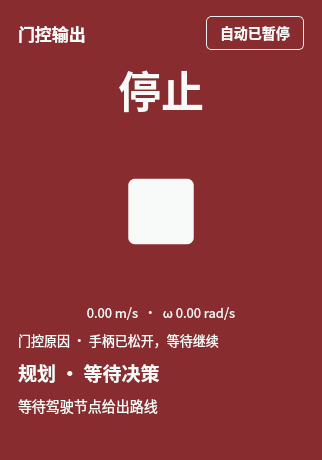

# V6.27.4 驾驶面板与图像录包验收

左侧是相机画面和录包。青绿细线表示可行候选，灰色细线表示被筛掉的候选，粉色粗线表示选中的路线。画面与规划结果按拍摄时间戳匹配。右侧先显示门控的最终输出，再显示规划器建议的动作，包括请求速度、转向和候选编号。控制按钮在底部，「调参…」和「事件记录…」分别打开小窗口。

前进显示绿色，停止显示红色方块，倒车显示向下箭头并交替闪动深红和亮红。前进箭头把角速度映射到从左 90° 到右 90°，对小角速度做放大。自动使用现有的 ±1.55 rad/s 规划范围，手柄使用底盘配置中的最大绝对转向请求。箭头表达软件最后发送的指令。原地转向用左右水平箭头。

| 自动左转前进 | 手柄接管倒车，两种红色交替 | 手柄松开后 |
|---|---|---|
|  |   |  |

上表由实际 Qt 面板接收 Foxy 软件门控状态时截取。自动给出 0.40 m/s、向左转 0.50 rad/s，箭头向左偏 51°。手柄接管时发出 −0.70 m/s，窗口显示向下箭头和两种红色。松开后软件门控发出零速度和零转向，窗口显示停止。[门控数值与角度](v6274-vector-evidence.json)

**自动驾驶限速**是自动速度指令的上限。目标速度为 3 m/s、限速为 1 m/s 时，规划按 1 m/s 计算，过弯或避障时可以更慢。一旦收到超过上限的自动指令，门控会暂停自动。修改限速后也要手动点「继续自动驾驶」。手柄控制使用自己的设置。

## 袋里是什么画面

`/concept/perception/overlay/compressed` 是现有 640×360 B1.4 识别叠图的 JPEG 版本。它保留道路、车线和障碍物标记，每次成功生成识别叠图时都可发布一张，和原有输出同频。只有订阅者存在时才进行压缩。选中轨迹和其余候选保存在同一 bag 的 `/concept/decision`，可以用采集时间戳配对。bag 的唯一图像格式是 `sensor_msgs/msg/CompressedImage`。

## 验收

从源码 `f40c5ab` 的 Git 归档，在独立 Ubuntu 20.04 / ROS 2 Foxy 环境构建 12 个软件包，46 项测试通过。两个真实 Qt 录包会话分别通过点击停止和关窗结束，各保存 165 条消息，其中各有 15 张 JPEG 可解码。计数与数据库一致。录包进程未订阅未压缩画面、含图像的感知消息、RViz 图层及最终 CAN 话题。退出后录包进程已清理。

进一步放大小角速度的面板版本 `2bf9458` 通过 19 项面板测试和上表中的软件门控复验。主窗口截图为 1120×720。

工作站负载使用 RTX 4070 Ti 和 60 秒 Unity 外圈障碍画面，按 15 Hz 输入 B1.4。面板处于录制中。以下数据来自 DB 逐帧解码、独立接收端的时间戳核对，以及另一隔离域的 `ros2 bag play --topics /concept/perception/overlay/compressed` 实测。

| 项目 | 结果 |
|---|---|
| JPEG 画面 | 收到 900 张识别叠图，录入 900 张，回放收到 900 张，逐帧时间戳一致。每张 JPEG 平均 15.5 kB。 |
| 决策与指令 | 665 条新决策与 665 条对应的自动指令全部录到。新指令在任意连续一秒内至少 8 条，最长间隔 163.2 ms。 |
| 磁盘与内存 | 整包 15,850 条消息，SQLite 96.8 MiB，其中 JPEG 内容约 14.0 MB。录包进程峰值常驻内存 49.5 MiB。 |

车载 Jetson 的实际内存、磁盘负载及指令时序仍需实测。[工作站统计](overlay-v6.27.4.json) · [部署与回放命令](../../AGENTS.md)
