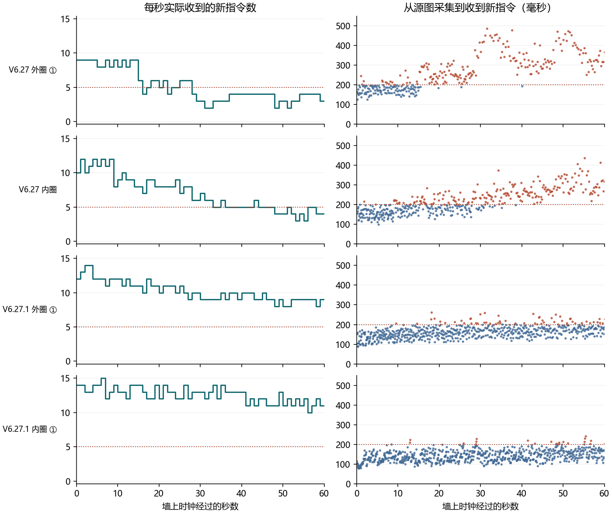

# V6.27.1 从相机采集到新控制指令

工作站用真实时钟发送 15 Hz 相机图像。驾驶程序用当前可用的最新感知帧规划，默认每秒最多请求 15 次。验收只统计软件接收端收到的、采集时间戳向前推进的新控制指令。新版外圈和内圈各跑两次 60 秒。V6.27 的测量提交是 `6e0a98c`，V6.27.1 是 `a8d7663`，两者按相同的 15 Hz 请求对照。

| 场次 | 感知 / 发图 | 新指令 / 其中有动作 | 平均 Hz | 任意连续一秒最少指令数 | 200 ms 空窗数 / 300 | 超 200 ms 间隔数 / 最长 ms | 采集到指令 中位 / P95 / 最大 ms | 采集到指令超 200 ms 条数 |
|---|---:|---:|---:|---:|---:|---:|---:|---:|
| V6.27 外圈 ① | 900 / 900 | 311 / 311 | 5.15 | 1 | 54 | 130 / 764.6 | 240 / 424 / 485 | 195 |
| V6.27 外圈 ② | 900 / 900 | 194 / 194 | 3.23 | 0 | 154 | 37 / 28858.9 | 212 / 318 / 501 | 110 |
| V6.27 内圈 | 899 / 900 | 418 / 417 | 6.93 | 3 | 12 | 78 / 373.9 | 198 / 320 / 436 | 202 |
| V6.27.1 外圈 ① | 897 / 900 | 614 / 412 | 10.20 | 8 | 0 | 0 / 181.9 | 161 / 210 / 261 | 56 |
| V6.27.1 外圈 ② | 900 / 900 | 623 / 458 | 10.35 | 7 | 0 | 0 / 187.8 | 162 / 208 / 251 | 61 |
| V6.27.1 内圈 ① | 898 / 900 | 757 / 757 | 12.58 | 10 | 0 | 0 / 163.7 | 137 / 189 / 241 | 20 |
| V6.27.1 内圈 ② | 899 / 900 | 761 / 761 | 12.67 | 10 | 0 | 0 / 153.8 | 140 / 189 / 245 | 19 |
| V6.27.1 外圈（双窗口） | 900 / 900 | 607 / 491 | 10.08 | 7 | 0 | 0 / 181.4 | 162 / 213 / 261 | 60 |

**验收结果。** 新版 5 场共 300 秒，1,500 个固定的 200 ms 接收窗口全部有新指令，任意连续一秒最少 7 条。最长间隔为 187.8 ms。五场 P95 采集到指令为 189–213 ms，最慢 261.4 ms。五场发出 4,500 张图，感知端实收 4,494 个结果，产生 3,362 条独立的新控制指令，216 条的源图年龄超过 200 ms。1,500 个接收窗中有 32 个仅收到源图年龄超过 200 ms 的新指令。双窗口场在 Xvfb 中开启实际 Qt 驾驶面板和 RViz，已确认 RViz 同时订阅相机、局部车身图和记忆地图。[逐场计数与图形界面订阅](../../realtime_v6271_gpu.json)

“有动作”指线速度或角速度有一项非零，原地转向也算。停车指令只要来自一次新的完整决策，就计入更新频率。平均 Hz 只计在这 60 秒内收到的指令。新指令总数还计入最后一张图发出后仍在途的响应。空窗、最长间隔及滑动一秒的最低计数均限于这 60 秒的接收时间。右侧三项分别说明车多久没收到更新、它多久才对相机所见作出反应，以及反应超过 200 ms 的频次。



左图红线为每秒 5 条，右图红线为每张源图 200 ms。颜色标出右图哪些新指令使用了超过 200 ms 的图像。图展示各场的一次运行，重复测量列在表中。[可重算的分场数字](service.json) · [V6.27 基线报告](../v6.27/README.md)

## 为什么现在更快

外圈压力测试曾在累计 13–15 个障碍物记忆后变慢。过去会为每条候选、未来每个时刻、每个障碍物反复计算碰撞概率。现在先计算障碍物运动预测，共享同一预测时刻的结果。对于风险阈值附近的情况，使用原有的双精度方法；只有误差上下界都落在阈值同一侧时才能提前确定判定。每条轨迹的车轮边界和停车余量仍要检查。

在相同输入下，75 个选项可能预测出完全相同的一段运动。只有所有计算用到的数值和时刻掩码逐比特一致，才把已算过的结果还给另一项。75 个选项都保留独立索引、可行标记和分数。四个最慢样本在独立白盒复测中，中位用时分别为 19.9、19.2、19.5、20.8 ms。另将车后路面记忆的像素投影合成了一次扫描，保留原始可见性、误差和清除顺序。

## 这批数据能验什么

- 工作站为 Ryzen 9 7900X、RTX 4070 Ti，ROS 2 Foxy。GPU 运行 B1.4；白盒和 H12 在 CPU 上运行。
- 每场使用 300 张连续、不同的 640×360 Unity 图。原录像记录为 5 Hz，每张以新采集时间重复三次。相机发送进程独立计时，B1.4 每次重新推理。速度目标为 1.0 m/s，输出端为隔离的 ROS 软件接收器。
- 外圈把两轮固定在 65 rpm、陀螺固定在零，用来测障碍物记忆累积时的计算开销。内圈使用与当帧图像匹配的轮速及陀螺，轮速按 CAN 字段量化。这两组回放的车不会随指令改变轨迹，不能用来判断完赛、避障成功率或电机响应。
- 同一代码用五组 1,079 帧逐帧核对。候选可行标记和选择一致，选中路径和控制的最大绝对差均为零。Foxy 构建 12 个包，28 项测试通过。[逐场回归](frozen-regression.json)
- 10 月 27 日实车 bag 的 120 张不同 BGRA8 原图另做感知链复验。工作站收到 120/120 份 B1.4 输出。这个试验走到识别结果；车载 Jetson 的拍摄到控制仍要用真车时钟复测。[实车图像的感知测速](../../../src/concept_yolop/bench/README.md)
- `ros2 run concept live` 使用 15 Hz 请求上限。车端禁用电机、确认 ZED 时间和主机对齐后，运行 `python3 "$REPO/vehicle_concept/checks/measure_timing.py" --seconds 60 --planning-hz 5 --vehicle-clock-confirmed`，按最低 5 Hz 的 200 ms 窗评估真实新指令。原 0.5 秒超时保护、手柄接管和松手后的人工恢复规则继续生效。[部署手册](../../../AGENTS.md) · [各指标定义](../../measure_timing.md)


## 在另一台电脑上复算

下载 [五场时间戳和控制记录](command-traces.zip)。解压到 `traces` 后，在安装了 Python 与 NumPy 的电脑上，从仓库根目录执行下列命令。把场次目录换为 `final15-2`、`innerfinal15-1`、`innerfinal15-2` 或 `visualfinal15` 可以复核其余四场。输出目录使用一个新目录。

```sh
python vehicle_concept/checks/realtime_analysis.py --rescore-from traces/final15-1 --out scored-outer-1 --decision-hz 5
```
