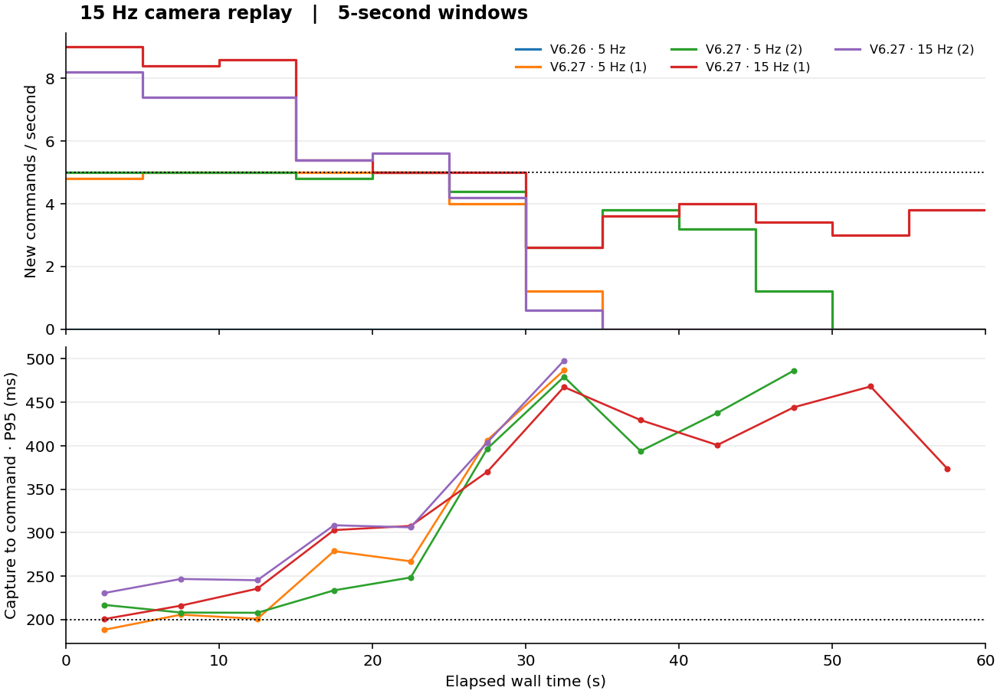

# V6.27 实时时钟测试

工作站为 RTX 4070 Ti、ROS 2 Foxy。V6.27 沿用 V6.26 的 B1.4、75 个候选、H12 权重和 0.5 秒保护。白盒现在整批计算每条路径的轮胎位置、电机响应和障碍物风险。第一版数值对照在五组记录中各取连续 12 帧，全部 60 帧的选择、可行判定、分数、完整候选路径和控制均与旧计算一致。部署复验见 [操作手册](../../../AGENTS.md)。

相机以真实时钟每秒发 15 张 640×360 BGR 原图。图像来自 5 Hz 的 Unity 外圈存档，60 秒使用连续 300 张图，每张发送三次，每次都重新跑 B1.4。60 秒压力测试的 CAN 输入为两轮恒定 65 rpm、陀螺为零。车看到弯道时，这组反馈仍报告车在直行，障碍物记忆的数量会增加。这里检验计算负载；圈速、转弯能力、物理相机到达延时需单独测。

每条控制都在独立订阅端实收，并与原图的采集时间戳对应。保留速度为零的有效停车决策，同时单列非零数。影子决策、重复发送和门控保持指令不计。每一场都重新启动进程。目标速度 1.0 m/s，电机端点为隔离的软件接收器。

| 版本和请求频率 | 感知 / 发图 | 新指令（非零） | 新指令 / 秒 | 采集后 200 ms 内 | 采集到指令 P50 / P95 / 最大 ms | 最长无新指令 |
|---|---:|---:|---:|---:|---:|---:|
| V6.26 · 5 Hz · 第一次 | 889 / 900 | 0 | 0 | 0 | 无样本 | 60 s |
| V6.26 · 5 Hz · 第二次 | 888 / 900 | 0 | 0 | 0 | 无样本 | 60 s |
| V6.27 · 5 Hz · 第一次 | 897 / 900 | 150（148） | 2.50 | 86 | 190 / 399 / 491 | 26.67 s |
| V6.27 · 5 Hz · 第二次 | 900 / 900 | 200（179） | 3.33 | 97 | 204 / 439 / 496 | 11.58 s |
| V6.27 · 15 Hz · 第一次 | 900 / 900 | 311（310） | 5.18 | 116 | 240 / 424 / 485 | 0.765 s |
| V6.27 · 15 Hz · 第二次 | 900 / 900 | 194（194） | 3.23 | 84 | 212 / 318 / 501 | 28.86 s |

图的横轴是实时时间。上图每五秒统计一次实际收到的新指令数并除以 5，下图只画该段收到指令时的延迟。启动阶段与末尾停顿都保留。60 秒汇总会等在途消息收完，再按源图是否属于本场计数。

5 Hz 档应有 300 个规划周期，另 600 张相机图是正常抽样余量。两次分别缺 150 和 100 个有新指令的周期。15 Hz 档应有 900 个周期，分别缺 589 和 706 个。固定周期的截止时间从本场第一张相机图预定的采集时刻起算；若用的是一个周期中的第二张图，已花去约 67 ms。完整记录另列这个截止时间与实际源图到指令的耗时。[逐轮 JSON 与分母定义](../../realtime_foxy_gpu.json)

5 Hz 第一次运行前 25 秒每五秒都出了 25 条，之后路段出现了 13–15 个障碍记忆，四次规划花了约 435–455 ms。下一张被处理的源图与上一次间隔超过 0.5 s，驾驶节点按现有规则锁停，需要操作员恢复。工作站已能在部分场景跑到约 5 Hz。两次重复的最慢段均未达到持续 5 Hz。实车 ZED 到 Jetson 控制指令的结果待车端实测。

复现使用同一真实时钟，明确关闭 `use_sim_time`，运行隔离回放，参数为 `device:=cuda planning_hz:=5.0` 或 `planning_hz:=15.0`。夹具准备和独立发送、接收程序见 [夹具脚本](../../prepare_realtime_fixture.py) 和 [测速脚本](../../realtime_meter.py)。实车的被动订阅用法见 [车端测速说明](../../measure_timing.md)。
