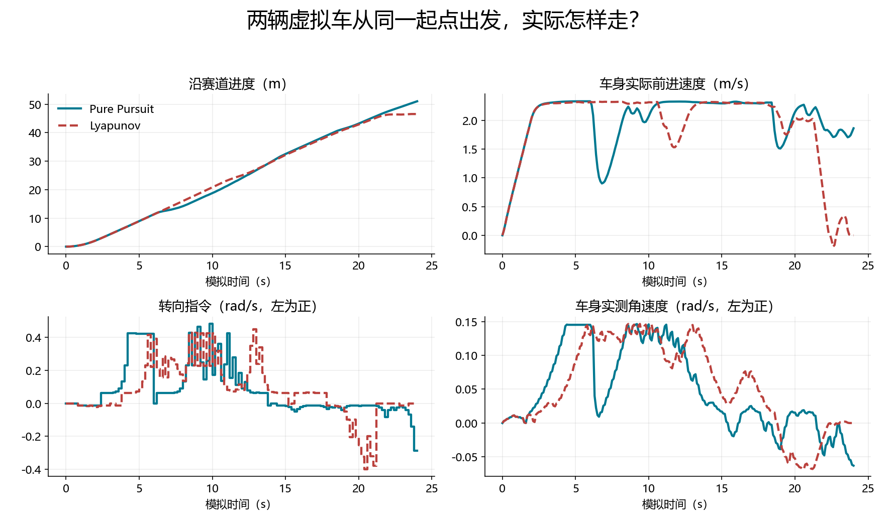
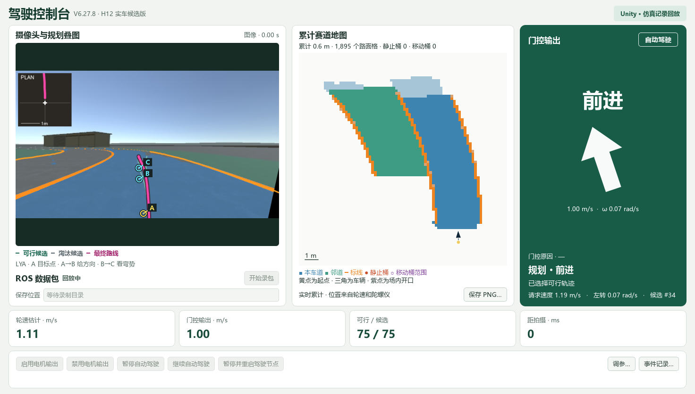

# V6.27.8 · 同一起点比较 Pure Pursuit 与 LYA

**本轮仍建议默认用 Pure Pursuit。** 在目标速度 2.0 m/s 的 24 秒 Unity 长弯里，两者都出了弯。Pure Pursuit 多走 4.47 米，结束时还在行驶。LYA 出弯后贴近外缘，短暂倒车、再起步，最后停稳。另一段更紧的弯里，两者都保持前进。四次都没有触发整侧轮胎完全出界。这次没有测整圈、障碍物场景或实车。[24 秒同步驾驶视频](long-bend.mp4) · [两场逐帧复核](replay-parity.json)

## 怎么切换

在已构建本实验分支的 Foxy 工作区里运行 `ros2 run concept live`，终端选 **1** 使用 Pure Pursuit，选 **2** 使用 LYA。回车沿用 Pure Pursuit。脚本可直接运行 `ros2 run concept live tracking_controller:=lya`；同名参数也适用于 `ros2 launch concept concept.launch.py`。需要切换时，先在面板禁用电机，停稳后退出并重新启动。面板的手柄接管、松手后暂停和手动恢复继续生效。

| 同条件双车实验 | Pure Pursuit | LYA |
|---|---:|---:|
| 普通弯 24 s · 实际前进里程 | 51.05 m | 46.57 m |
| 通过距起点 36 m 的出弯线 | 16.50 s | 16.68 s |
| 最近前轮中心到外缘白线的余量 | 0.168 m | 0.059 m |
| 结束实速 | 1.86 m/s | 约 0 m/s |
| 发出零速指令的总时间 | 0.20 s | 2.00 s |
| 结束前连续低于 0.05 m/s | 0 s | 0.35 s |
| 弯度继续加深 8 s · 实际前进里程 | 14.45 m | 14.22 m |
| 8 s 结束实速 | 2.33 m/s | 2.31 m/s |



**长弯最后发生了什么。** 21.2 秒，LYA 所在位置的 75 个可选项都给出零前进速度。22.4 秒，系统发出一拍 −0.2 m/s 的倒车指令，22.8 秒重新发出前进指令。23.6 和 23.8 秒，已有 60 条能向前的候选，H12 仍选了停车。起步检查记下了「有障碍或检测尚未排除」。本场没有放桶，也没有已定位的障碍记录。这两拍说明排序与起步检查仍有误停问题。现有数据无法断言具体是由哪个图像区域触发。[LYA 逐拍选点和 CAN](long-lya.csv) · [Pure Pursuit 同场记录](long-pure-pursuit.csv) · [长弯裁判数据](long-results.json)

## LYA 用什么点转向

摄像头 B1.4 推理、道路记忆、白盒的路界与障碍检查和 H12 排序都沿用上一版。这一版让每条前进候选先用**所选控制器**预测车会怎样走，再检查这条预测轨迹。当前帧通过检查且被选中的那条轨迹，给出第一拍速度和转向。独立的外缘回正、停车或倒车分支可以接管。两种模式都从当前摄像头、轮速、陀螺和已有车载记忆出发。

* **Pure Pursuit** 根据当前速度选一个预瞄点 **P**。点离车头指向越偏，通常请求越大的转向；算法还考虑当前车速和实测横摆。24 秒场的 120 张图和 120 对轮速指令与 V6.27.7 默认控制逐一相同。
* **LYA** 取 11 月 19 日实车安装件 `lya_follower_connected_omegat_global.py` 的控制公式。A 是沿候选路线取的近端目标，A→B 给目标方向，再比较 B→C 与 A→B 的方向变化，求出前方弯势。三点沿前向深度相隔各 1 米。本拍要能从已观测路段取齐三点，往后各步才按该候选预测。原车固定参考速度在这里改为每个候选自己的参考速度。保留了原车增益和 −0.04 rad/s 的 ROS 转向偏置，起步和停车遵循 Concept 的速度与电机约束。原车安装文件的 SHA-256 为 `76cc9931f363dbedbd9031b7fd5f49f53637d002180e659c490b783831a6cf5b`。[车载归档](https://github.com/Sophia-AI-formula-team/neo_aiformula_sophia/releases/tag/field-archive-2026-11-19) · [接入的公式](../../src/concept_candidates/concept_candidates/tracking.py) · [数值对照](../../src/concept_drive/test/test_tracking_controller.py)

**同一张照片，两种不同的转向请求。** 在弯度加深场的第 1.0 秒（序号 5），两车收到字节完全相同的相机图。Pure Pursuit 选了 4 号轨迹。P 在前方 1.78 米、左侧 2.12 米，请求向左 1.187 rad/s。LYA 选了 34 号轨迹。A、B、C 分别在前方 1、2、3 米，对应左偏 0.077、0.236、0.368 米，请求向左 0.167 rad/s。考虑上一拍实际轮速差和电机能改变方向的速度，两者这拍都只发出向左 **0.073 rad/s**。粉线表示按受约束的指令预测的车迹，字母圈表示控制器用来计算的目标。[同帧两车原相机与车身坐标对照](same-frame.png) · [Pure Pursuit 面板](panel-pure-pursuit.png)



面板显示实际 ROS 识别叠图，按采集时间的秒、纳秒匹配同一帧决策，并核对决策记录中的控制量与发出的自动指令。目标落在画面外会用文字标明。手柄接管、暂停、停车、倒车、外缘接管或消息过期时会清除追踪标记。截图是用本次 Unity 和 ROS 记录重放到正式 Qt 面板所得，右侧箭头按门控最后反馈的实际输出显示。[LYA 截图记录](panel-lya.json) · [两张截图校验](panel-image-check.json)

## 时钟与验收

仿真每 0.2 秒拍一张图，B1.4 使用 GPU，Unity 按整数左右轮 CAN 推进车身。裁判单独读取轮胎和赛道，首圈驾驶端从空记忆开始。长弯 120 帧中，Pure Pursuit 实际负责 88 帧，外缘保护 31 帧，停车 1 帧。LYA 实际负责 60 帧，外缘保护 49 帧，停车 10 帧，倒车 1 帧。下面是工作站的真实时钟，稳态统计取第 2 至 120 帧。等待回复时 Unity 暂停模拟时钟。[同场逐帧耗时](long-results.json) · [8 秒场记录](deep-results.json)

| 长弯耗时 | Pure Pursuit | LYA |
|---|---:|---:|
| ROS 驾驶决策中位数 / P95 | 54.1 / 61.1 ms | 58.8 / 67.9 ms |
| Unity 拍照至 CAN 写入中位数 / P95 | 122.4 / 181.8 ms | 130.8 / 168.5 ms |
| 同链路首帧 | 115.5 ms | 129.9 ms |

H12 和 B1.4 的权重均沿用上一版，本次没有训练。工作站最终仿真镜像通过 178 项检查。另在独立 Foxy 工作区编译了 12 个包，使用真实终端给 `ros2 run concept live mode:=replay` 输入 1、2，分别从 `/concept/drive` 读回 `pure_pursuit`、`lya`。仿真原服务已恢复。车载 Jetson 的延迟、实车转向和整圈表现仍待测。[终端验收脚本](check_terminal.py)

## 接手与复现

团队实验分支为 `experiment/concept-tracking-v6278`，仿真驾驶源码提交 `26df0a3`。在有 Foxy 和车端依赖的环境从一个新目录构建。11/20 原备车目录的 V6.27.6 以及冻结部署分支有各自的构建说明。[车端接线与回退](../../AGENTS.md) · [仿真镜像和权重](../unity1120/foxy/README.md)

```bash
git clone --single-branch --branch experiment/concept-tracking-v6278 \
  https://github.com/Sophia-AI-formula-team/neo_aiformula_sophia.git neo-concept-v6278
export REPO="$(cd neo-concept-v6278 && pwd)"
source /opt/ros/foxy/setup.bash
source /home/workspace/install/setup.bash
mkdir -p "$HOME/concept_v6278_ws" && cd "$HOME/concept_v6278_ws"
colcon build --base-paths "$REPO/vehicle_concept/src" --symlink-install &&
  source install/local_setup.bash &&
  python3 "$REPO/vehicle_concept/checks/check_overlay.py" "$PWD"
ros2 run concept live --show-args
```

闭环复现时依次设置 `CONCEPT_TRACKING_CONTROLLER=pure_pursuit` 和 `lya`，各自重建仿真 driver 实例。每场重置驾驶记忆。长弯起点 `--start .046284 --seconds 24`，弯度加深起点 `--start .067645 --seconds 8`，相对车道中心的偏移和初始航向均为零。使用相同的 B1.4、2.0 m/s 目标和 Honda 投影。最终镜像标识为 `sha256:b1c1839b1d5529ae111e8785f1c6a5ef7aa8383efa76a306d08f2f8997368c37`。四场共 320 帧，最终版与前一轮的照片、CAN 和车载输入逐帧一致。修正首拍的归属后，19 帧被正确标记为外缘接管。[Unity 运行器](../unity1120/host/README.md) · [评分和投影脚本](../unity1120/host/compare_tracking.py) · [视频生成脚本](make_video.py)
