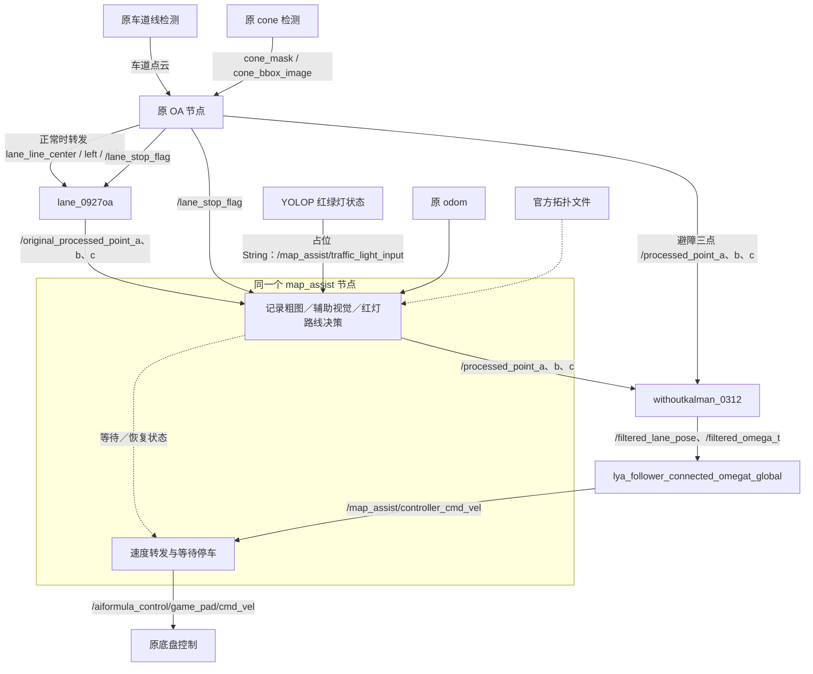
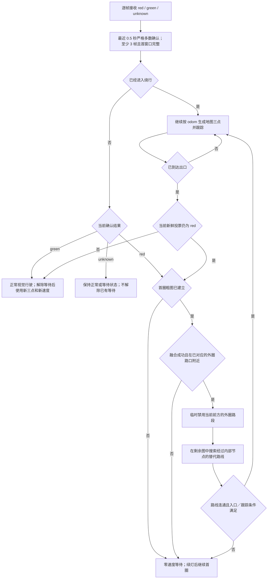

# map_assist：保留 odom 尺度的地图融合、视觉辅助与红灯改道

`map_assist` 仍在原 `semantic_local_planner_ros` 包内，独立于原语义门控运行。原语义方案保留。

## 启动：新 lane 用默认配置，旧 rosbag 指定测试配置

```bash
ros2 run semantic_local_planner_ros map_assist
```

上面这条裸命令自动读取包内 `config/map_assist.yaml`，适用于新 `lane_0927oa` 的正常冷启动：订阅 `/original_processed_point_a/b/c`，输出 `/processed_point_a/b/c`，使用系统时间，启用构图与方向辅助。初始假定尚未避障，随后服从真实 `/lane_stop_flag`；未知 OA 状态的中途重启应加 `--ros-args -p avoidance_initially_idle:=false`。红灯控制和速度转发默认关闭，需要这些功能时按下文车辆配置开启。

旧 rosbag 构图测试使用以下单行命令：

```bash
ros2 run semantic_local_planner_ros map_assist --ros-args --params-file "$(ros2 pkg prefix semantic_local_planner_ros)/share/semantic_local_planner_ros/config/map_assist_bag.yaml"
```

测试配置订阅旧 `/processed_point_a/b/c`，三点输出到 debug 话题，关闭驾驶纠偏、红灯控制及速度输出。录制开头应未进入避障，后续使用真实 flag；使用系统时间，按 1 倍速普通播放即可，不需要 `--clock`。在 RViz 添加 `/map_assist/path`（Path，Transient Local），首圈结束后查看整条路线。`phase=guarding` 且 `map_fusion.available=true` 表示融合成功。

显式指定配置时不叠加默认车辆配置。两种启动方式都会自动定位包内官方 OSM；切换时结束当前 map，再用另一条命令启动，不需要修改代码或来回改话题。

## Python 3.8 与 status（2026-10-06）

源码使用 Python 3.8 兼容的 `typing.List/Dict/Tuple/Optional/Union`。运行时类型别名也已修正；地图定位依赖 `ament_index_python`，数学核心依赖 NumPy，ROS 相关依赖见包内 `package.xml`。不需要升级车辆 Python。

旧版 status 依赖控制用 ROS 定时器；`use_sim_time=true` 且没有持续的 `/clock` 时，节点可以出现在话题列表里，却没有状态消息。新版状态由独立的单调时钟定时器发布，未收到 odom/三点、bag 未开始或暂停时也能查看。诊断回调不驱动车辆控制。

```bash
ros2 topic echo /map_assist/status
```

未播放数据也应看到 `reason=waiting_for_odom`。`odom_age_sec=null` 表示尚无有效 odom 接收；`point_age_sec` 的 a/b/c 为 null 表示对应三点还未收到。年龄持续增大表示输入没有继续更新。`use_sim_time` 和 `ros_time_sec` 显示当前时钟设置与时间。现有 bag 配置默认 `use_sim_time=false`；若仍读到 true，检查是否加载了旧安装配置或传入了覆盖参数。话题存在只表示通信端点已注册，不保证正在发布数据。

## 0. 粗图怎样建立（本次修正）

```text
首圈 odom + 避障／岔路不可信标记
    → 临时测量轨迹（不是最终粗图）
    → 与官方外圈比较整体形状、方向和局部转弯特征
    → 将官方外圈节点对应到 odom 轨迹
    → 保留 odom 米制尺度和实测段长，用官方节点方向约束外圈形状
    → 对融合结果平滑，得到最终粗图
    → 保存每个外圈节点在最终粗图上的坐标和累计路程
```

官方地图用于形状和连接关系，不规定本次轨迹的实际尺寸。比较前将官方外圈归一到 odom 量纲；不能把 odom 轨迹放大／缩小成官方尺寸。小范围融合和平滑仍可能稍微改变总弧长和局部距离，但不采用官方总长或官方各段长度覆盖实测尺度。首圈最小行驶距离仅使用 `min_lap_distance_m` 的 odom 米数，不再乘官方周长。

融合独立于 `enable_traffic_control`：即使关闭红灯功能，仍执行地图比较、节点对应、融合和平滑。匹配不明确或节点特征不可靠时，状态为 `odom_only`，保留 odom 平滑轨迹供检查，但正常行驶仅透传有效视觉，不启用地图纠偏或拓扑绕行；通过 `/map_assist/reset` 重新学习。`map_fusion.available` 与 `reason` 明确报告结果。

外圈路口使用最终粗图的节点坐标和实测进度。内部节点先按官方图变到 odom 尺度，再把外圈节点的位移沿原图连接平滑传递到内部；所有连线长度重新用 odom 坐标计算。内部节点位置仍是推算，首圈没有经过的内部道路并未被测量。无新增连接，也没有承诺消除后续 odom 漂移。

## 1. 接入现有行驶链路

手动接线使用 `lane_0927oa → map_assist → withoutkalman_0312 → lya_follower_connected_omegat_global`。`lane_0927oa` 保留 `lane_0529oa` 的处理逻辑，只修改三个输出话题。OA 继续使用原来的 `oa_neo` 或 `oa_neov1.2`，本次没有修改、启动或替换 OA。



`a、b、c` 表示三个独立 `Pose2D` 话题，单位米，车体坐标 x 向前、y 向左。

接入改动有两处：新 lane 将视觉三点交给 `map_assist`；LYA 的速度输出通过重映射交给同一节点做停车处理。OA 的避障三点仍直接送入 `withoutkalman_0312`。

**真正等待靠零速度实现。** 现用 LYA 存在最低线速度限制，零三点和停发三点都不能代替停车。正常时原样转发新 LYA 速度指令；等待时周期发送零 `Twist`；速度超过默认 0.5 秒未更新也发零。解除等待后要求新的有效视觉三点和新的 LYA 指令，不重放旧速度缓存。

## 2. 启动：一个开关选择原系统或地图辅助

在车辆 ROS2 工作区安装这套包后：

```bash
colcon build --symlink-install --packages-up-to semantic_local_planner_ros
source install/setup.bash
ros2 launch semantic_local_planner_ros map_drive.launch.py
```

`map_drive` 启动原来的三个节点和一个 `map_assist`。先结束手动启动的这三个进程，避免重复发布。相机、YOLOP、cone 检测、OA、里程计及底盘仍按原来的方式启动。

完全使用原行驶链路：

```bash
ros2 launch semantic_local_planner_ros map_drive.launch.py use_map_assist:=false
```

关闭模式只启动原三个节点，保持原话题，不启动 `map_assist`。这是启动时切换；已接入时单独结束 `map_assist` 不会自动恢复旧接线。

只关闭视觉的方向纠偏、保留红灯决策与停车功能：

```bash
ros2 launch semantic_local_planner_ros map_drive.launch.py enable_correction:=false
```

### 现有 OA 的初始 flag

当前两版 OA 都只在开始／结束避障时发布 flag，没有初始状态发布。裸命令读取的车辆 YAML 按正常冷启动设 `avoidance_initially_idle: true`；`map_drive.launch.py` 的启动参数仍默认 false，等待真实 flag。

如果是**已确认 OA 尚未进入避障的冷启动**，可显式声明初始空闲，先完成本次接入而不改 OA：

```bash
ros2 launch semantic_local_planner_ros map_drive.launch.py avoidance_initially_idle:=true
```

它只设置本节点的初始状态，不向外发布假 flag。之后始终遵从真实 `/lane_stop_flag`；收到 true 后不会超时自动恢复。在车辆已经避障时启动本节点，应显式设置 false，等待真实状态。后续若 OA 增加当前真实状态发布，就不再需要这一启动假设。

### 不使用 launch：逐终端手动启动

下列命令用于车辆上的 Linux/Bash。每个终端先加载现有 ROS2 环境及包含这些包的工作区 `install/setup.bash`。新增包需已构建。各节点只保留一个实例；不要同时运行旧启动命令或 `map_drive.launch.py`。

**终端 1：map_assist。** 默认车辆配置按已确认 OA 空闲的冷启动设置；如果是未知 OA 状态的中途启动，另加 `-p avoidance_initially_idle:=false`。包内配置和 OSM 路径自动加载；红灯停车／绕行需要同时开启交通与速度功能。

```bash
ros2 run semantic_local_planner_ros map_assist --ros-args -p enable_traffic_control:=true -p enable_velocity_gate:=true
```

**终端 2：视觉三点。** 新增的 `lane_0927oa` 已直接发布 `/original_processed_point_a/b/c`，不再需要重映射。它保留 `lane_0529oa` 的处理逻辑，只修改三个输出话题；文件放进原 `lane_points` 包，在该包 `setup.py` 的 `console_scripts` 中添加 `'lane_0927oa = lane_points.lane_0927oa:main',` 后重新构建。

```bash
ros2 run lane_points lane_0927oa
```

已有的 `map_drive.launch.py` 仍使用 `lane_0529oa` 加三点重映射，接线效果相同。手动方案使用 `lane_0927oa`，两者择一启动。

**终端 3：原三点处理节点。** 如果已经运行，就保留原实例。

```bash
ros2 run kalman_filter withoutkalman_0312
```

**终端 4：LYA。** 将它的输出交给 map_assist，再由 map_assist 输出到底盘话题。

```bash
ros2 run trajectory_follower lya_follower_connected_omegat_global --ros-args -r /aiformula_control/game_pad/cmd_vel:=/map_assist/controller_cmd_vel
```

OA、相机、检测、odom 和底盘照旧运行。**不要把 OA 的 `/processed_point_*` 重映射成视觉输入，也不要将 `/lane_stop_flag` 接成 `/point_flag`。**

手动接线完成后检查：

```bash
ros2 node info /map_assist
ros2 topic info /original_processed_point_a --verbose
ros2 topic info /processed_point_a --verbose
ros2 topic info /map_assist/controller_cmd_vel --verbose
ros2 topic info /aiformula_control/game_pad/cmd_vel --verbose
ros2 topic echo /map_assist/status
```

| 话题 | 应有的发布方 | 应有的订阅方 |
|---|---|---|
| `/original_processed_point_a/b/c` | `lane_line_subscriber` | `map_assist` |
| `/processed_point_a/b/c` | `map_assist` 和原 OA（按 flag 分时发送） | `data_processing_node` |
| `/map_assist/controller_cmd_vel` | `trajectory_follower` | `map_assist` |
| `/aiformula_control/game_pad/cmd_vel` | 本套自动驾驶链路中为 `map_assist` | 原底盘控制节点 |

图中能看到发布／订阅关系只代表接线成立；是否有数据还应看 `ros2 topic hz` 和状态原因。若显示 `avoidance_state_unknown`，当前仍未确认 OA 状态；`waiting_fresh_visual_triplet` 表示视觉输入尚未满足；`controller_command_timeout` 表示尚未收到新 LYA 速度。

手动恢复原系统时，结束 map_assist 和 lane_0927oa，改用原 `lane_0529oa`；LYA 去掉速度重映射后重新启动。三点处理和 OA 的命令不变。只关闭 map_assist 不会自动恢复这两处连接。

## 3. 红灯决策



- **红绿多数确认：**按消息实际到达的单调时间统计最近 0.5 秒；红、绿都必须占全部消息的严格多数（超过一半），unknown 也计入分母。至少 3 条实际检测消息，并等满首个 0.5 秒窗口后才确认。平票、无多数或样本不足时结果为 unknown；断流超过 0.5 秒后重新等待完整窗口。控制定时器不会自行补票。
- **第一圈：**沿视觉行驶并记录 odom。确认红灯后等待，只有确认绿灯解除；判断变成 unknown 或停止更新，不会自动解除已有红灯等待。绿灯解除后等待默认 0.2 秒、新的完整视觉三点和新的 LYA 速度，才允许继续。
- **建图：**检测闭合圈后，先进行官方外圈对应和形状约束融合，再平滑。自动搜索起点和行驶方向，按局部转弯特征对应节点；最终保留 odom 米制尺度，不要求手动给起点或固定绕行节点。
- **质量检查：**对应误差太大、节点特征不可靠、形状近似对称而存在多个解释时，报告 `odom_only` 及不可靠原因，不用该结果执行地图纠偏或拓扑绕行。有效视觉继续正常透传。
- **第二圈起确认红灯：**先进入等待，再在当前匹配的外圈附近找路口。要求地图融合、定位和入口条件可靠，默认距路口不超过 3 米；不满足就等待，不会自动开到更远的路口。根据已识别行进方向确定原本下一条边，临时将其视为不可通行。从该路口到这条边的另一端，在剩余官方图上搜索经过内部节点的最短连通路线。每次按当前位置计算，不写死 `1→5→6→3` 等顺序。
- **跟踪替代路线：**在外圈节点已绑定最终粗图的 odom 图上搜索；入口、出口精确使用这份粗图的节点，内部节点用边界约束推算。每次新 odom 生成一组车体三点，经原处理节点和 LYA 执行。按顺序通过节点，进入 `detour_waypoint_radius_m` 容差范围即视为到达；三点只采样当前直线段，尚未生成平滑的路口转弯轨迹。偏离太远或目标不可向前执行时停车。
- **回到原路：**以替代路线出口重新设置外圈匹配进度。完成前即使确认绿灯，也先走完已进入的连接路线；到达出口后重新读取当前投票，若仍有新鲜确认红灯，重新等待并检查绕行条件，否则等待新视觉三点后恢复。这里没有灯位置、灯 ID 或永久“已处理红灯”标记；因此同一盏仍持续检测到的红灯也可能再次触发，不能区分它与新的红灯。
- **OA 仍优先：**true 时不输出任何地图／视觉三点，已有红灯决策暂停，新 LYA 避障速度指令照常通过；false 后再处理红灯或恢复路线。速度断流仍会停车。

**位置与道路边界：**融合对本次 odom 粗图施加有限的外圈形状约束，不是全局 SLAM，也没有消除长期 odom 漂移。官方文件只有稀疏连线，没有车道宽度和路口转弯曲线；本版只在路口附近启动替代路线，不能从任意路段直接穿过场地去连接内部节点。图中没有单行方向标签，当前按提供的无向连通关系搜索。内部节点是估计位置，实际路线可行性、容差和转弯跟踪需要现场验证。

## 4. 红绿灯输入留占位

参数文件：`config/map_assist.yaml`。

```yaml
traffic_light_topic: /map_assist/traffic_light_input
traffic_vote_window_sec: 0.5
traffic_vote_min_samples: 3
```

当前约定 `std_msgs/msg/String`，内容为 `red`、`green`、`unknown`。这是预留接口，没有假称已接上 YOLOP 的真实输出。若 YOLOP 输出的是检测框或自定义消息，还需要把识别结果转换成这一状态，或调整本节点订阅类型和回调；只改话题名不能改变消息类型。

上游应当逐帧发布：没识别到灯也发送 unknown，不能缓存最后一次 red 或 green，再用定时器重复发送来凑票。投票使用消息数量；同一检测结果不应被重复计数。

以后改话题可以直接传启动参数：

```bash
ros2 launch semantic_local_planner_ros map_drive.launch.py traffic_light_topic:=/your/light_state
```

联调时以 10 Hz 模拟状态，各持续至少 0.5 秒；结束当前颜色的发布后再测试另一种颜色。测试时只保留一个灯色发布来源，避免与真实检测消息混合。单次 `--once` 不满足多数确认条件。

```bash
ros2 topic pub -r 10 /map_assist/traffic_light_input std_msgs/msg/String "{data: red}"
ros2 topic pub -r 10 /map_assist/traffic_light_input std_msgs/msg/String "{data: green}"
```

## 5. 查看、重置与原单节点入口

```bash
ros2 topic echo /map_assist/status
ros2 topic echo /map_assist/path --once --qos-durability transient_local
ros2 topic pub --once /map_assist/reset std_msgs/msg/Bool '{data: true}'
```

状态包含 `phase`（learning / guarding / odom_only）、`map_fusion`、`topology_alignment`、`official_node_positions_odom`、`official_node_progress_m`、`topology_mapping`、`traffic_mode`、被禁用的 `blocked_edge`、自动选中的 `detour_node_ids` 和速度放行原因。`traffic_light_raw` 是最后一条原始灯色，可能已经过时；`traffic_light` 是当前有效多数判断；`traffic_vote` 包含窗口长度、最低样本数、是否就绪、总帧数、red/green/unknown 各自帧数及最后消息年龄，用于核对投票和断流。融合成功、当前 odom 匹配有效（`route_matched`）、内部图可用是分别报告的条件。粗图及对应只存当前进程内存，重启或 reset 后重新学习。

原 `map_assist.launch.py` 仍只启动单个点辅助节点，默认不启用红灯控制和速度转发；新接入使用 `map_drive.launch.py`。不要同时运行原语义 mux 或另一套向最终点／最终速度话题发控制指令的链路。

常用配置保留原视觉纠偏的 15° 容差、1 米进度容差、连续 5 组异常才介入和 8° 最大修正。融合默认参数：节点搜索 4 米、转弯特征窗口 2 米、形状约束权重 0.25、融合位移上限 0.75 米；质量误差以 odom 米为单位。参数集中在同一 YAML 中。`route_node_ids` 可选地指定首圈外圈；为空时读取官方文件第一个闭合外圈，起点与行进方向仍自动估计。

## 6. 可选的距离停车接近

**0.2.0（2026-10-12）：**`semantic_planner_core` 新增距离观测校验和制动包络；`semantic_local_planner_ros` 新增默认关闭的接近状态、原子观测接口、诊断和回归测试。两包从 0.1.0 升为 0.2.0，表示 0.x 阶段新增可选功能；旧颜色接口、默认停车行为、原 OA 所有权和地图绕行保持兼容。其余包版本不变。该版本变更不声称测距精度、实际停车距离或实车验收已经通过。

`enable_signal_approach` 默认 `false`，保持原有“确认红灯立即等待；建图后可尝试拓扑绕行”的行为。仅开启此参数时，确认红灯且有可靠距离的车辆可以进入 `traffic_mode=approach`，沿原视觉三点和 LYA 轨迹减速接近。此功能没有加入左转指令，也没有启动另一套 costmap/primitive planner。

启用时必须同时开启 `enable_traffic_control` 和 `enable_velocity_gate`。在 `/map_assist/signal_observation` 发布 `std_msgs/msg/String`，内容是每个真实检测帧的一条原子 JSON：

```json
{"state":"red","sequence":42,"age_sec":0.12,"distance_m":12.3,"uncertainty_m":0.4}
```

- `state` 保留真实 `red`、`green` 或 `unknown`，不得为了接近而隐藏红灯。颜色仍使用原来 0.5 秒、至少 3 帧的严格多数确认。
- `sequence` 为非负、严格递增整数。同一帧不得同时再发旧颜色话题；重复或倒序帧不投票，也不刷新距离。
- `age_sec` 是图像采集到回调时的总年龄。超过 `signal_observation_timeout_sec`（默认 0.5 秒）不投颜色票；运行期间还会加上回调后的时间。无新帧时不能重发缓存结果。
- `distance_m` 是采集时刻，灯目标相对车头参考点在**当时车体前向轴上的投影深度**，已经处理相机外参和车头偏移。等价参考面通过该灯目标且垂直于当时车体前向轴；它随车辆航向变化，不等于固定赛道信号平面或停车线的间距，也不是灯的欧氏斜距。不能把悬空灯框的底边当作地面停车线。缺失或 `null` 表示距离不可用；禁止输入 Simulator 灯位、场景对象位置或测试路线真值。
- `uncertainty_m` 是非负距离误差界，默认 0。上游负责校准、目标一致性和误差估计。保守控制使用 `distance_m - uncertainty_m - speed_bound * total_age`，`speed_bound` 为采集区间内最大实测正向速度，含采集前一个 odom 样本。上游不要先推进到当前距离再重复补偿年龄。

接近速度限制满足 `v * approach_latency_sec + v² / (2 * approach_deceleration_mps2) <= remaining_m`，同时不超过 `approach_max_speed_mps`（默认 0.8 m/s）。减速度默认 1.0 m/s²、延迟默认 0.2 秒，都是待实车验证的控制配置。LYA 的 v/w 同比例缩小以保持命令的 w/v 比值；这不保证实际车辆在不同速度下的轨迹曲率相同。红灯接近不允许倒车或原地旋转。速度来自新鲜 odom 的 `twist.twist.linear.x`，过期、缺失或无效 odom 不能授权接近。

`target_stop_distance_m`（默认 8.5 米）作用于**保守距离下界**，不是对真实停车距离的无误差保证；加上测距不确定度后，实际停车可能更远。余量低于 `approach_stop_tolerance_m`（默认 0.1 米）时进入等待。实际车速超出剩余距离的制动包络时先发零命令并报告 `approach_braking`，仍保留接近状态；只有后续可靠距离及新控制命令才能恢复减速接近，防止普通制动滞后被误当成永久停车。

接近过程中，当前真实灯色 `traffic_light_raw=unknown`、缺失/无效/过期距离或无效/过期 odom 会锁存等待，直到确认绿灯。已经由确认红灯进入 approach 后，旧票过期导致的平票、无多数或样本数不足不会单独撤销已确认的红灯接近意图；`traffic_light` 仍如实报告当前票决 unknown，不补票、不重放历史颜色。保持接近仍要求当前真实灯色非 unknown、距离与 odom 新鲜有效且满足制动包络。锁存故障不能被拓扑绕行解除。已经等待的红灯不会因为后续框突然变远而重新接近。绿灯恢复要求当前 raw green 与多数确认 green，并满足原来的延迟、新完整 ABC 和新 LYA 命令。旧颜色 String 输入没有距离，会安全退回原等待行为。原 OA 所有权和已提交绕行规则保持；到达停车目标后的正常红灯等待仍可按原条件尝试拓扑绕行。

`status.signal_approach` 报告 enabled、target_stop_distance_m、observation_sequence、wait_latched、原始 distance_m/uncertainty_m 以及 profile。profile 的 valid/reason 总是存在；有效时另含 age_sec、distance_lower_m、remaining_m、speed_limit_mps、braking_distance_m、braking_required。该状态是诊断输出，不是控制输入。

固定相机的可见性决定允许选择的停车目标；停车后若灯离开视野，unknown 会保持等待。8–9 米等目标必须用实际相机视野和制动录像验证，不能仅通过调参数宣称达到。回调测试使用 ROS stub；纯包测试中的运动是明确标记的合成模型，均不替代真实 Unity 或实车验证。

Simulator 的 8–9 米验收另按固定赛道信号平面与实际车头最前角点计算，只用于独立评估，不输入控制。body-forward 测距及其下界不能当作这个固定平面间距。当前模拟器 RGB 适配器的不确定度仅涵盖框中心半像素量化，不覆盖车身俯仰或安装高度等全部误差；因此所谓保守下界限于该模型，实际停车必须逐次实跑核验。
